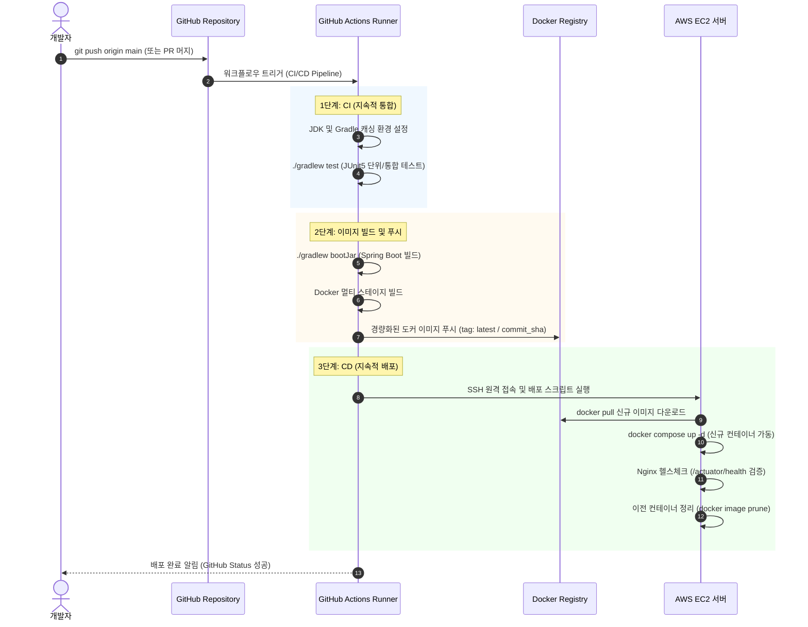
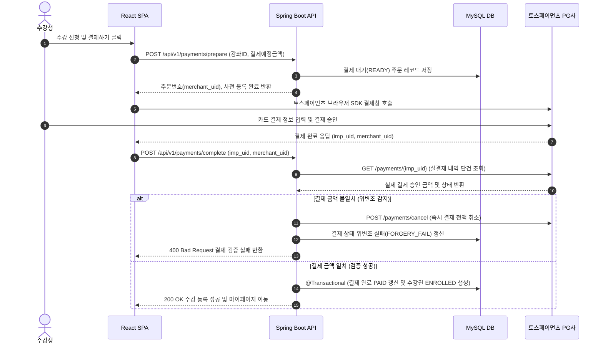

# 1. 시스템 아키텍처 설계서 (FixGo)

## 목차
- [1. 시스템 아키텍처 설계서 (FixGo)](#1-시스템-아키텍처-설계서-fixgo)
- [1.1 시스템 아키텍처 개요](#11-시스템-아키텍처-개요)
- [1.2 AWS 클라우드 및 컨테이너 인프라 아키텍처](#12-aws-클라우드-및-컨테이너-인프라-아키텍처)
- [1.3 GitHub Actions 기반 CI/CD 배포 자동화 파이프라인](#13-github-actions-기반-cicd-배포-자동화-파이프라인)
- [1.4 핵심 비즈니스 데이터 흐름도](#14-핵심-비즈니스-데이터-흐름도)

---

## 1.1 시스템 아키텍처 개요

FixGo는 프론트엔드와 백엔드가 물리적으로 분리된 계층형 RESTful API 아키텍처를 채택하며, Spring Boot 코어 서버와 Spring Data JPA, QueryDSL, Spring Batch, 카카오 주소검색, 택배 배송 추적, SMS발송 API, 및 토스페이먼츠 결제 게이트웨이가 유기적으로 결합된 구조로 동작.

```mermaid
graph TD
    Client["React SPA 클라이언트 (브라우저)"]
    Netlify["Netlify (CDN / HTTPS)"]
    S3_Profile["AWS S3 버킷 (직원 프로필 사진)"]
    EC2["AWS EC2 인스턴스 (Amazon Linux 2023)"]
    Docker_Nginx["Nginx 리버스 프록시 (컨테이너 / 443, 80)"]
    Docker_App["Spring Boot API & Batch 서버 (컨테이너 / 8080)"]
    DB["EC2 내부 MySQL (운영 DB)"]
    PG_Gateway["토스페이먼츠 결제 게이트웨이 (PG사 API)"]
    AI_Service["미정"]

    Client -->|정적 리소스 요청| Netlify
    Netlify -->|오리진 페치| GitHub
    Client -->|프로필 사진 요청| Netlify
    Netlify -->|프로필 사진 페치| S3_Profile

    Client -->|"REST API / SSE 요청 (JSON, JWT)"| EC2
    EC2 --> Docker_Nginx
    Docker_Nginx -->|리버스 프록시 포워딩| Docker_App
    Docker_App -->|Spring Data JPA / QueryDSL / JDBC| RDS_DB
    Docker_App -->|직원 프로필 사진 업로드| S3_Profile

    Client -->|결제창 SDK 호출| PG_Gateway
    PG_Gateway -->|결제 승인 응답| Client
    Client -->|결제 사후검증 요청| Docker_Nginx
    Docker_App -->|REST API 결제 단건 조회 검증| PG_Gateway
    PG_Gateway -->|"비동기 웹훅 (Webhook)"| Docker_Nginx
    
    Client --> |서드파티 API 호출| 3rd_Party API(카카오 주소검색, 택배 배송 추적)
    3rd_Party API(카카오 주소검색, 택배 배송 추적) --> |응답| Client
    
    Docker_App --> |SMS 발송 요청| SMS_API
    SMS_API --> |SMS 발송| 고객 휴대전화
    SMS_API --> |SMS 발송 결과 응답| Docker_App

```

---

## 1.2 AWS 클라우드 및 컨테이너 인프라 아키텍처

### 1.2.1 프론트엔드 호스팅 및 CDN 캐싱 (Netlify + CloudFlare)
- React SPA 정적 빌드 결과물 배포:
  - Vite 기반으로 빌드된 React SPA 정적 아티팩트(HTML, JS, CSS, 이미지 에셋)를 Netlify에 배포.
  - GitHub 저장소를 Netlify 프로젝트에 연동하여 코드 변경 시 자동 빌드 및 배포가 수행되는 CI/CD 환경 구성.
  - Cloudflare를 DNS 및 CDN·보안 계층으로 활용하여 사용자 요청을 중계하고, 정적 리소스 캐싱 및 HTTPS 기반의 보안 통신을 지원.
  - Cloudflare의 SSL/TLS 설정과 Netlify의 HTTPS 인증서 구성을 연계하여 사용자와 서비스 간 암호화 통신을 적용.
  - React SPA의 브라우저 히스토리 라우팅을 지원하기 위해 Netlify의 Rewrite 규칙을 설정하여, 클라이언트 라우트 요청 시 /index.html을 반환하도록 구성.
  - 프론트엔드와 백엔드를 분리 배포하고, 프론트엔드에서 AWS EC2의 Spring Boot REST API 서버로 HTTPS 통신을 수행하도록 구성.

### 1.2.2 백엔드 컨테이너 가상화 (AWS EC2 + Docker Compose)
- 도커 컨테이너 격리 및 리버스 프록시:
  - AWS EC2 t3.small/medium 인스턴스에 Docker Engine 및 Docker Compose 환경 구축.
  - Nginx 컨테이너(호스트 80/443 포트 바인딩)와 Spring Boot 애플리케이션 컨테이너(8080 포트)를 브리지 도커 네트워크로 상호 격리.
  - Nginx가 Let's Encrypt SSL 인증서를 관리하고 외부 클라이언트의 HTTPS 요청을 복호화한 후 내부 8080 포트의 Spring Boot 컨테이너로 리버스 프록시 포워딩.

### 1.2.3 관리형 데이터베이스 (Docker MySQL)
- 고가용성 및 데이터 영속성 보장:
  - 백엔드 EC2 인스턴스와 격리된 전용 서브넷 그룹에 Docker 컨테이너 기반 MySQL 인스턴스를 구축하여 데이터 무결성 보장.
  - 보안 그룹(Security Group) 규칙을 통해 백엔드 EC2 인스턴스의 프라이빗 IP로부터의 3306 포트 인바운드 트래픽만 엄격히 허용.
  - HikariCP 커넥션 풀을 최적화(MaximumPoolSize: 10~20)하여 대량 트래픽 및 배치 처리 시 안정적인 데이터베이스 커넥션 유지.

### 1.2.4 파일 스토리지 (AWS S3)
- 강의 자료 및 과제물 파일 업로드 파이프라인:
  - 직원 프로필 사진 업로드 시 Spring Boot 서버가 요청 수신.
  - AWS SDK for Java를 사용하여 S3 버킷에 저장.

---

## 1.3 GitHub Actions 기반 CI/CD 배포 자동화 파이프라인

코드 형상 관리부터 서버 무중단 배포까지 전 과정을 GitHub Actions 워크플로우로 자동화.



---

## 1.4 핵심 비즈니스 데이터 흐름도

### 1.4.1 A/S 진행 상태 흐름
```mermaid
sequenceDiagram
    autonumber
    Receptionist as 접수 담당자
    Technician as 수리기사
    Admin as 관리자
    Customer as 고객
    Server as 백엔드 서버
    DB as 데이터베이스
    PG as 토스페이먼츠 PG사
    
    Customer->>Receptionist: A/S 접수
    Receptionist->>Server: 기사 배정 및 A/S 접수 내용 등록 요청
    Server->>DB: 등록
    
    Technician->>Server: 배정된 A/S 접수 내역 조회 요청
    Server->>DB: 조회
    Server->>Technician: 배정된 A/S 접수 내역 응답
    Technician->>Server: 수리 시작 상태로 변경 요청
    Server->>DB: 변경 내용 반영
    Technician->>Server: 상세 수리 내역 저장 및 수리 완료 상태로 변경 요청
    Server->>DB: 내역 저장 변경 내용 반영
    
    Server->>
```

### 1.4.2 A/S 비용 결제 사전/사후 검증 흐름
기능 구현 완료 후 수정 예정


