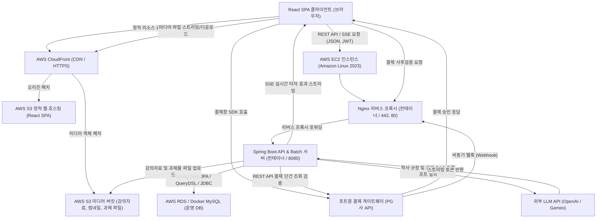
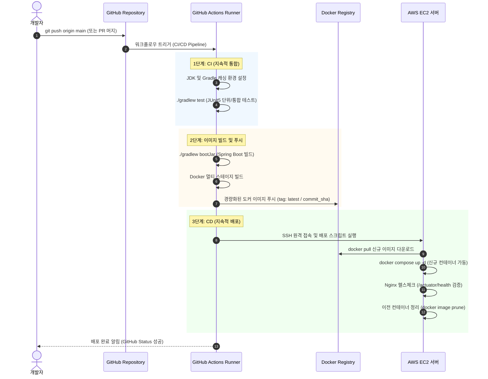
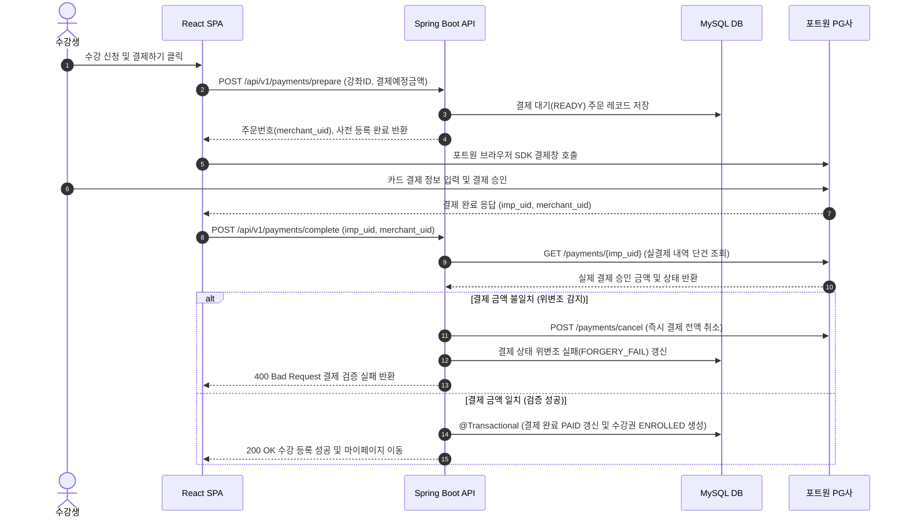
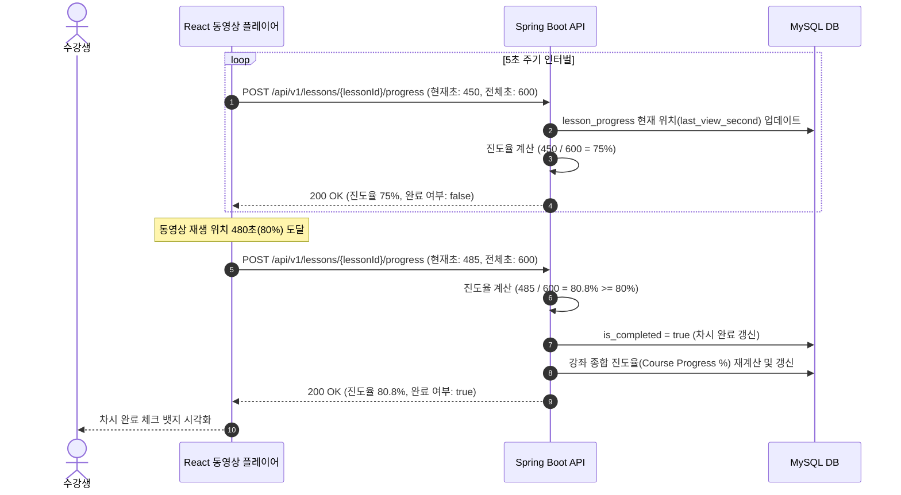
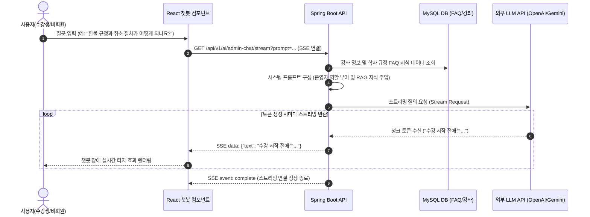
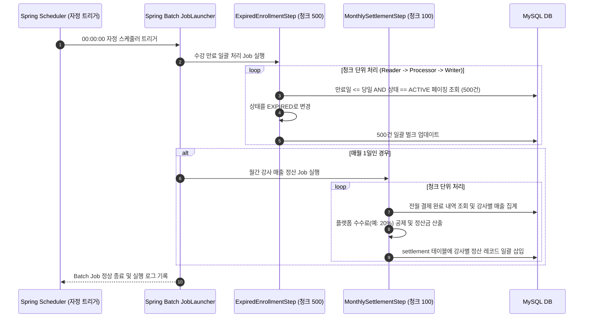

# 1. 시스템 아키텍처 설계서 (하루배움 LMS)

## 목차
- [1. 시스템 아키텍처 설계서 (하루배움 LMS)](#1-시스템-아키텍처-설계서-하루배움-lms)
- [1.1 시스템 아키텍처 개요](#11-시스템-아키텍처-개요)
- [1.2 AWS 클라우드 및 컨테이너 인프라 아키텍처](#12-aws-클라우드-및-컨테이너-인프라-아키텍처)
- [1.3 GitHub Actions 기반 CI/CD 배포 자동화 파이프라인](#13-github-actions-기반-cicd-배포-자동화-파이프라인)
- [1.4 핵심 비즈니스 데이터 흐름도](#14-핵심-비즈니스-데이터-흐름도)

---

## 1.1 시스템 아키텍처 개요

하루배움 플랫폼은 프론트엔드와 백엔드가 물리적으로 분리된 계층형 RESTful API 아키텍처를 채택하며, Spring Boot 코어 서버와 Spring Data JPA, QueryDSL, Spring Batch, 외부 LLM AI 서비스 및 포트원 결제 게이트웨이가 유기적으로 결합된 구조로 동작.

---

## 1.2 AWS 클라우드 및 컨테이너 인프라 아키텍처

### 1.2.1 프론트엔드 호스팅 및 CDN 캐싱 (AWS S3 + CloudFront)
- React SPA 정적 빌드 결과물 배포:
  - Vite 기반으로 빌드된 React SPA 정적 아티팩트(HTML, JS, CSS, 이미지 에셋)를 AWS S3 정적 웹 호스팅 버킷에 배포.
  - S3 버킷 앞단에 AWS CloudFront CDN을 연동하여 전 세계 엣지 로케이션 캐싱 및 SSL/TLS(HTTPS) 인증서 종단 처리.
  - SPA 브라우저 히스토리 라우팅 특성을 지원하기 위해 CloudFront 사용자 정의 오류 응답(Custom Error Response)을 설정하여 403 및 404 발생 시 `/index.html`을 HTTP 200으로 반환하도록 구성.

### 1.2.2 백엔드 컨테이너 가상화 (AWS EC2 + Docker Compose)
- 도커 컨테이너 격리 및 리버스 프록시:
  - AWS EC2 t3.small/medium 인스턴스에 Docker Engine 및 Docker Compose 환경 구축.
  - Nginx 컨테이너(호스트 80/443 포트 바인딩)와 Spring Boot 애플리케이션 컨테이너(8080 포트)를 브리지 도커 네트워크로 상호 격리.
  - Nginx가 Let's Encrypt SSL 인증서를 관리하고 외부 클라이언트의 HTTPS 요청을 복호화한 후 내부 8080 포트의 Spring Boot 컨테이너로 리버스 프록시 포워딩.

### 1.2.3 관리형 데이터베이스 (AWS RDS / Docker MySQL)
- 고가용성 및 데이터 영속성 보장:
  - 백엔드 EC2 인스턴스와 격리된 전용 서브넷 그룹에 AWS RDS 또는 Docker 컨테이너 기반 MySQL 인스턴스를 구축하여 데이터 무결성 보장.
  - 보안 그룹(Security Group) 규칙을 통해 백엔드 EC2 인스턴스의 프라이빗 IP로부터의 3306 포트 인바운드 트래픽만 엄격히 허용.
  - HikariCP 커넥션 풀을 최적화(MaximumPoolSize: 10~20)하여 대량 트래픽 및 배치 처리 시 안정적인 데이터베이스 커넥션 유지.

### 1.2.4 미디어 및 파일 스토리지 (AWS S3)
- 강의 자료 및 과제물 파일 업로드 파이프라인:
  - 강좌 썸네일, 강의 첨부파일, 수강생 과제 제출물 업로드 시 Spring Boot 서버가 Multipart 요청 수신.
  - AWS SDK for Java를 사용하여 S3 버킷의 용도별 디렉토리(`courses/`, `materials/`, `assignments/`)에 UUID 기반 고유 파일명으로 저장.
  - 민감한 강의 자료 및 과제물은 S3 Presigned URL 방식을 도입하여 인가된 수강생만 일정 시간 동안 다운로드하도록 보안 강화.

---

## 1.3 GitHub Actions 기반 CI/CD 배포 자동화 파이프라인

코드 형상 관리부터 서버 무중단 배포까지 전 과정을 GitHub Actions 워크플로우로 자동화.

---

## 1.4 핵심 비즈니스 데이터 흐름도

### 1.4.1 수강 신청 및 결제 사전/사후 검증 흐름
결제 금액 위변조를 원천 차단하고 결제 승인과 수강권(Enrollment) 생성을 원자적으로 보장.

### 1.4.2 동영상 진도율 저장 및 80% 차시 완료 판정 흐름
동영상 시청 중 주기적으로 위치를 기록하고 진도율 요건 충족 시 차시 완료 상태를 동기화.

### 1.4.3 AI 기반 학사 행정 지원 챗봇 비동기 스트리밍(SSE) 흐름
과정 운영자의 행정 업무를 무인화하기 위해 강좌 정보 및 학사 규정 FAQ를 실시간 스트리밍으로 제공.

### 1.4.4 Spring Batch 자정 수강 만료 및 월간 정산 흐름
대용량 데이터를 메모리 부하 없이 페이징 청크 단위로 안전하게 일괄 처리.

