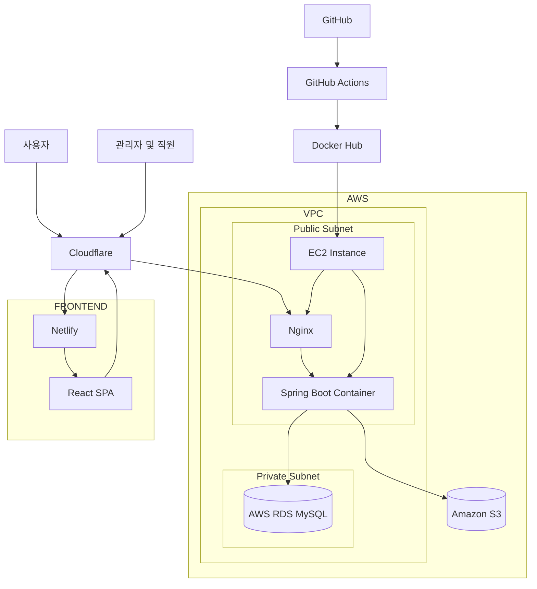
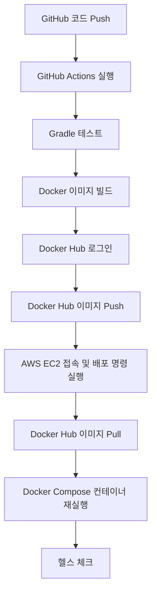

# 1. 시스템 아키텍처

## 1.1 시스템 아키텍처 개요

FixGo는 전자제품 A/S 업무를 효율적으로 관리하기 위한 웹 기반 A/S 관리 시스템이다.

프론트엔드와 백엔드를 분리한 3-Tier 아키텍처를 기반으로 구성한다.

- **Frontend**: React 기반 SPA로 구성하며 GitHub를 통해 소스 코드를 관리하고 Netlify를 통해 배포한다.
- **Backend**: Spring Boot 기반 REST API 서버로 구성하며 Docker 컨테이너로 패키징하여 AWS EC2에서 실행한다.
- **Database**: AWS RDS for MySQL을 사용하여 서비스 데이터를 관리한다.
- **Image Storage**: AWS S3를 활용하여 접수 사진, 제품 사진 등의 파일을 저장한다.
- **Container Image Registry**: Docker Hub를 활용하여 빌드된 Docker 이미지를 저장하고 EC2에서 이미지를 가져와 실행한다.
- **CDN 및 보안**: Cloudflare를 활용하여 DNS, CDN 및 보안 기능을 제공한다.

### 1.1.1 전체 시스템 구성도

## 1.2 AWS 및 컨테이너 인프라 구성

### 1.2.1 프론트엔드 호스팅

- React 기반 프론트엔드는 Netlify를 통해 배포한다.
- GitHub 저장소와 Netlify를 연동하여 코드 변경 시 자동 빌드 및 배포가 이루어지도록 구성한다.
- Cloudflare를 통해 도메인 및 DNS를 관리한다.
- 프론트엔드와 백엔드는 HTTPS 기반으로 통신한다.

### 1.2.2 VPC 및 Subnet 구성

AWS VPC 내부에 EC2와 RDS를 배치하여 네트워크를 분리한다.

- **Public Subnet**: 외부 요청을 수신하는 EC2를 배치한다.
- **Private Subnet**: 외부에서 직접 접근할 수 없는 RDS를 배치한다.
- **Internet Gateway**: Public Subnet의 EC2가 외부 네트워크와 통신할 수 있도록 구성한다.
- **Security Group**: 필요한 포트만 허용하여 서비스 접근을 제한한다.

보안 그룹 구성 예시는 다음과 같다.

| 대상  | 허용 포트 | 접근 대상                         |
|-----|-------|-------------------------------|
| EC2 | 443   | HTTPS 요청                      |
| EC2 | 80    | HTTP 리다이렉트 및 인증서 발급 등에 필요한 경우 |
| EC2 | 22    | SSH 접속이 필요한 경우에만 제한적으로 허용     |
| RDS | 3306  | EC2 보안 그룹                     |

### 1.2.3 EC2 및 Docker 구성

- AWS EC2 인스턴스 한 대를 사용하여 백엔드 서버를 운영한다.
- EC2 내부에서 Docker를 실행하고 Docker Compose를 통해 컨테이너를 관리한다.
- Nginx를 리버스 프록시로 구성하여 외부 요청을 Spring Boot 애플리케이션으로 전달한다.
- Nginx는 HTTPS 요청을 처리하고 내부 Docker 네트워크를 통해 Spring Boot 컨테이너와 통신한다.
- Spring Boot 컨테이너의 8080 포트는 외부에 직접 노출하지 않는다.

초기 배포는 EC2 한 대를 기준으로 구성하며, 추후 트래픽 증가 시 여러 EC2 인스턴스와 로드밸런서를 추가할 수 있다.

### 1.2.4 RDS 데이터베이스 구성

- AWS RDS for MySQL을 사용한다.
- 데이터베이스는 Private Subnet에 배치한다.
- EC2에서만 데이터베이스에 접근할 수 있도록 보안 그룹을 설정한다.
- Spring Data JPA 및 MyBatis를 활용하여 데이터베이스에 접근한다.
- 데이터베이스 백업 및 복구 기능을 활용하여 데이터를 관리한다.

### 1.2.5 S3 파일 저장소 구성

- AWS S3를 사용하여 A/S 접수 사진, 제품 사진 및 관련 첨부 파일을 저장한다.
- 데이터베이스에는 파일 자체가 아닌 파일 경로 또는 객체 키 등의 메타데이터를 저장한다.
- 파일 접근은 필요한 경우 Presigned URL을 활용한다.
- 버킷은 기본적으로 비공개로 설정하고 필요한 접근 권한만 부여한다.

### 1.2.6 Docker Hub 이미지 저장소 구성

- Docker Hub를 사용하여 빌드된 Docker 이미지를 저장한다.
- GitHub Actions에서 Spring Boot 애플리케이션을 Docker 이미지로 빌드한다.
- 빌드가 완료된 이미지를 Docker Hub 저장소에 Push한다.
- AWS EC2에서는 Docker Hub에 저장된 이미지를 Pull하여 컨테이너를 실행한다.
- Docker Hub 저장소는 Private Repository로 설정하고 인증 정보를 통해 접근하도록 구성한다.

### 1.2.7 외부 API 연동

서비스 기능에 필요한 외부 API를 연동한다.

- Toss Payments: 결제 처리
- SOLAPI: 문자 및 알림 발송
- Kakao API: 주소 검색
- Smart택배: 배송 조회
- AI API: 영수증 분석 (보류)

## 1.3 GitHub Actions 기반 CI/CD

GitHub Actions를 활용하여 백엔드 애플리케이션의 테스트, Docker 이미지 빌드, 이미지 저장 및 EC2 배포 과정을 자동화한다.

### 1.3.1 CI/CD 배포 흐름

### 1.3.2 CI 과정

1. 개발자가 GitHub 저장소에 코드를 Push한다.
2. GitHub Actions가 자동으로 실행된다.
3. Gradle을 통해 테스트를 수행한다.
4. 테스트가 정상적으로 완료되면 Docker 이미지를 빌드한다.
5. Docker Hub에 로그인한다.
6. 빌드한 이미지를 Docker Hub 저장소에 Push한다.

### 1.3.3 CD 과정

1. GitHub Actions에서 AWS 인증을 수행하고 EC2에 배포 명령을 전달한다.
2. EC2에서 Docker Hub에 저장된 최신 이미지를 Pull한다.
3. Docker Compose를 통해 기존 컨테이너를 새로운 이미지로 교체한다.
4. 애플리케이션의 정상 실행 여부를 헬스 체크로 확인한다.
5. 문제가 발생하면 이전 이미지 버전을 사용하여 롤백할 수 있도록 구성한다.

### 1.3.4 인증 및 보안 관리

- GitHub Actions에서 Docker Hub에 로그인하기 위해 Docker Hub Access Token을 GitHub Secrets에 저장한다.
- EC2에서 Private Repository 이미지를 가져올 때도 Docker Hub 인증 정보를 안전하게 관리한다.
- AWS 리소스 접근은 GitHub Actions의 OIDC 및 IAM 역할 등을 활용하여 인증한다.
- 데이터베이스 접속 정보 및 외부 API 키는 환경 변수 또는 AWS Secrets Manager 등을 통해 관리한다.

## 1.4 주요 데이터 흐름

### 1.4.1 A/S 접수 및 수리 처리

1. 고객이 A/S를 요청하거나 직원이 고객의 요청을 접수한다.
2. 접수 정보와 제품 정보가 데이터베이스에 저장된다.
3. 첨부 사진은 S3에 저장하고 파일 정보는 데이터베이스에 기록한다.
4. 직원이 수리 진행 상태를 관리한다.
5. 수리 완료 및 상태 변경 정보가 시스템에 반영된다.

### 1.4.2 결제 처리

1. 고객에게 결제 요청 정보를 제공한다.
2. Toss Payments를 통해 결제를 진행한다.
3. 결제 결과를 서버에서 검증한다.
4. 검증된 결제 결과를 데이터베이스에 저장한다.
5. 결제 및 환불 상태를 관리한다.

### 1.4.3 알림 발송

1. 접수, 수리 진행, 결제 등 주요 이벤트가 발생한다.
2. 서버에서 알림 발송 요청을 처리한다.
3. SOLAPI를 통해 고객에게 알림을 발송한다.
4. 발송 결과를 데이터베이스에 기록한다.

### 1.4.4 배송 관리

1. 수리 완료 후 배송 정보를 등록한다.
2. 배송 관련 정보를 외부 배송 조회 API와 연동한다.
3. 배송 상태를 조회하여 시스템에 반영한다.
4. 고객에게 배송 진행 상황을 제공한다.

### 1.4.5 AI 영수증 분석 (보류)

1. 고객 또는 직원이 영수증 이미지를 등록한다.
2. 이미지는 S3에 저장한다.
3. 서버에서 AI API에 영수증 분석을 요청한다.
4. 분석 결과를 수신하여 제품 및 구매 정보 확인에 활용한다.
5. 직원이 분석 결과를 확인하고 필요한 경우 수정한다.