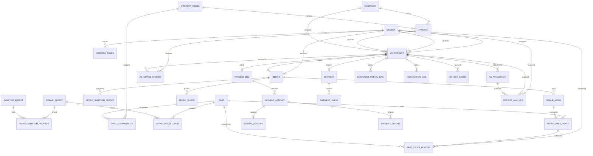

# 02_ERD

## 핵심 관계 요약

## 테이블별 상세 컬럼

## 1.2.1 직원 계정 및 권한 관리

### 1) MEMBER

- 테이블 설명: 내부 직원 로그인 계정

| 컬럼명             | 데이터 타입       | 제약조건               | 기본값               | 인덱스 | 설명                        |
|-----------------|--------------|--------------------|-------------------|-----|---------------------------|
| id              | BIGINT       | PK, AUTO_INCREMENT | -                 | PK  | 직원 ID                     |
| code            | VARCHAR(255) | UNIQUE             | -                 | -   | 직원 코드(동명이인 방지)            |
| email           | VARCHAR(255) | NOT NULL, UNIQUE   | -                 | -   | 로그인 이메일                   |
| password_hash   | VARCHAR(255) | NOT NULL           | -                 | -   | 암호 해시                     |
| name            | VARCHAR(255) | NOT NULL           | -                 | -   | 직원명                       |
| phone           | VARCHAR(255) | NULL               | -                 | -   | 연락처                       |
| role            | VARCHAR(255) | NOT NULL           | -                 | -   | 역할                        |
| profile_img_url | VARCHAR(255) | NULL               | -                 | -   | 프로필 이미지 URL               |
| status          | VARCHAR(255) | NOT NULL           | ACTIVE            | -   | ACTIVE, INACTIVE, DELETED |
| deleted_at      | DATETIME     | NULL               | -                 |     | 퇴사(삭제) 시각                 |
| created_at      | DATETIME     | NOT NULL           | CURRENT_TIMESTAMP | -   | 생성 시각                     |
| updated_at      | DATETIME     | NOT NULL           | CURRENT_TIMESTAMP | -   | 수정 시각                     |
| created_by      | VARCHAR(255) | NOT NULL           | -                 | -   | 생성자                       |
| updated_by      | VARCHAR(255) | NOT NULL           | -                 | -   | 수정자                       |

### 2) REFRESH_TOKEN

- 테이블 설명: 직원 로그인 세션 갱신용 토큰

| 컬럼명        | 데이터 타입       | 제약조건                     | 기본값               | 인덱스             | 설명               |
|------------|--------------|--------------------------|-------------------|-----------------|------------------|
| id         | BIGINT       | PK, AUTO_INCREMENT       | -                 | PK              | 토큰 ID            |
| member_id  | BIGINT       | NOT NULL, FK → MEMBER.id | -                 | -               | 직원 ID            |
| token_hash | VARCHAR(255) | NOT NULL, UNIQUE         | -                 | UK_REFRESH_HASH | Refresh Token 해시 |
| issued_at  | DATETIME     | NOT NULL                 | CURRENT_TIMESTAMP | -               | 발급 시각            |
| expires_at | DATETIME     | NOT NULL                 | -                 | -               | 만료 시각            |
| revoked_at | DATETIME     | NULL                     | -                 | -               | 폐기 시각            |

## 1.2.2 고객 정보 관리

### 1) CUSTOMER

- 테이블 설명: 회원가입하지 않는 A/S 고객의 연락처 및 주소

| 컬럼명            | 데이터 타입       | 제약조건               | 기본값               | 인덱스 | 설명    |
|----------------|--------------|--------------------|-------------------|-----|-------|
| id             | BIGINT       | PK, AUTO_INCREMENT | -                 | PK  | 고객 ID |
| name           | VARCHAR(255) | NOT NULL           | -                 | -   | 고객명   |
| phone          | VARCHAR(255) | NOT NULL           | -                 | -   | 연락처   |
| email          | VARCHAR(255) | NOT NULL           | -                 | -   | 이메일   |
| zipcode        | VARCHAR(255) | NULL               | -                 | -   | 우편번호  |
| basic_address  | VARCHAR(255) | NULL               | -                 | -   | 기본 주소 |
| detail_address | VARCHAR(255) | NULL               | -                 | -   | 상세 주소 |
| created_at     | DATETIME     | NOT NULL           | CURRENT_TIMESTAMP | -   | 생성 시각 |
| updated_at     | DATETIME     | NOT NULL           | CURRENT_TIMESTAMP | -   | 수정 시각 |
| created_by     | VARCHAR(255) | NOT NULL           | -                 | -   | 생성자   |
| updated_by     | VARCHAR(255) | NOT NULL           | -                 | -   | 수정자   |

## 1.2.3 제품 및 수리 이력 관리

### 1) PRODUCT_MODEL

- 테이블 설명: 수리 대상 모델 마스터. 기존 PRODUCT를 모델 테이블로 명확하게 변경.

| 컬럼명             | 데이터 타입       | 제약조건               | 기본값               | 인덱스 | 설명            |
|-----------------|--------------|--------------------|-------------------|-----|---------------|
| id              | BIGINT       | PK, AUTO_INCREMENT | -                 | PK  | 모델 ID         |
| name            | VARCHAR(255) | NOT NULL           | -                 | -   | 제품명           |
| model_name      | VARCHAR(255) | NOT NULL           | -                 | -   | 모델명           |
| category        | VARCHAR(255) | NOT NULL           | -                 | -   | 제품군           |
| warranty_months | INT          | NULL               | -                 | -   | 기본 제조 보증 개월 수 |
| is_active       | BOOLEAN      | NOT NULL           | TRUE              | -   | 신규 접수 가능 여부   |
| created_at      | DATETIME     | NOT NULL           | CURRENT_TIMESTAMP | -   | 생성 시각         |
| updated_at      | DATETIME     | NOT NULL           | CURRENT_TIMESTAMP | -   | 수정 시각         |
| created_by      | VARCHAR(255) | NOT NULL           | -                 | -   | 생성자           |
| updated_by      | VARCHAR(255) | NOT NULL           | -                 | -   | 수정자           |

#### 2) PRODUCT (개별 제품 및 시리얼번호 관리)

- 테이블 설명: 자사가 제조·판매한 제품을 시리얼번호 단위로 등록하고 관리한다.
- 고객에게 판매되기 전에도 제품 정보를 보유할 수 있다.
- A/S 접수 시 시리얼번호를 통해 모델과 제품 정보를 자동 조회한다.

| 컬럼명              | 데이터 타입       | 제약조건                            | 기본값               | 인덱스                       | 설명          |
|------------------|--------------|---------------------------------|-------------------|---------------------------|-------------|
| id               | BIGINT       | PK, AUTO_INCREMENT              | -                 | PK                        | 자사 제품 ID    |
| product_model_id | BIGINT       | NOT NULL, FK → PRODUCT_MODEL.id | -                 | IDX_COMPANY_PRODUCT_MODEL | 제품 모델 ID    |
| customer_id      | BIGINT       | NULL, FK → CUSTOMER.id          | -                 | IDX_CP_CUSTOMER           | 소유 고객       |
| serial_number    | VARCHAR(255) | NOT NULL, UNIQUE                | -                 | UK_COMPANY_PRODUCT_SERIAL | 제품 고유 시리얼번호 |
| manufactured_at  | DATE         | NOT NULL                        | -                 | -                         | 제조일         |
| purchased_at     | DATE         | NULL                            | -                 | -                         | 구매일         |
| created_at       | DATETIME     | NOT NULL                        | CURRENT_TIMESTAMP | -                         | 등록 시각       |
| updated_at       | DATETIME     | NOT NULL                        | CURRENT_TIMESTAMP | -                         | 수정 시각       |
| created_by       | VARCHAR(255) | NOT NULL                        | -                 | -                         | 생성자         |
| updated_by       | VARCHAR(255) | NOT NULL                        | -                 | -                         | 수정자         |

## 1.2.4 A/S 요청 및 접수 관리

### 1) SYMPTOM_PRESET

- 테이블 설명: 고장 증상 프리셋

| 컬럼명              | 데이터 타입       | 제약조건               | 기본값 | 인덱스 | 설명        |
|------------------|--------------|--------------------|-----|-----|-----------|
| id               | BIGINT       | PK, AUTO_INCREMENT | -   | PK  | 증상 프리셋 ID |
| product_category | VARCHAR(255) | NOT NULL           | -   | -   | 적용 제품군    |
| name             | VARCHAR(255) | NOT NULL           | -   | -   | 증상 프리셋명   |

### 2) AS_REQUEST

- 테이블 설명: A/S 접수 건과 현재 업무 상태. 한 건은 하나의 고객 보유 제품을 대상으로 한다.

| 컬럼명               | 데이터 타입        | 제약조건                               | 기본값               | 인덱스                  | 설명               |
|-------------------|---------------|------------------------------------|-------------------|----------------------|------------------|
| id                | BIGINT        | PK, AUTO_INCREMENT                 | -                 | PK                   | A/S ID           |
| request_number    | VARCHAR(255)  | NOT NULL, UNIQUE                   | -                 | UK_AS_REQUEST_NUMBER | 접수번호             |
| customer_id       | BIGINT        | NOT NULL, FK → CUSTOMER.id         | -                 | IDX_AS_CUSTOMER      | 고객 ID            |
| product_id        | BIGINT        | NOT NULL, FK → CUSTOMER_PRODUCT.id | -                 | IDX_AS_PRODUCT       | 접수 실물 제품         |
| receptionist_id   | BIGINT        | NOT NULL, FK → MEMBER.id           | -                 | IDX_AS_RECEPTIONIST  | 접수 직원            |
| technician_id     | BIGINT        | NULL, FK → MEMBER.id               | -                 | IDX_AS_TECHNICIAN    | 현재 배정 기사         |
| symptom           | VARCHAR(255)  | NOT NULL                           | -                 | -                    | 고장증상 요약          |
| symptom_detail    | VARCHAR(255)  | NOT NULL                           | -                 | -                    | 고장 증상 상세         |
| request_memo      | VARCHAR(1000) | NULL                               | -                 | -                    | 요청 메모            |
| return_method     | VARCHAR(255)  | NOT NULL                           | DELIVERY          | -                    | DELIVERY, PICKUP |
| status            | VARCHAR(255)  | NOT NULL                           | RECEIVED          | IDX_AS_STATUS        | 현재 A/S 상태        |
| status_changed_at | DATETIME      | NOT NULL                           | CURRENT_TIMESTAMP | -                    | 마지막 상태 변경        |
| closed_at         | DATETIME      | NULL                               | -                 | -                    | 종결 시각            |
| created_at        | DATETIME      | NOT NULL                           | CURRENT_TIMESTAMP | IDX_AS_CREATED       | 접수 시각            |
| updated_at        | DATETIME      | NOT NULL                           | CURRENT_TIMESTAMP | -                    | 수정 시각            |
| created_by        | VARCHAR(255)  | NOT NULL                           | -                 | -                    | 생성자              |
| updated_by        | VARCHAR(255)  | NOT NULL                           | -                 | -                    | 수정자              |

### 3) AS_ATTACHMENT

- 테이블 설명: 구매 증빙 첨부 파일 메타데이터.

| 컬럼명           | 데이터 타입       | 제약조건                         | 기본값               | 인덱스                       | 설명     |
|---------------|--------------|------------------------------|-------------------|---------------------------|--------|
| id            | BIGINT       | PK, AUTO_INCREMENT           | -                 | PK                        | 첨부 ID  |
| as_request_id | BIGINT       | NOT NULL, FK → AS_REQUEST.id | -                 | IDX_AS_ATTACHMENT_REQUEST | A/S ID |
| file_url      | VARCHAR(500) | NOT NULL                     | -                 | -                         | 저장 경로  |
| original_name | VARCHAR(255) | NULL                         | -                 | -                         | 원본 파일명 |
| created_at    | DATETIME     | NOT NULL                     | CURRENT_TIMESTAMP | -                         | 등록 시각  |
| updated_at    | DATETIME     | NOT NULL                     | CURRENT_TIMESTAMP | -                         | 수정 시각  |
| created_by    | VARCHAR(255) | NOT NULL                     | -                 | -                         | 생성자    |
| updated_by    | VARCHAR(255) | NOT NULL                     | -                 | -                         | 수정자    |

## 1.2.5 A/S 배정 및 진행 관리

### 1) AS_STATUS_HISTORY

- 테이블 설명: A/S 상태 전이, 담당 기사 배정 및 재배정 및 사유 이력.

| 컬럼명           | 데이터 타입        | 제약조건                         | 기본값               | 인덱스                  | 설명                |
|---------------|---------------|------------------------------|-------------------|----------------------|-------------------|
| id            | BIGINT        | PK, AUTO_INCREMENT           | -                 | PK                   | 이력 ID             |
| as_request_id | BIGINT        | NOT NULL, FK → AS_REQUEST.id | -                 | IDX_ASH_REQUEST_TIME | A/S ID            |
| from          | VARCHAR(255)  | NULL                         | -                 | -                    | 이전 상태             |
| to            | VARCHAR(255)  | NOT NULL                     | -                 | -                    | 변경 상태             |
| reason        | VARCHAR(1000) | NULL                         | -                 | -                    | 사유                |
| changed_by    | BIGINT        | NULL, FK → MEMBER.id         | -                 | -                    | 처리 직원; 시스템이면 NULL |
| created_at    | DATETIME      | NOT NULL                     | CURRENT_TIMESTAMP | -                    | 상태 변경 시각          |

## 1.2.6 수리 작업 및 비용 관리

### 1) LABOR_RATE

- 테이블 설명: 제품군별 시간당 공임 단가.

| 컬럼명                  | 데이터 타입       | 제약조건               | 기본값               | 인덱스 | 설명            |
|----------------------|--------------|--------------------|-------------------|-----|---------------|
| id                   | BIGINT       | PK, AUTO_INCREMENT | -                 | PK  | 공임 단가 ID      |
| product_category     | VARCHAR(255) | NOT NULL           | -                 | -   | 제품군           |
| rate_per_ten_minutes | INT          | NOT NULL           | -                 | -   | 10분 당 공임 원 단위 |
| inspection_cost      | INT          | NOT NULL           | -                 | -   | 점검비           |
| effective_from       | DATE         | NOT NULL           | -                 | -   | 적용 시작일        |
| is_active            | BOOLEAN      | NOT NULL           | TRUE              | -   | 현재 사용 여부      |
| created_at           | DATETIME     | NOT NULL           | CURRENT_TIMESTAMP | -   | 생성 시각         |
| updated_at           | DATETIME     | NOT NULL           | CURRENT_TIMESTAMP | -   | 수정 시각         |
| created_by           | VARCHAR(255) | NOT NULL           | -                 | -   | 생성자           |
| updated_by           | VARCHAR(255) | NOT NULL           | -                 | -   | 수정자           |

### 2) REPAIR_PRESET

- 테이블 설명: 표준 수리 작업과 예상 소요시간

| 컬럼명         | 데이터 타입       | 제약조건               | 기본값               | 인덱스 | 설명     |
|-------------|--------------|--------------------|-------------------|-----|--------|
| id          | BIGINT       | PK, AUTO_INCREMENT | -                 | PK  | 프리셋 ID |
| name        | VARCHAR(255) | NOT NULL           | -                 | -   | 작업명    |
| description | VARCHAR(255) | NULL               | -                 | -   | 작업 설명  |
| created_at  | DATETIME     | NOT NULL           | CURRENT_TIMESTAMP | -   | 생성 시각  |
| updated_at  | DATETIME     | NOT NULL           | CURRENT_TIMESTAMP | -   | 수정 시각  |
| created_by  | VARCHAR(255) | NOT NULL           | -                 | -   | 생성자    |
| updated_by  | VARCHAR(255) | NOT NULL           | -                 | -   | 수정자    |

### 3) REPAIR_SYMPTOM_RELATION

- 테이블 설명: 고장 증상 프리셋과 수리 프리셋 관계 테이블

| 컬럼명               | 데이터 타입   | 제약조건                             | 기본값               | 인덱스 | 설명        |
|-------------------|----------|----------------------------------|-------------------|-----|-----------|
| id                | BIGINT   | PK, AUTO_INCREMENT               | -                 | PK  | 관계 ID     |
| symptom_preset_id | BIGINT   | NOT NULL, FK → SYMPTOM_PRESET.id | -                 | FK  | 증상 프리셋 ID |
| repair_preset_id  | BIGINT   | NOT NULL, FK → REPAIR_PRESET.id  | -                 | FK  | 수리 프리셋 ID |
| created_at        | DATETIME | NOT NULL                         | CURRENT_TIMESTAMP | -   | 생성 시각     |

### 4) REPAIR

- 테이블 설명: A/S별 점검 및 수리 결과.
- A/S 요청에 기사 배정되는 시점에 새 Row 생성

| 컬럼명             | 데이터 타입       | 제약조건                                 | 기본값        | 인덱스             | 설명                         |
|-----------------|--------------|--------------------------------------|------------|-----------------|----------------------------|
| id              | BIGINT       | PK, AUTO_INCREMENT                   | -          | PK              | 수리 ID                      |
| as_request_id   | BIGINT       | NOT NULL, UNIQUE, FK → AS_REQUEST.id | -          | UK_REPAIR_AS    | A/S 1:1                    |
| technician_id   | BIGINT       | NOT NULL, FK → MEMBER.id             | -          | IDX_REPAIR_TECH | 담당 기사                      |
| diagnosis       | VARCHAR(255) | NULL                                 | -          | -               | 점검 결과                      |
| work_note       | VARCHAR(255) | NULL                                 | -          | -               | 수리 메모                      |
| repair_decision | VARCHAR(255) | NULL                                 | -          | -               | REPAIRABLE, UNREPAIRABLE 등 |
| warranty_result | VARCHAR(255) | NOT NULL                             | -          | -               | FREE, PAID                 |
| reason          | VARCHAR(255) | NULL                                 | -          | -               | 보증 판정 사유                   |
| labor_rate      | INT          | NULL                                 | -          | -               | 당시 적용된 공임 비용               |
| inspection_cost | INT          | NULL                                 | -          | -               | 당시 적용된 점검 비용               |
| final_amount    | INT          | NULL                                 | -          | -               | 최종 확정 수리비(원)               |
| status          | VARCHAR(255) | NOT NULL                             | DIAGNOSING | -               | DIAGNOSING,                

REQUESTED, APPROVED,
REJECTED,
REPAIRING, COMPLETED |
| reason_for_rejection | VARCHAR(255)  | NULL | - | - | 고객이 입력한 견적 거부 사유 |
| confirmed_at | DATETIME | NULL | - | - | 최종 비용 확정 시각 |
| created_at | DATETIME | NOT NULL | CURRENT_TIMESTAMP | - | 생성 시각 |
| updated_at | DATETIME | NOT NULL | CURRENT_TIMESTAMP | - | 수정 시각 |
| created_by | VARCHAR(255) | NOT NULL | - | - | 생성자 |
| updated_by | VARCHAR(255) | NOT NULL | - | - | 수정자 |

#### 5) REPAIR_SYMPTOM_PRESET

- 1개의 A/S에서 사용한 고장 증상 프리셋의 이름

| 컬럼명                 | 데이터 타입       | 제약조건                     | 기본값 | 인덱스              | 설명           |
|---------------------|--------------|--------------------------|-----|------------------|--------------|
| id                  | BIGINT       | PK, AUTO_INCREMENT       | -   | PK               | 작업 항목 ID     |
| repair_id           | BIGINT       | NOT NULL, FK → REPAIR.id | -   | IDX_RITEM_REPAIR | 수리 ID        |
| symptom_preset_name | VARCHAR(255) | NOT NULL                 | -   | -                | 고장 증상 프리셋 이름 |

### 5) REPAIR_WORK

- 테이블 설명: 실제 수행한 수리 작업 항목.

| 컬럼명                | 데이터 타입       | 제약조건                     | 기본값               | 인덱스              | 설명        |
|--------------------|--------------|--------------------------|-------------------|------------------|-----------|
| id                 | BIGINT       | PK, AUTO_INCREMENT       | -                 | PK               | 작업 항목 ID  |
| repair_id          | BIGINT       | NOT NULL, FK → REPAIR.id | -                 | IDX_RITEM_REPAIR | 수리 ID     |
| repair_preset_name | VARCHAR(255) | NOT NULL                 | -                 | -                | 선택 프리셋 이름 |
| work_name          | VARCHAR(255) | NOT NULL                 | -                 | -                | 작업명 스냅샷   |
| created_at         | DATETIME     | NOT NULL                 | CURRENT_TIMESTAMP | -                | 생성 시각     |
| updated_at         | DATETIME     | NOT NULL                 | CURRENT_TIMESTAMP | -                | 수정 시각     |
| created_by         | VARCHAR(255) | NOT NULL                 | -                 | -                | 생성자       |
| updated_by         | VARCHAR(255) | NOT NULL                 | -                 | -                | 수정자       |

### 6) REPAIR_PHOTO

- 테이블 설명: 수리 전후 사진.

| 컬럼명        | 데이터 타입       | 제약조건                     | 기본값               | 인덱스               | 설명                       |
|------------|--------------|--------------------------|-------------------|-------------------|--------------------------|
| id         | BIGINT       | PK, AUTO_INCREMENT       | -                 | PK                | 사진 ID                    |
| repair_id  | BIGINT       | NOT NULL, FK → REPAIR.id | -                 | IDX_RPHOTO_REPAIR | 수리 ID                    |
| photo_type | VARCHAR(255) | NOT NULL                 | -                 | -                 | BEFORE, AFTER, DIAGNOSIS |
| file_url   | VARCHAR(500) | NOT NULL                 | -                 | -                 | 사진 경로                    |
| created_at | DATETIME     | NOT NULL                 | CURRENT_TIMESTAMP | -                 | 등록 시각                    |
| updated_at | DATETIME     | NOT NULL                 | CURRENT_TIMESTAMP | -                 | 수정 시각                    |
| created_by | VARCHAR(255) | NOT NULL                 | -                 | -                 | 생성자                      |
| updated_by | VARCHAR(255) | NOT NULL                 | -                 | -                 | 수정자                      |

## 1.2.9 부품 재고 관리

### 1) PART

- 테이블 설명: 부품과 현재 재고 수량.

| 컬럼명              | 데이터 타입       | 제약조건               | 기본값               | 인덱스           | 설명                   |
|------------------|--------------|--------------------|-------------------|---------------|----------------------|
| id               | BIGINT       | PK, AUTO_INCREMENT | -                 | PK            | 부품 ID                |
| part_code        | VARCHAR(255) | NOT NULL, UNIQUE   | -                 | UK_PART_CODE  | 부품 코드                |
| name             | VARCHAR(255) | NOT NULL           | -                 | IDX_PART_NAME | 부품명                  |
| unit_price       | BIGINT       | NOT NULL           | 0                 | -             | 기준 단가(원)             |
| standard_minutes | INT          | NOT NULL           | -                 | -             | 표준 작업시간 (10분 단위로 저장) |
| stock_quantity   | INT          | NOT NULL           | 0                 | -             | 현재 수량                |
| is_discontinued  | BOOLEAN      | NOT NULL           | FALSE             | -             | 단종 여부                |
| is_active        | BOOLEAN      | NOT NULL           | TRUE              | -             | 사용 여부                |
| version          | BIGINT       | NOT NULL           | 0                 | -             | 재고 동시성 제어            |
| created_at       | DATETIME     | NOT NULL           | CURRENT_TIMESTAMP | -             | 생성 시각                |
| updated_at       | DATETIME     | NOT NULL           | CURRENT_TIMESTAMP | -             | 수정 시각                |
| created_by       | VARCHAR(255) | NOT NULL           | -                 | -             | 생성자                  |
| updated_by       | VARCHAR(255) | NOT NULL           | -                 | -             | 수정자                  |

### 2) PART_COMPATIBILITY

- 테이블 설명: 부품과 호환 가능한 제품 모델의 다대다 관계.

| 컬럼명              | 데이터 타입 | 제약조건                          | 기본값 | 인덱스                          | 설명       |
|------------------|--------|-------------------------------|-----|------------------------------|----------|
| part_id          | BIGINT | PK(복합), FK → PART.id          | -   | PK_PART_COMPAT               | 부품 ID    |
| product_model_id | BIGINT | PK(복합), FK → PRODUCT_MODEL.id | -   | PK_PART_COMPAT, IDX_PC_MODEL | 호환 모델 ID |

### 3) REPAIR_PRESET_PART

- 테이블 설명: 프리셋 작업에 필요한 기본 부품

| 컬럼명              | 데이터 타입 | 제약조건                          | 기본값 | 인덱스                          | 설명     |
|------------------|--------|-------------------------------|-----|------------------------------|--------|
| repair_preset_id | BIGINT | PK(복합), FK → REPAIR_PRESET.id | -   | PK_PRESET_PART               | 프리셋 ID |
| part_id          | BIGINT | PK(복합), FK → PART.id          | -   | PK_PRESET_PART, IDX_RPP_PART | 부품 ID  |

### 4) REPAIR_PART_USAGE

- 테이블 설명: 실제 수리에서 사용한 부품 및 확정 단가.

| 컬럼명            | 데이터 타입   | 제약조건                          | 기본값               | 인덱스 | 설명          |
|----------------|----------|-------------------------------|-------------------|-----|-------------|
| id             | BIGINT   | PK, AUTO_INCREMENT            | -                 | PK  | 부품 사용 ID    |
| repair_work_id | BIGINT   | NOT NULL, FK → REPAIR_WORK.id | -                 | FK  | 수리 항목 ID    |
| part_id        | BIGINT   | NOT NULL, FK → PART.id        | -                 | FK  | 부품 ID       |
| quantity       | INT      | NOT NULL                      | 1                 | -   | 사용 수량       |
| unit_price     | BIGINT   | NOT NULL                      | -                 | -   | 당시 적용 단가(원) |
| created_at     | DATETIME | NOT NULL                      | CURRENT_TIMESTAMP | -   | 사용 기록 시각    |

### 5) PART_STOCK_HISTORY

- 테이블 설명: 부품 입고·출고·조정의 불변 이력.

| 컬럼명                  | 데이터 타입       | 제약조건                            | 기본값               | 인덱스               | 설명              |
|----------------------|--------------|---------------------------------|-------------------|-------------------|-----------------|
| id                   | BIGINT       | PK, AUTO_INCREMENT              | -                 | PK                | 재고 변동 ID        |
| part_id              | BIGINT       | NOT NULL, FK → PART.id          | -                 | IDX_PSH_PART_TIME | 부품 ID           |
| repair_part_usage_id | BIGINT       | NULL, FK → REPAIR_PART_USAGE.id | -                 | -                 | 수리 출고 연결        |
| movement_type        | VARCHAR(255) | NOT NULL                        | -                 | -                 | IN, OUT, ADJUST |
| quantity_delta       | INT          | NOT NULL                        | -                 | -                 | 증감 수량(+/-)      |
| reason               | VARCHAR(255) | NULL                            | -                 | -                 | 변동 사유           |
| processed_by         | BIGINT       | NULL, FK → MEMBER.id            | -                 | -                 | 처리 직원           |
| created_at           | DATETIME     | NOT NULL                        | CURRENT_TIMESTAMP | -                 | 재고 변동 시각        |

## 1.2.8 결제 및 입금 관리

### 1) PAYMENT_BILL

- 테이블 설명: A/S에 대한 확정 청구 금액과 최종 수납 상태. 결제 재시도 시 유지

| 컬럼명                   | 데이터 타입       | 제약조건                                 | 기본값               | 인덱스 | 설명                                         |
|-----------------------|--------------|--------------------------------------|-------------------|-----|--------------------------------------------|
| id                    | BIGINT       | PK, AUTO_INCREMENT                   | -                 | PK  | 청구 ID                                      |
| as_request_id         | BIGINT       | NOT NULL, UNIQUE, FK → AS_REQUEST.id | -                 | FK  | A/S당 청구 1건                                 |
| amount                | BIGINT       | NOT NULL                             | -                 | -   | 수리비·점검비·반송비 총액(원)                          |
| status                | VARCHAR(255) | NOT NULL                             | UNPAID            | -   | UNPAID, PAID, REFUNDED, PARTIALLY_REFUNDED |
| successful_attempt_id | BIGINT       | NULL, FK → PAYMENT_ATTEMPT.id        | -                 | FK  | 성공 시도 ID                                   |
| paid_at               | DATETIME     | NULL                                 | -                 | -   | 수납 확정 시각                                   |
| created_at            | DATETIME     | NOT NULL                             | CURRENT_TIMESTAMP | -   | 생성 시각                                      |
| updated_at            | DATETIME     | NOT NULL                             | CURRENT_TIMESTAMP | -   | 수정 시각                                      |

### 2) PAYMENT_ATTEMPT

- 테이블 설명: PG 또는 현장 수납의 개별 시도

| 컬럼명             | 데이터 타입       | 제약조건                           | 기본값               | 인덱스 | 설명                                                                               |
|-----------------|--------------|--------------------------------|-------------------|-----|----------------------------------------------------------------------------------|
| id              | BIGINT       | PK, AUTO_INCREMENT             | -                 | PK  | 결제 시도 ID                                                                         |
| payment_bill_id | BIGINT       | NOT NULL, FK → PAYMENT_BILL.id | -                 | FK  | 청구 ID                                                                            |
| order_id        | VARCHAR(255) | NULL, UNIQUE                   | -                 | -   | 서버 생성 주문번호                                                                       |
| payment_key     | VARCHAR(255) | NULL, UNIQUE                   | -                 | -   | PG 결제 식별자                                                                        |
| amount          | BIGINT       | NOT NULL                       | -                 | -   | 시도 금액(원)                                                                         |
| method          | VARCHAR(255) | NULL                           | -                 | -   | CARD, VIRTUAL_ACCOUNT,CASH                                                       |
| channel         | VARCHAR(255) | NOT NULL                       | -                 | -   | ONLINE, ONSITE                                                                   |
| status          | VARCHAR(255) | NOT NULL                       | READY             | -   | READY, IN_PROGRESS, WAITING_FOR_DEPOSIT, DONE, CANCELED, PARTIAL_CANCELED,FAILED |
| failure_code    | VARCHAR(255) | NULL                           | -                 | -   | 실패 코드                                                                            |
| failure_message | VARCHAR(255) | NULL                           | -                 | -   | 실패 사유                                                                            |
| approved_at     | DATETIME     | NULL                           | -                 | -   | 승인/수납 확정 시각                                                                      |
| created_at      | DATETIME     | NOT NULL                       | CURRENT_TIMESTAMP | -   | 생성 시각                                                                            |
| updated_at      | DATETIME     | NOT NULL                       | CURRENT_TIMESTAMP | -   | 수정 시각                                                                            |
| created_by      | VARCHAR(255) | NOT NULL                       | -                 | -   | 생성자                                                                              |
| updated_by      | VARCHAR(255) | NOT NULL                       | -                 | -   | 수정자                                                                              |

### 3) VIRTUAL_ACCOUNT

- 테이블 설명: 온라인 가상계좌 발급 정보

| 컬럼명                | 데이터 타입       | 제약조건                                      | 기본값               | 인덱스 | 설명              |
|--------------------|--------------|-------------------------------------------|-------------------|-----|-----------------|
| id                 | BIGINT       | PK, AUTO_INCREMENT                        | -                 | PK  | 가상계좌 ID         |
| payment_attempt_id | BIGINT       | NOT NULL, UNIQUE, FK → PAYMENT_ATTEMPT.id | -                 | FK  | 발급 시도 ID        |
| bank_code          | VARCHAR(255) | NOT NULL                                  | -                 | -   | 은행 코드           |
| account_number     | VARCHAR(255) | NOT NULL                                  | -                 | -   | 가상계좌 번호         |
| webhook_secret     | VARCHAR(255) | NOT NULL                                  | -                 | -   | 가상계좌 웹훅 검증용 비밀값 |
| due_at             | DATETIME     | NOT NULL                                  | -                 | -   | 입금 기한           |
| created_at         | DATETIME     | NOT NULL                                  | CURRENT_TIMESTAMP | -   | 발급 시각           |
| updated_at         | DATETIME     | NOT NULL                                  | CURRENT_TIMESTAMP | -   | 수정 시각           |

### 4) PAYMENT_REFUND

- 테이블 설명: 결제 완료 건에 대한 전액·부분 환불 요청 및 처리 결과를 관리

| 컬럼명                   | 데이터 타입       | 제약조건                                         | 기본값               | 인덱스 | 설명                                           |
|-----------------------|--------------|----------------------------------------------|-------------------|-----|----------------------------------------------|
| id                    | BIGINT       | PK, AUTO_INCREMENT                           | -                 | PK  | 가상계좌 ID                                      |
| payment_attempt_id    | BIGINT       | NOT NULL, FK → PAYMENT_SUCCESSFUL_ATTEMPT.id | -                 | FK  | 환불 대상 결제                                     |
| idempotency_key       | VARCHAR(255) | NOT NULL, UNIQUE                             | -                 | -   | 환불 요청 멱등키                                    |
| transaction_key       | VARCHAR(255) | NULL, UNIQUE                                 | -                 | -   | PG 취소 거래 식별자                                 |
| cancel_amount         | BIGINT       | NOT NULL                                     | -                 | -   | 환불 요청 금액                                     |
| cancel_reason         | VARCHAR(255) | NOT NULL                                     | -                 | -   | 환불 사유                                        |
| status                | VARCHAR(30)  | NOT NULL                                     | REQUESTED         | -   | REQUESTED, PROCESSING, UNKNOWN, DONE, FAILED |
| refund_bank_code      | VARCHAR(255) | NULL                                         | -                 | -   | 고객 은행 코드                                     |
| refund_account_number | VARCHAR(255) | NULL                                         | -                 | -   | 고객 계좌 번호                                     |
| refund_holder_name    | VARCHAR(255) | NULL                                         | -                 | -   | 예금주                                          |
| failure_code          | VARCHAR(255) | NULL                                         | -                 | -   | 실패 코드                                        |
| failure_message       | VARCHAR(255) | NULL                                         | -                 | -   | 실패 사유                                        |
| refund_channel        | VARCHAR(255) | NOT NULL                                     | -                 | -   | TOSS, MANUAL                                 |
| canceled_at           | DATETIME     | NULL                                         | -                 | -   | PG 취소 처리 시각                                  |
| created_at            | DATETIME     | NOT NULL                                     | CURRENT_TIMESTAMP | -   | 생성 시각                                        |
| updated_at            | DATETIME     | NOT NULL                                     | CURRENT_TIMESTAMP | -   | 수정 시각                                        |
| created_by            | VARCHAR(255) | NOT NULL                                     | -                 | -   | 생성자                                          |

## 1.2.9 배송 및 제품 반환 관리

### 1) SHIPMENT

- 테이블 설명: 택배 배송 또는 방문 수령 정보.

| 컬럼명                  | 데이터 타입       | 제약조건                                 | 기본값               | 인덱스                 | 설명                                    |
|----------------------|--------------|--------------------------------------|-------------------|---------------------|---------------------------------------|
| id                   | BIGINT       | PK, AUTO_INCREMENT                   | -                 | PK                  | 반환 ID                                 |
| as_request_id        | BIGINT       | NOT NULL, UNIQUE, FK → AS_REQUEST.id | -                 | -                   | A/S 1:1                               |
| return_method        | VARCHAR(255) | NOT NULL                             | DELIVERY          |                     | 반환 방법 (DELIVERY, PICKUP)              |
| recipient_name       | VARCHAR(255) | NOT NULL                             |                   |                     | 수령인                                   |
| recipient_phone      | VARCHAR(255) | NOT NULL                             |                   |                     | 수령인 연락처                               |
| zipcode              | VARCHAR(255) | NULL                                 |                   |                     | 배송지 우편번호                              |
| address              | VARCHAR(255) | NULL                                 |                   |                     | 배송지 기본 주소                             |
| address_detail       | VARCHAR(255) | NULL                                 |                   |                     | 배송지 상세 주소                             |
| courier              | VARCHAR(255) | NULL                                 | -                 | -                   | 택배사명                                  |
| courier_code         | VARCHAR(255) | NULL                                 |                   |                     | 스마트택배 택배사 코드                          |
| tracking_number      | VARCHAR(255) | NULL                                 | -                 |                     | 운송장번호                                 |
| status               | VARCHAR(255) | NOT NULL                             | READY             | IDX_SHIPMENT_STATUS | READY, SHIPPING, DELIVERED, PICKED_UP |
| shipped_at           | DATETIME     | NULL                                 |                   |                     | 배송 시작 시각                              |
| completed_at         | DATETIME     | NULL                                 |                   |                     | 배송 또는 방문수령 완료 시각                      |
| last_checked_at      | DATETIME     | NULL                                 |                   |                     | 스마트택배 API 마지막 조회 시각                   |
| last_tracking_status | VARCHAR(255) | NULL                                 |                   |                     | 외부 API에서 받은 배송 상태                     |
| created_at           | DATETIME     | NOT NULL                             | CURRENT_TIMESTAMP | -                   | 생성 시각                                 |
| updated_at           | DATETIME     | NOT NULL                             | CURRENT_TIMESTAMP | -                   | 수정 시각                                 |
| created_by           | VARCHAR(255) | NOT NULL                             |                   |                     | 배송 등록 직원 ID                           |
| updated_by           | VARCHAR(255) | NOT NULL                             |                   |                     | 마지막 수정 직원 ID                          |

### 2) SHIPMENT_EVENT

- 테이블 설명: 배송 이벤트 중복 처리 및 상태 변경 기록.

| 컬럼명         | 데이터 타입       | 제약조건                       | 기본값               | 인덱스 | 설명                          |
|-------------|--------------|----------------------------|-------------------|-----|-----------------------------|
| id          | BIGINT       | PK, AUTO_INCREMENT         | -                 | PK  | 이벤트 ID                      |
| shipment_id | BIGINT       | NOT NULL, FK → SHIPMENT.id | -                 | -   | 배송 ID                       |
| event_key   | VARCHAR(255) | NOT NULL, UNIQUE           | -                 | -   | 동일 웹훅 중복 처리 방지              |
| status      | VARCHAR(255) | NOT NULL                   | RECEIVED          | -   | RECEIVED, PROCESSED, FAILED |
| occurred_at | DATETIME     | NULL                       | -                 | -   | 배송 완료 발생 시각                 |
| created_at  | DATETIME     | NOT NULL                   | CURRENT_TIMESTAMP | -   | 이벤트 저장 시각                   |

## 1.2.10 고객 통합 페이지 및 알림 관리

### 1) CUSTOMER_PORTAL_LINK

- 테이블 설명: 고객의 A/S 단일 통합 페이지 접근 링크.

| 컬럼명           | 데이터 타입   | 제약조건                         | 기본값               | 인덱스 | 설명               |
|---------------|----------|------------------------------|-------------------|-----|------------------|
| id            | BIGINT   | PK, AUTO_INCREMENT           | -                 | PK  | 링크 ID            |
| as_request_id | BIGINT   | NOT NULL, FK → AS_REQUEST.id | -                 | FK  | A/S 접수 ID        |
| token_hash    | CHAR(64) | NOT NULL, UNIQUE             | -                 | -   | 난수 토큰 SHA-256 해시 |
| expires_at    | DATETIME | NOT NULL                     | -                 | -   | 만료 시각            |
| created_at    | DATETIME | NOT NULL                     | CURRENT_TIMESTAMP | -   | 발급 시각            |
| updated_at    | DATETIME | NOT NULL                     | CURRENT_TIMESTAMP | -   | 수정 시각            |

### 2) NOTIFICATION_LOG

- 테이블 설명: 알림톡 우선 발송 및 SMS 대체 발송 이력.

| 컬럼명               | 데이터 타입       | 제약조건                     | 기본값 | 인덱스 | 설명                                                          |
|-------------------|--------------|--------------------------|-----|-----|-------------------------------------------------------------|
| id                | BIGINT       | PK, AUTO_INCREMENT       | -   | PK  | 알림 발송 ID                                                    |
| as_request_id     | BIGINT       | NULL, FK → AS_REQUEST.id | -   | -   | 관련 A/S                                                      |
| event_key         | VARCHAR(255) | NOT NULL, UNIQUE         | -   |     | 업무 이벤트 중복 발송 방지                                             |
| notification_type | VARCHAR(255) | NOT NULL                 | -   | -   | 접수, 입금, 배송 알림 종류(RECEIVED(A/S 접수 완료), ESTIMATE(견적 발급 및 확인), 

REPAIR(수리 완료),
PAYMENT(결제 요청)
SHIPPING(배송 시작) |
| recipient_phone | VARCHAR(255) | NOT NULL | - | - | 수신 번호 |
| message | VARCHAR(255) | NOT NULL | - | - | 발송 내용 |
| provider_message_id | VARCHAR(255) | NULL | - | - | SOLAPI messageId |
| provider_group_id | VARCHAR(255) | NULL | - | - | SOLAPI groupId |
| provider_status_code | VARCHAR(255) | NULL | - | - | SOLAPI 4자리 상태 코드 |
| provider_status_message | VARCHAR(255) | NULL | - | - | SOLAPI 상태 설명 |
| status | VARCHAR(255) | NOT NULL | PENDING | IDX_NLOG_STATUS | PENDING, SENDING, SENT, FAILED |
| retry_count | INT | NOT NULL | 0 | - | 재시도 횟수 |
| error_message | VARCHAR(255) | NULL | - | - | 오류 메시지 |
| sent_at | DATETIME | NULL | - | - | 발송 시각 |
| created_at | DATETIME | NOT NULL | CURRENT_TIMESTAMP | - | 생성 시각 |
| created_by | VARCHAR(255) | NULL | | | 알림을 발송한 직원Id |

## 1.2.11 대시보드 및 운영 통계

### 1) 통계 전용 테이블 없음

- 테이블 설명: 초기 구현은 AS_REQUEST, REPAIR, PAYMENT_BILL, SHIPMENT, MEMBER, PRODUCT_MODEL을 집계 조회한다.

## 1.2.14 AI 영수증 분석

### 1) RECEIPT_ANALYSIS

- 테이블 설명: 구매 증빙 사진의 AI 추출 결과와 직원 검수 상태.

| 컬럼명                      | 데이터 타입       | 제약조건                            | 기본값               | 인덱스               | 설명                                   |
|--------------------------|--------------|---------------------------------|-------------------|-------------------|--------------------------------------|
| id                       | BIGINT       | PK, AUTO_INCREMENT              | -                 | PK                | 분석 ID                                |
| attachment_id            | BIGINT       | NOT NULL, FK → AS_ATTACHMENT.id | -                 | IDX_RA_ATTACHMENT | 분석 대상 영수증                            |
| as_request_id            | BIGINT       | NOT NULL, FK → AS_REQUEST.id    | -                 | IDX_RA_AS         | A/S ID                               |
| extracted_manufacturer   | VARCHAR(255) | NULL                            | -                 | -                 | 추출 제조사                               |
| extracted_product_name   | VARCHAR(255) | NULL                            | -                 | -                 | 추출 제품명                               |
| extracted_model_name     | VARCHAR(255) | NULL                            | -                 | -                 | 추출 모델명                               |
| extracted_purchased_at   | DATE         | NULL                            | -                 | -                 | 추출 구매일                               |
| extracted_warranty_until | DATE         | NULL                            | -                 | -                 | 추출 보증 만료일                            |
| raw_result               | JSON         | NULL                            | -                 | -                 | AI 구조화 응답(민감정보 최소화)                  |
| status                   | VARCHAR(255) | NOT NULL                        | PENDING           | -                 | PENDING, SUCCEEDED, FAILED, REVIEWED |
| reviewed_by              | BIGINT       | NULL, FK → MEMBER.id            | -                 | -                 | 검수 직원                                |
| created_at               | DATETIME     | NOT NULL                        | CURRENT_TIMESTAMP | -                 | 분석 요청 시각                             |
| reviewed_at              | DATETIME     | NULL                            | -                 | -                 | 검수 완료 시각                             |

## 공통 운영·선택 확장

### 1) OUTBOX_EVENT

- 테이블 설명: 알림 발송 요청의 유실 방지.

| 컬럼명           | 데이터 타입       | 제약조건                     | 기본값               | 인덱스              | 설명                         |
|---------------|--------------|--------------------------|-------------------|------------------|----------------------------|
| id            | BIGINT       | PK, AUTO_INCREMENT       | -                 | PK               | 아웃박스 ID                    |
| event_key     | VARCHAR(255) | NOT NULL, UNIQUE         | -                 | UK_OUTBOX_KEY    | 중복 방지 키                    |
| as_request_id | BIGINT       | NULL, FK → AS_REQUEST.id | -                 | IDX_OUTBOX_AS    | 관련 A/S                     |
| event_type    | VARCHAR(255) | NOT NULL                 | -                 | -                | 이벤트 유형                     |
| payload       | JSON         | NOT NULL                 | -                 | -                | 전달할 데이터                    |
| status        | VARCHAR(255) | NOT NULL                 | PENDING           | IDX_OUTBOX_RETRY | PENDING, PROCESSED, FAILED |
| retry_count   | INT          | NOT NULL                 | 0                 | -                | 재시도 횟수                     |
| next_retry_at | DATETIME     | NULL                     | -                 | IDX_OUTBOX_RETRY | 다음 처리 시각                   |
| created_at    | DATETIME     | NOT NULL                 | CURRENT_TIMESTAMP | -                | 생성 시각                      |
| processed_at  | DATETIME     | NULL                     | -                 | -                | 완료 시각                      |