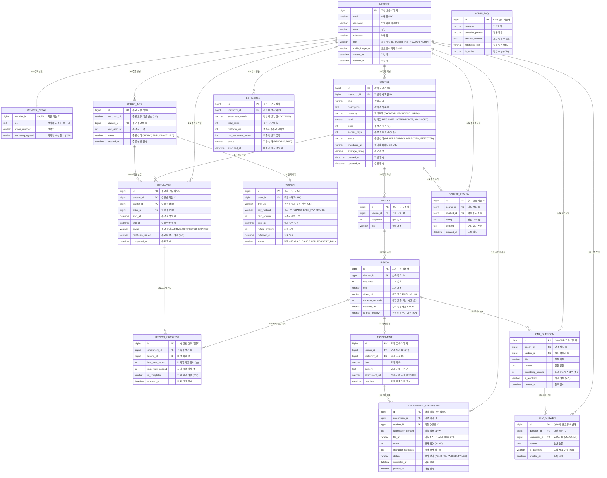

# 1. 데이터베이스 모델링 및 ERD 명세서 (하루배움 LMS)

## 목차
- [1. 데이터베이스 모델링 및 ERD 명세서 (하루배움 LMS)](#1-데이터베이스-모델링-및-erd-명세서-하루배움-lms)
- [1.1 엔티티 관계 다이어그램 (ERD)](#11-엔티티-관계-다이어그램-erd)
- [1.2 테이블별 상세 컬럼 명세](#12-테이블별-상세-컬럼-명세)

---

## 1.1 엔티티 관계 다이어그램 (ERD)

하루배움 플랫폼의 16개 핵심 엔티티 간의 관계도이며, 회원 계정, 강좌 및 계층 커리큘럼, 주문/결제, 수강권 및 진도율, 과제/피드백, 커뮤니티, 정산 및 AI 학사 FAQ 테이블 간의 물리적 외래키(FK) 연관관계를 도식화.

---

## 1.2 테이블별 상세 컬럼 명세

### 1.2.1 회원 및 인증 도메인 (MEMBER, MEMBER_DETAIL)

#### 1) MEMBER (회원 기본 계정 테이블)
- 테이블 설명: 수강생, 강사, 관리자의 기본 계정 및 인증 정보를 저장하는 핵심 테이블.

| 컬럼명 | 데이터 타입 | 제약조건 | 기본값 | 인덱스 | 설명 |
|---|---|---|---|---|---|
| id | BIGINT | PK, AUTO_INCREMENT | - | PK | 회원 고유 식별자 |
| email | VARCHAR(100) | NOT NULL, UNIQUE | - | UK_MEMBER_EMAIL | 로그인 이메일 계정 |
| password | VARCHAR(255) | NOT NULL | - | - | BCrypt 암호화된 비밀번호 |
| name | VARCHAR(50) | NOT NULL | - | - | 회원 실명 |
| nickname | VARCHAR(50) | NOT NULL | - | IDX_MEMBER_NICKNAME | 커뮤니티 노출용 닉네임 |
| role | VARCHAR(20) | NOT NULL | 'ROLE_STUDENT' | - | 권한 (ROLE_STUDENT, ROLE_INSTRUCTOR, ROLE_ADMIN) |
| profile_image_url | VARCHAR(500) | NULL | - | - | S3 프로필 이미지 URL |
| created_at | DATETIME | NOT NULL | CURRENT_TIMESTAMP | - | 회원 가입 일시 |
| updated_at | DATETIME | NOT NULL | CURRENT_TIMESTAMP ON UPDATE CURRENT_TIMESTAMP | - | 회원 정보 수정 일시 |

#### 2) MEMBER_DETAIL (회원 부가 정보 테이블)
- 테이블 설명: 회원 기본 정보와 1:1로 수직 분할된 상세 프로필 테이블.

| 컬럼명 | 데이터 타입 | 제약조건 | 기본값 | 인덱스 | 설명 |
|---|---|---|---|---|---|
| member_id | BIGINT | PK, FK (MEMBER.id) | - | PK, FK | 회원 고유 식별자 |
| bio | TEXT | NULL | - | - | 강사 약력 또는 수강생 한 줄 소개 |
| phone_number | VARCHAR(20) | NULL | - | - | 회원 연락처 |
| marketing_agreed | CHAR(1) | NOT NULL | 'N' | - | 마케팅 수신 동의 여부 (Y/N) |

---

### 1.2.2 강좌 및 커리큘럼 도메인 (COURSE, CHAPTER, LESSON)

#### 3) COURSE (강좌 기본 테이블)
- 테이블 설명: 강사가 개설하고 수강생이 수강하는 강좌 메타데이터 테이블.

| 컬럼명 | 데이터 타입 | 제약조건 | 기본값 | 인덱스 | 설명 |
|---|---|---|---|---|---|
| id | BIGINT | PK, AUTO_INCREMENT | - | PK | 강좌 고유 식별자 |
| instructor_id | BIGINT | NOT NULL, FK (MEMBER.id) | - | IDX_COURSE_INSTRUCTOR | 개설 강사 회원 식별자 |
| title | VARCHAR(200) | NOT NULL | - | IDX_COURSE_TITLE | 강좌 제목 |
| description | TEXT | NOT NULL | - | - | 강좌 상세 소개 본문 |
| category | VARCHAR(50) | NOT NULL | - | IDX_COURSE_CATEGORY | 카테고리 (BACKEND, FRONTEND, INFRA) |
| level | VARCHAR(20) | NOT NULL | 'BEGINNER' | - | 난이도 (BEGINNER, INTERMEDIATE, ADVANCED) |
| price | INT | NOT NULL | 0 | - | 수강료 (0원일 경우 무료 강좌) |
| access_days | INT | NOT NULL | 90 | - | 결제 후 기본 수강 가능 기간 (일수) |
| status | VARCHAR(20) | NOT NULL | 'DRAFT' | IDX_COURSE_STATUS | 승인 상태 (DRAFT, PENDING, APPROVED, REJECTED) |
| thumbnail_url | VARCHAR(500) | NULL | - | - | S3 강좌 대표 썸네일 이미지 URL |
| average_rating | DECIMAL(2,1) | NOT NULL | 0.0 | - | 수강생 평균 평점 |
| created_at | DATETIME | NOT NULL | CURRENT_TIMESTAMP | - | 강좌 등록 일시 |
| updated_at | DATETIME | NOT NULL | CURRENT_TIMESTAMP ON UPDATE CURRENT_TIMESTAMP | - | 강좌 수정 일시 |

#### 4) CHAPTER (강좌 챕터/대단원 테이블)
- 테이블 설명: 강좌 하위의 대단원 구조를 정의하는 테이블.

| 컬럼명 | 데이터 타입 | 제약조건 | 기본값 | 인덱스 | 설명 |
|---|---|---|---|---|---|
| id | BIGINT | PK, AUTO_INCREMENT | - | PK | 챕터 고유 식별자 |
| course_id | BIGINT | NOT NULL, FK (COURSE.id) | - | IDX_CHAPTER_COURSE | 소속 강좌 식별자 |
| sequence | INT | NOT NULL | 1 | - | 강좌 내 챕터 표시 순서 |
| title | VARCHAR(200) | NOT NULL | - | - | 챕터 제목 |

#### 5) LESSON (강좌 차시/소단원 테이블)
- 테이블 설명: 실제 동영상 강의 및 강의 자료가 매핑되는 최소 학습 단위 테이블.

| 컬럼명 | 데이터 타입 | 제약조건 | 기본값 | 인덱스 | 설명 |
|---|---|---|---|---|---|
| id | BIGINT | PK, AUTO_INCREMENT | - | PK | 차시 고유 식별자 |
| chapter_id | BIGINT | NOT NULL, FK (CHAPTER.id) | - | IDX_LESSON_CHAPTER | 소속 챕터 식별자 |
| sequence | INT | NOT NULL | 1 | - | 챕터 내 차시 표시 순서 |
| title | VARCHAR(200) | NOT NULL | - | - | 차시 제목 |
| video_url | VARCHAR(500) | NOT NULL | - | - | S3/CloudFront 동영상 스트리밍 URL |
| duration_seconds | INT | NOT NULL | 0 | - | 동영상 총 재생 시간 (초 단위) |
| material_url | VARCHAR(500) | NULL | - | - | S3 강의 첨부자료 URL |
| is_free_preview | CHAR(1) | NOT NULL | 'N' | - | 무료 미리보기 제공 여부 (Y/N) |

---

### 1.2.3 주문 및 결제 도메인 (ORDER_INFO, PAYMENT)

#### 6) ORDER_INFO (수강 주문 테이블)
- 테이블 설명: 수강생의 강좌 결제 요청 단위를 관리하는 주문 테이블.

| 컬럼명 | 데이터 타입 | 제약조건 | 기본값 | 인덱스 | 설명 |
|---|---|---|---|---|---|
| id | BIGINT | PK, AUTO_INCREMENT | - | PK | 주문 고유 식별자 |
| merchant_uid | VARCHAR(100) | NOT NULL, UNIQUE | - | UK_ORDER_MERCHANT_UID | 주문 고유 식별 번호 (결제사 전달용) |
| student_id | BIGINT | NOT NULL, FK (MEMBER.id) | - | IDX_ORDER_STUDENT | 주문 수강생 식별자 |
| total_amount | INT | NOT NULL | - | - | 총 결제 예정 금액 |
| status | VARCHAR(20) | NOT NULL | 'READY' | IDX_ORDER_STATUS | 주문 상태 (READY, PAID, CANCELLED) |
| ordered_at | DATETIME | NOT NULL | CURRENT_TIMESTAMP | - | 주문 생성 일시 |

#### 7) PAYMENT (결제 트랜잭션 테이블)
- 테이블 설명: 포트원 PG사와의 실제 결제 승인 및 사후 검증 결과를 보관하는 테이블.

| 컬럼명 | 데이터 타입 | 제약조건 | 기본값 | 인덱스 | 설명 |
|---|---|---|---|---|---|
| id | BIGINT | PK, AUTO_INCREMENT | - | PK | 결제 고유 식별자 |
| order_id | BIGINT | NOT NULL, UNIQUE, FK (ORDER_INFO.id) | - | UK_PAYMENT_ORDER | 주문 식별자 (1:1 매핑) |
| imp_uid | VARCHAR(100) | NOT NULL, UNIQUE | - | UK_PAYMENT_IMP_UID | 포트원 결제 고유 번호 |
| pay_method | VARCHAR(30) | NOT NULL | 'CARD' | - | 결제 수단 (CARD, EASY_PAY, TRANS) |
| paid_amount | INT | NOT NULL | - | - | PG사 실결제 승인 금액 |
| paid_at | DATETIME | NOT NULL | - | - | 결제 승인 일시 |
| refund_amount | INT | NOT NULL | 0 | - | 환불 금액 |
| refunded_at | DATETIME | NULL | - | - | 환불 처리 일시 |
| status | VARCHAR(20) | NOT NULL | 'PAID' | IDX_PAYMENT_STATUS | 결제 상태 (PAID, CANCELLED, FORGERY_FAIL) |

---

### 1.2.4 수강 및 학습 진도 도메인 (ENROLLMENT, LESSON_PROGRESS)

#### 8) ENROLLMENT (수강권 테이블)
- 테이블 설명: 결제 완료 후 수강생에게 부여되는 강좌별 수강 권한 및 기간 관리 테이블.

| 컬럼명 | 데이터 타입 | 제약조건 | 기본값 | 인덱스 | 설명 |
|---|---|---|---|---|---|
| id | BIGINT | PK, AUTO_INCREMENT | - | PK | 수강권 고유 식별자 |
| student_id | BIGINT | NOT NULL, FK (MEMBER.id) | - | IDX_ENROLL_STUDENT | 수강생 회원 식별자 |
| course_id | BIGINT | NOT NULL, FK (COURSE.id) | - | IDX_ENROLL_COURSE | 수강 강좌 식별자 |
| order_id | BIGINT | NOT NULL, FK (ORDER_INFO.id) | - | - | 원천 주문 식별자 |
| start_at | DATETIME | NOT NULL | - | - | 수강 시작 일시 |
| end_at | DATETIME | NOT NULL | - | IDX_ENROLL_END_AT | 수강 만료 일시 (배치 조회 기준) |
| status | VARCHAR(20) | NOT NULL | 'ACTIVE' | IDX_ENROLL_STATUS | 수강 상태 (ACTIVE, COMPLETED, EXPIRED) |
| certificate_issued | CHAR(1) | NOT NULL | 'N' | - | 수료증 발급 여부 (Y/N) |
| completed_at | DATETIME | NULL | - | - | 수료 달성 일시 |

#### 9) LESSON_PROGRESS (차시별 진도율 테이블)
- 테이블 설명: 수강생의 차시별 동영상 재생 위치 및 80% 완료 여부를 저장하는 테이블.

| 컬럼명 | 데이터 타입 | 제약조건 | 기본값 | 인덱스 | 설명 |
|---|---|---|---|---|---|
| id | BIGINT | PK, AUTO_INCREMENT | - | PK | 진도 기록 고유 식별자 |
| enrollment_id | BIGINT | NOT NULL, FK (ENROLLMENT.id) | - | IDX_PROGRESS_ENROLL | 소속 수강권 식별자 |
| lesson_id | BIGINT | NOT NULL, FK (LESSON.id) | - | IDX_PROGRESS_LESSON | 대상 차시 식별자 |
| last_view_second | INT | NOT NULL | 0 | - | 마지막 시청 재생 위치 (초 단위) |
| max_view_second | INT | NOT NULL | 0 | - | 최대 진입 시청 위치 (초 단위) |
| is_completed | CHAR(1) | NOT NULL | 'N' | - | 80% 이상 수강 완료 여부 (Y/N) |
| updated_at | DATETIME | NOT NULL | CURRENT_TIMESTAMP ON UPDATE CURRENT_TIMESTAMP | - | 진도율 최종 동기화 일시 |

---

### 1.2.5 과제 및 커뮤니티 도메인 (ASSIGNMENT, ASSIGNMENT_SUBMISSION, QNA, REVIEW)

#### 10) ASSIGNMENT (차시 과제 출제 테이블)
- 테이블 설명: 강사가 특정 차시에 연결하여 출제한 과제 정보 테이블.

| 컬럼명 | 데이터 타입 | 제약조건 | 기본값 | 인덱스 | 설명 |
|---|---|---|---|---|---|
| id | BIGINT | PK, AUTO_INCREMENT | - | PK | 과제 고유 식별자 |
| lesson_id | BIGINT | NOT NULL, UNIQUE, FK (LESSON.id) | - | UK_ASSIGN_LESSON | 연계 차시 식별자 (1:1 매핑) |
| instructor_id | BIGINT | NOT NULL, FK (MEMBER.id) | - | - | 출제 강사 식별자 |
| title | VARCHAR(200) | NOT NULL | - | - | 과제 제목 |
| content | TEXT | NOT NULL | - | - | 과제 요구사항 및 가이드 본문 |
| attachment_url | VARCHAR(500) | NULL | - | - | S3 첨부 가이드 파일 URL |
| deadline | DATETIME | NOT NULL | - | - | 과제 제출 마감 일시 |

#### 11) ASSIGNMENT_SUBMISSION (수강생 과제 제출 및 채점 테이블)
- 테이블 설명: 수강생이 제출한 과제물과 강사의 평가 점수 및 피드백을 기록하는 테이블.

| 컬럼명 | 데이터 타입 | 제약조건 | 기본값 | 인덱스 | 설명 |
|---|---|---|---|---|---|
| id | BIGINT | PK, AUTO_INCREMENT | - | PK | 과제 제출 고유 식별자 |
| assignment_id | BIGINT | NOT NULL, FK (ASSIGNMENT.id) | - | IDX_SUBMIT_ASSIGN | 대상 과제 식별자 |
| student_id | BIGINT | NOT NULL, FK (MEMBER.id) | - | IDX_SUBMIT_STUDENT | 제출 수강생 식별자 |
| submission_content | TEXT | NOT NULL | - | - | 제출 설명 텍스트 |
| file_url | VARCHAR(500) | NOT NULL | - | - | S3 업로드된 과제물/소스코드 URL |
| score | INT | NULL | - | - | 강사 평가 점수 (0~100) |
| instructor_feedback | TEXT | NULL | - | - | 강사 평가 피드백 코멘트 |
| status | VARCHAR(20) | NOT NULL | 'PENDING' | - | 평가 상태 (PENDING, PASSED, FAILED) |
| submitted_at | DATETIME | NOT NULL | CURRENT_TIMESTAMP | - | 과제 최초 제출 일시 |
| graded_at | DATETIME | NULL | - | - | 강사 채점 완료 일시 |

#### 12) QNA_QUESTION (강의 질의응답 질문 테이블)
- 테이블 설명: 수강생이 강의를 들으며 특정 시점에 등록한 질문 테이블.

| 컬럼명 | 데이터 타입 | 제약조건 | 기본값 | 인덱스 | 설명 |
|---|---|---|---|---|---|
| id | BIGINT | PK, AUTO_INCREMENT | - | PK | Q&A 질문 고유 식별자 |
| lesson_id | BIGINT | NOT NULL, FK (LESSON.id) | - | IDX_QNA_LESSON | 소속 차시 식별자 |
| student_id | BIGINT | NOT NULL, FK (MEMBER.id) | - | IDX_QNA_STUDENT | 질문 작성 수강생 식별자 |
| title | VARCHAR(200) | NOT NULL | - | - | 질문 제목 |
| content | TEXT | NOT NULL | - | - | 질문 본문 |
| timestamp_second | INT | NULL | - | - | 동영상 타임스탬프 (초 단위) |
| is_resolved | CHAR(1) | NOT NULL | 'N' | - | 질문 해결 여부 (Y/N) |
| created_at | DATETIME | NOT NULL | CURRENT_TIMESTAMP | - | 질문 등록 일시 |

#### 13) QNA_ANSWER (강의 질의응답 답변 테이블)
- 테이블 설명: 강사 또는 관리자가 질문에 대해 작성한 답변 테이블.

| 컬럼명 | 데이터 타입 | 제약조건 | 기본값 | 인덱스 | 설명 |
|---|---|---|---|---|---|
| id | BIGINT | PK, AUTO_INCREMENT | - | PK | Q&A 답변 고유 식별자 |
| question_id | BIGINT | NOT NULL, FK (QNA_QUESTION.id) | - | IDX_ANSWER_QUESTION | 대상 질문 식별자 |
| responder_id | BIGINT | NOT NULL, FK (MEMBER.id) | - | - | 답변 작성자 식별자 |
| content | TEXT | NOT NULL | - | - | 답변 본문 |
| is_accepted | CHAR(1) | NOT NULL | 'N' | - | 질문자 채택 여부 (Y/N) |
| created_at | DATETIME | NOT NULL | CURRENT_TIMESTAMP | - | 답변 등록 일시 |

#### 14) COURSE_REVIEW (강좌 수강 후기 테이블)
- 테이블 설명: 수강생이 강좌 수강 후 남기는 별점 및 평가 테이블.

| 컬럼명 | 데이터 타입 | 제약조건 | 기본값 | 인덱스 | 설명 |
|---|---|---|---|---|---|
| id | BIGINT | PK, AUTO_INCREMENT | - | PK | 수강 후기 고유 식별자 |
| course_id | BIGINT | NOT NULL, FK (COURSE.id) | - | IDX_REVIEW_COURSE | 대상 강좌 식별자 |
| student_id | BIGINT | NOT NULL, FK (MEMBER.id) | - | - | 작성 수강생 식별자 |
| rating | INT | NOT NULL | 5 | - | 별점 (1~5점) |
| content | TEXT | NOT NULL | - | - | 후기 본문 |
| created_at | DATETIME | NOT NULL | CURRENT_TIMESTAMP | - | 후기 등록 일시 |

---

### 1.2.6 배치 및 AI 지식 베이스 도메인 (SETTLEMENT, ADMIN_FAQ)

#### 15) SETTLEMENT (강사 월간 정산 집계 테이블)
- 테이블 설명: Spring Batch가 매월 1일 자정에 강사별 수강료 매출을 집계하여 영속화하는 정산 테이블.

| 컬럼명 | 데이터 타입 | 제약조건 | 기본값 | 인덱스 | 설명 |
|---|---|---|---|---|---|
| id | BIGINT | PK, AUTO_INCREMENT | - | PK | 정산 고유 식별자 |
| instructor_id | BIGINT | NOT NULL, FK (MEMBER.id) | - | IDX_SETTLE_INSTRUCTOR | 정산 대상 강사 식별자 |
| settlement_month | VARCHAR(7) | NOT NULL | - | IDX_SETTLE_MONTH | 정산 대상 연월 (예: '2026-09') |
| total_sales | INT | NOT NULL | 0 | - | 해당 월 총 수강료 매출 |
| platform_fee | INT | NOT NULL | 0 | - | 플랫폼 수수료 공제액 (예: 20%) |
| net_settlement_amount | INT | NOT NULL | 0 | - | 강사 실수령 최종 정산금 |
| status | VARCHAR(20) | NOT NULL | 'PENDING' | - | 지급 상태 (PENDING, PAID) |
| executed_at | DATETIME | NOT NULL | CURRENT_TIMESTAMP | - | 배치 정산 실행 일시 |

#### 16) ADMIN_FAQ (AI 학사 행정 지원 지식 베이스 테이블)
- 테이블 설명: 과정 운영자의 반복 행정 업무를 무인화하기 위해 AI 챗봇의 프롬프트와 RAG 질의에 활용되는 행정 FAQ 지식 베이스 테이블.

| 컬럼명 | 데이터 타입 | 제약조건 | 기본값 | 인덱스 | 설명 |
|---|---|---|---|---|---|
| id | BIGINT | PK, AUTO_INCREMENT | - | PK | FAQ 지식 고유 식별자 |
| category | VARCHAR(50) | NOT NULL | - | IDX_FAQ_CATEGORY | 카테고리 (COURSE, PAYMENT, REFUND, COMPLETION) |
| question_pattern | VARCHAR(300) | NOT NULL | - | - | 대표 질문 패턴 및 유사 질문 키워드 |
| answer_content | TEXT | NOT NULL | - | - | 검증된 공식 학사 행정 표준 답변 |
| reference_link | VARCHAR(500) | NULL | - | - | 관련 규정 또는 신청 바로가기 URL |
| is_active | CHAR(1) | NOT NULL | 'Y' | - | AI 질의 사용 활성 여부 (Y/N) |
