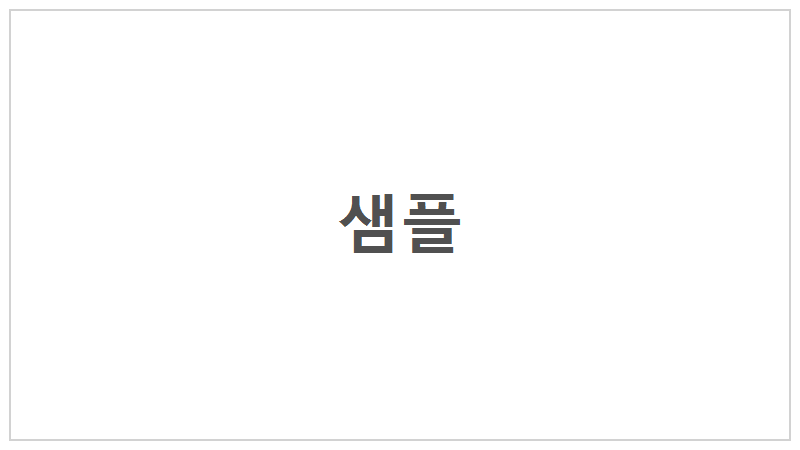
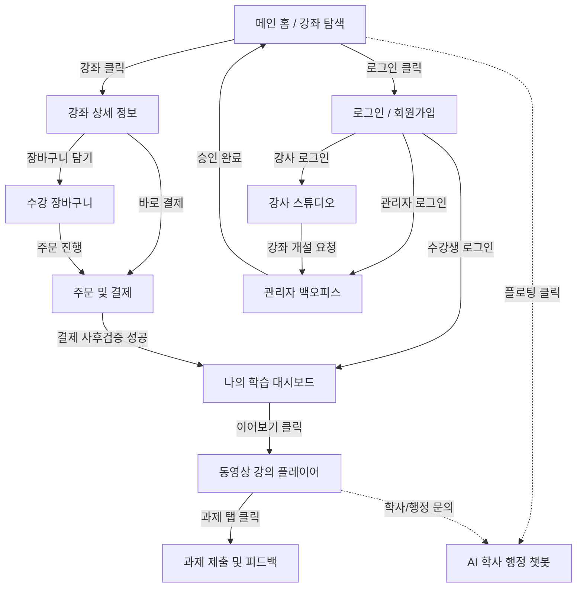

# 1. 화면 설계서 (UI Wireframe)

## 목차
- [1. 화면 설계서 (UI Wireframe)](#1-화면-설계서-ui-wireframe)
- [1.1 서비스 화면 구성 개요](#11-서비스-화면-구성-개요)
- [1.2 주요 화면별 명세](#12-주요-화면별-명세)
- [1.3 전체 화면 와이어프레임 배치도](#13-전체-화면-와이어프레임-배치도)
- [1.4 전체 화면 흐름도 및 내비게이션 구조](#14-전체-화면-흐름도-및-내비게이션-구조)

---

## 1.1 서비스 화면 구성 개요

하루배움 플랫폼은 수강생의 학습 몰입도 제고, 강사의 편리한 커리큘럼/과제 관리, 관리자의 자동화된 학사·정산 모니터링을 지원하는 반응형 SPA(Single Page Application) 화면 구조를 채택.

### 1.1.1 주요 화면 목록
- [전체 화면 와이어프레임 배치도 (전체 보기)](#13-전체-화면-와이어프레임-배치도)
- 회원가입 및 로그인 화면 (`/login`, `/signup`)
- 메인 홈 및 강좌 탐색/검색 화면 (`/`, `/courses`)
- 강좌 상세 정보 및 커리큘럼 화면 (`/courses/{courseId}`)
- 수강 장바구니 및 포트원 결제 화면 (`/cart`, `/checkout`)
- 나의 수강 현황 대시보드 화면 (`/my/learning`)
- 동영상 강의 플레이어 및 차시 학습 화면 (`/courses/{courseId}/lessons/{lessonId}`)
- 과제 제출 및 강사 피드백 화면 (`/lessons/{lessonId}/assignment`)
- AI 기반 학사 행정 지원 챗봇 위젯 (플로팅 모달)
- 강사 전용 강좌/과제 관리 화면 (`/instructor/courses`)
- 관리자 백오피스 통계 및 정산 대시보드 화면 (`/admin/dashboard`)

---

## 1.2 주요 화면별 명세

### 1.2.1 회원가입 및 로그인 화면 (`/login`, `/signup`)

- 출력 데이터 항목 (Output Data):
  - 서비스 로고 및 슬로건: 하루배움 브랜드 로고 및 안내 문구
  - 입력 필드: 이메일, 비밀번호, 실명, 닉네임, 역할 라디오 버튼 (수강생/강사)
  - 소셜 로그인 버튼: 카카오, 구글 간편 인증 버튼
- 화면 제어 및 동작 규칙 (Behavior Rules):
  - 이메일 형식 정규식 검증 및 비밀번호(영문, 숫자, 특수문자 조합 8자리 이상) 실시간 검증.
  - 로그인 성공 시 백엔드로부터 수신한 JWT Access Token을 상태(State)에 저장하고 역할(Role)에 따라 맞춤형 메인 페이지로 분기 이동.
  - 로그인 실패 시 경고 메시지(계정 정보 불일치) 필드 하단 노출.

### 1.2.2 메인 홈 및 강좌 탐색 화면 (`/`, `/courses`)

- 출력 데이터 항목 (Output Data):
  - 상단 GNB: 로고, 강좌탐색, 나의학습, AI행정챗봇 토글, 장바구니 아이콘, 로그인/프로필 아바타
  - 필터 컨트롤: 카테고리 탭, 난이도 칩, 검색창, 정렬 셀렉트 박스
  - 강좌 카드 그리드: 썸네일, 제목, 강사명, 카테고리/난이도 뱃지, 평점, 수강료
  - 페이징 컨트롤: 페이지 번호 블록 및 이전/다음 버튼
- 화면 제어 및 동작 규칙 (Behavior Rules):
  - 카테고리, 난이도, 검색어 변경 시 OpenFeign QueryDSL 동적 쿼리 API를 비동기 호출하여 카드 목록 갱신.
  - 강좌 카드 클릭 시 해당 강좌 상세 화면(`/courses/{courseId}`)으로 라우팅.

### 1.2.3 강좌 상세 및 커리큘럼 화면 (`/courses/{courseId}`)

- 출력 데이터 항목 (Output Data):
  - 강좌 기본 정보: 제목, 썸네일, 평점, 총 수강생 수, 수강 가능 일수, 수강료
  - 탭 콘텐츠: 강좌 상세 소개 설명문, 챕터별 차시 커리큘럼 목차, 수강생 리뷰 목록
  - 우측 고정 결제 카드: 가격 정보, 장바구니 담기 버튼, 바로 결제 버튼, 강사 약력 프로필
- 화면 제어 및 동작 규칙 (Behavior Rules):
  - 무료 미리보기(`is_free_preview == 'Y'`) 차시는 결제 전이라도 영상 시청 가능.
  - 장바구니 담기 클릭 시 백엔드 장바구니 등록 후 상단 카운트 갱신.
  - 바로 결제하기 클릭 시 결제 준비 단계(`/checkout`)로 즉시 이동.

### 1.2.4 수강 장바구니 및 포트원 결제 화면 (`/cart`, `/checkout`)

- 출력 데이터 항목 (Output Data):
  - 주문 상품 목록: 강좌명, 수강 기간, 개별 금액, 삭제 버튼
  - 결제 금액 계산서: 총 주문 금액, 쿠폰 할인액, 최종 실결제 금액
  - 결제 수단: 신용카드, 카카오페이, 토스페이 라디오 버튼
- 화면 제어 및 동작 규칙 (Behavior Rules):
  - 결제하기 클릭 시 백엔드 `POST /api/v1/payments/prepare`를 호출하여 주문 번호(merchant_uid)와 결제 예정 금액을 사전 등록.
  - 사전 등록 성공 시 포트원 브라우저 SDK 결제창을 팝업 형태로 구동.
  - 결제 승인 콜백 수신 즉시 백엔드 `POST /api/v1/payments/complete`를 호출하여 실결제 금액 일치 검증을 수행하고 수강권 발급 완료 후 대시보드로 이동.

### 1.2.5 나의 수강 현황 대시보드 화면 (`/my/learning`)

- 출력 데이터 항목 (Output Data):
  - 학습 요약 지표: 수강 강좌 수, 총 완료 차시 수, 과제 제출 수, 획득 수료증 수
  - 강좌별 카드: 강좌 썸네일, 강좌 제목, 진도율 프로그레스 바(%), 최근 학습 차시명, 수강 만료 D-Day
  - 액션 버튼: 이어보기, 과제 확인, 수료증 발급(100% 달성 시 활성화), 후기 작성
- 화면 제어 및 동작 규칙 (Behavior Rules):
  - 이어보기 클릭 시 최근 기록된 `last_view_second` 시점의 동영상 플레이어 화면으로 직행.
  - 수강 만료일 도래 시 카드가 비활성화되고 재수강 신청 버튼으로 전환.

### 1.2.6 동영상 강의 플레이어 및 차시 학습 화면 (`/courses/{courseId}/lessons/{lessonId}`)

- 출력 데이터 항목 (Output Data):
  - 메인 플레이어: 비디오 스트리밍 영역, 타임라인 바, 재생/배속 제어 컨트롤러
  - 우측 사이드바: 전체 커리큘럼 차시 트리 구조, 차시별 수강 완료 체크 아이콘, 현재 차시 표시
  - 하단 인터랙션 탭: 강의 첨부자료 다운로드 링크, 차시 타임스탬프 Q&A 목록 및 질문 작성 폼
- 화면 제어 및 동작 규칙 (Behavior Rules):
  - 플레이어 재생 중 5초 주기로 백엔드에 재생 위치(초)를 자동 전송하여 진도 동기화.
  - 동영상 재생률이 80% 이상 도달 시 자동으로 완료 처리되며 우측 목차에 체크 뱃지 즉시 부여.
  - Q&A 질문 작성 시 현재 동영상 재생 타임스탬프가 질문 데이터에 자동 첨부.

### 1.2.7 과제 제출 및 강사 피드백 화면 (`/lessons/{lessonId}/assignment`)

- 출력 데이터 항목 (Output Data):
  - 과제 정보: 과제명, 마감 기한, 가이드 설명 본문, 강사 첨부 자료 다운로드 링크
  - 제출 폼 / 제출 내역: 텍스트 설명 입력창, 파일 첨부 드래그앤드롭 영역, 제출일시, 제출 파일명
  - 강사 평가 영역: 평가 상태(대기/통과/미흡), 점수(0~100점), 강사 피드백 코멘트
- 화면 제어 및 동작 규칙 (Behavior Rules):
  - 과제 미제출 시 파일 업로드 폼 노출, 제출 완료 시 제출 내역 및 다운로드 링크 노출.
  - 평가 상태가 PENDING일 경우 '강사 채점 대기 중' 상태 표시, 채점 완료 시 알림 및 점수/피드백 카드 노출.

### 1.2.8 AI 기반 학사 행정 지원 챗봇 위젯 (플로팅 모달)

- 출력 데이터 항목 (Output Data):
  - 대화 헤더: AI 챗봇 캐릭터 아이콘, 닫기 버튼, 운영 자동화 안내 문구
  - 채팅 타임라인: 사용자 질의 말풍선, AI 스트리밍 답변 말풍선, 추천 바로가기 링크 칩
  - 하단 추천 키워드 칩: 자주 묻는 질문(환불 규정, 수료 기준, 결제 방법 등) 원클릭 버튼
- 화면 제어 및 동작 규칙 (Behavior Rules):
  - 전체 화면 우측 하단 플로팅 챗봇 아이콘 클릭 시 모달 창 활성화.
  - 질문 전송 시 백엔드 SSE(Server-Sent Events) 스트리밍 엔드포인트를 호출하여 글자가 실시간으로 타이핑되는 UX 제공.
  - 질문 분석 후 학사 FAQ 및 강좌 정보와 매핑된 관리자 표준 가이드 및 해당 메뉴 바로가기 링크 반환.

### 1.2.9 강사 전용 강좌/과제 관리 화면 (`/instructor/courses`)

- 출력 데이터 항목 (Output Data):
  - 개설 강좌 목록: 강좌명, 승인 상태 뱃지, 수강생 수, 수강료, 관리 액션 버튼들
  - 미처리 업무 대시보드: 미채점 과제 건수, 미답변 질문 건수
- 화면 제어 및 동작 규칙 (Behavior Rules):
  - 신규 강좌 개설 시 정보 입력 후 저장하면 관리자 검토를 위해 PENDING 상태로 자동 전환.
  - 채점하기 클릭 시 수강생 제출 파일 다운로드 및 점수/피드백 입력 팝업 제공.

### 1.2.10 관리자 백오피스 통계 및 정산 대시보드 화면 (`/admin/dashboard`)

- 출력 데이터 항목 (Output Data):
  - 플랫폼 핵심 KPI: 일일 매출액, 활성 사용자 수, 승인 대기 강좌 수
  - 월간 정산 관리 테이블: 강사명, 총 매출액, 수수료 공제액, 최종 지급액, 지급 상태 버튼
  - 강좌 심사 목록: 개설 요청 강좌 목록 및 승인/반려 제어 버튼
- 화면 제어 및 동작 규칙 (Behavior Rules):
  - 승인 버튼 클릭 시 강좌 상태를 APPROVED로 갱신하여 수강생 탐색 화면에 즉시 공개.
  - 매월 1일 자정에 Spring Batch 6.x가 정산 배치를 자동 완수하며, 비상 시 관리자가 [수동 정산 실행] 버튼을 통해 재실행 가능.

---

## 1.3 전체 화면 와이어프레임 배치도

---

## 1.4 전체 화면 흐름도 및 내비게이션 구조

