## FixGo 화면 설계서 (UI Wireframe)

---

### 목차

- [1. 화면 설계](#1-화면-설계)

- [1.1 화면 설계 개요](#11-화면-설계-개요)

    - [1.1.1 화면 설계 목적](#111-화면-설계-목적)

    - [1.1.2 공통 UI 구성 및 디자인 규칙](#112-공통-ui-구성-및-디자인-규칙)

    - [1.1.3 전체 화면 목록 및 URL](#113-전체-화면-목록-및-url)

- [1.2 사용자 역할별 화면 구성](#12-사용자-역할별-화면-구성)

    - [1.2.1 공통 화면](#121-공통-화면)

    - [1.2.2 관리자 화면](#122-관리자-화면)

    - [1.2.3 접수담당자 화면](#123-접수담당자-화면)

    - [1.2.4 수리기사 화면](#124-수리기사-화면)

    - [1.2.5 고객 포털 화면](#125-고객-포털-화면)

- [1.3 업무 기능별 상세 화면 설계](#13-업무-기능별-상세-화면-설계)

    - [1.3.1 인증 및 계정 관리](#131-인증-및-계정-관리)

    - [1.3.2 A/S 접수 관리](#132-as-접수-관리)

    - [1.3.3 점검 및 수리 관리](#133-점검-및-수리-관리)

    - [1.3.4 프리셋 관리](#134-프리셋-관리)

    - [1.3.5 고객 관리](#135-고객-관리)

    - [1.3.6 결제 관리](#136-결제-관리)

    - [1.3.7 배송 및 방문 수령 관리](#137-배송-및-방문-수령-관리)

    - [1.3.8 이메일 알림 관리](#138-이메일-알림-관리)

    - [1.3.9 제품 및 지원 품목 관리](#139-제품-및-지원-품목-관리)

    - [1.3.10 부품 및 재고 관리](#1310-부품-및-재고-관리)

    - [1.3.11 공임비 및 점검비 관리](#1311-공임비-및-점검비-관리-admincosts)

    - [1.3.12 직원 관리](#1312-직원-관리)

    - [1.3.13 통계 및 리포트](#1313-통계-및-리포트)

    - [1.3.14 관리자 AI 업무 도우미](#1314-관리자-ai-업무-도우미)

    - [1.3.15 고객 포털](#1315-고객-포털)

---

## 1. 화면 설계

---

### 1.1 화면 설계 개요

---  

#### 1.1.1 화면 설계 목적

FixGo는 사자전자 스마트폰 및 노트북 제품의 A/S 접수부터 점검, 견적 승인, 수리, 결제 및\
제품 반환까지의 전 과정을 통합 관리하는 반응형 SPA 기반 웹 시스템이다. 직원의 고객·제\
품·수리 이력 관리, 수리기사의 업무 처리, 관리자의 운영 현황 모니터링을 지원하며, 고객 포\
털과 이메일 안내를 통해 고객의 진행 확인 및 견적 승인·결제를 지원한다.

---

#### 1.1.2 공통 UI 구성 및 디자인 규칙

- 직원 화면은 왼쪽 사이드바, 상단 화면 제목·로그인 사용자 정보, 본문으로 구성한다. 사\
  용자 이름으로 마이페이지에 이동하며 로그아웃을 제공한다.

- 사이드바는 역할별 접근 메뉴를 구분하고 현재 메뉴를 강조한다.

- 목록은 검색 및 필터 영역, 데이터 테이블, 페이지네이션으로 구성한다. 기본 페이지 크\
  기는 20건이며 처음·이전·번호·다음·마지막으로 이동한다.

- 정렬 가능한 열 제목을 다시 클릭하면 오름차순/내림차순을 전환한다. 검색·필터 변경\
  시 해당 목록을 갱신한다.

- 상세 화면은 관련 정보를 카드 또는 구역으로 나누고 항목명과 값을 구분한다. 행 선택으\
  로 상세 페이지 또는 모달을 연다.

- 등록·수정·삭제·완료 처리 버튼은 역할과 업무 상태에 따라 표시한다. 확인이 필요한 동\
  작은 확인 후 실행하며 실패 시 오류를 안내한다.

- 운영 확인 화면은 청색 계열 브랜드 색상과 흰색 카드, 연한 회색 배경을 사용한다. 성공/\
  완료는 녹색, 실패·반려는 오류 색상으로 구분한다.

- 고객 포털은 직원 사이드바 없이 고객용 진행 단계와 현재 업무를 표시한다.

---

#### 1.1.3 전체 화면 목록 및 URL

#### 1. 인증 및 계정 관리

| 화면명             | URL        |
|-----------------|------------|
| 로그인             | /login     |
| 마이페이지 및 비밀번호 변경 | /member/me |

#### 2. A/S 접수 관리

| 화면명            | URL                                                     |
|----------------|---------------------------------------------------------|
| A/S 접수 목록      | /as/list                                                |
| A/S 접수 등록      | /as/new                                                 |
| A/S 접수 상세 및 수정 | /as/details/{asReceptionId}                             |
| A/S 수리 이력      | /as/details/{asReceptionId}/history                     |
| 접수증            | /as/details/{asReceptionId}/documents/reception-receipt |

#### 3. 점검 및 수리 관리

| 화면명             | URL                                                    |
|-----------------|--------------------------------------------------------|
| 기사 전용 담당 A/S 목록 | /as/my                                                 |
| A/S 진행 상세 (점검)  | /as/{repairId}/inspection                              |
| A/S 진행 상세 (수리)  | /as/{repairId}/repair                                  |
| 견적서             | /as/details/{asReceptionId}/documents/estimate         |
| 수리 내역서          | /as/details/{asReceptionId}/documents/repair-statement |

#### 4. 프리셋 관리

| 화면명            | URL                |
|----------------|--------------------|
| 수리 프리셋 관리      | /preset/list       |
| 수리 프리셋 상세 및 수정 | /preset/{presetId} |
| 고장 증상 프리셋 조회   | /preset/symptoms   |

#### 5. 고객 관리

| 화면명         | URL                    |
|-------------|------------------------|
| 고객 관리       | /customer              |
| 고객 등록       | /customer/new          |
| 고객 상세 및 수정  | /customer/{customerId} |
| 고객 엑셀 일괄 등록 | /customer/bulk         |

#### 6. 결제 관리

| 화면명                 | URL               |
|---------------------|-------------------|
| 결제 관리               | /payment/list     |
| 결제 상세 및 현금 결제·환불 처리 | /payment/{billId} |

#### 7. 배송 및 방문 수령 관리

| 화면명           | URL                    |
|---------------|------------------------|
| 배송 및 방문 수령 관리 | /shipment/list         |
| 배송 상세 및 배송 추적 | /shipment/{shipmentId} |

#### 8. 이메일 알림 관리

| 화면명             | URL                            |
|-----------------|--------------------------------|
| 이메일 발송          | /notification                  |
| 이메일 발송 내역       | /notification/list             |
| 이메일 발송 상세 및 재발송 | /notification/{notificationId} |
| 이메일 프리셋 관리      | /notification/preset/list      |
| 이메일 발송 통계       | /notification/statistics       |

#### 9. 제품 및 지원 품목 관리

| 화면명              | URL                         |
|------------------|-----------------------------|
| 지원 품목 및 제품 모델 관리 | /product-models/list        |
| 제품 모델 상세 및 수정    | /product-models/{id}        |
| 수리 대상 제품 관리      | /products/items             |
| 수리 대상 제품 상세      | /products/items/{productId} |

#### 10. 부품 및 재고 관리

| 화면명        | URL                   |
|------------|-----------------------|
| 부품 및 재고 관리 | /admin/parts/list     |
| 부품 상세      | /admin/parts/{partId} |

#### 11. 공임비 및 점검비 관리

| 화면명          | URL                |
|--------------|--------------------|
| 공임비 및 점검비 관리 | /admin/labor-rates |

#### 12. 직원 관리

| 화면명       | URL                |
|-----------|--------------------|
| 직원 목록     | /member/list       |
| 직원 상세     | /member/{memberId} |
| 직원 등록     | /member/new        |
| 삭제된 직원 목록 | /member/deleted    |

#### 13. 통계 및 리포트

| 화면명            | URL                                 |
|----------------|-------------------------------------|
| 통계 및 리포트       | /admin/statistics                   |
| 접수·완료 건수 및 완료율 | /admin/statistics/receptions        |
| 기사별 수리 현황      | /admin/statistics/technicians       |
| 제품 모델별 수리 통계   | /admin/statistics/models            |
| 모델별 고장 증상 통계   | /admin/statistics/models/{modelId}  |
| 결제 통계          | /admin/statistics/payments          |
| 기간별 결제 내역      | /admin/statistics/payments/history  |
| 미수금 청구서 목록     | /admin/statistics/unpaid-bills      |
| 배송 현황 통계       | /admin/statistics/shipments         |
| 기간별 배송 내역      | /admin/statistics/shipments/history |
| 장기 미처리 접수 조회   | /admin/statistics/incomplete        |
| 기사 배정 이력       | /admin/allocation_history           |
| A/S 상태 변경 이력   | /admin/status_change_history        |

#### 14. 관리자 AI 업무 도우미

| 화면명               | URL       |
|-------------------|-----------|
| 관리자 AI 채팅 및 대화 이력 | /admin/ai |

#### 15. 고객 포털

| 화면명                   | URL             |
|-----------------------|-----------------|
| 고객 포털 - A/S 접수 현황     | /portal/{token} |
| 고객 포털 - 견적 확인 및 승인·거절 | /portal/{token} |
| 고객 포털 - 결제            | /portal/{token} |

---

### 1.2 사용자 역할별 화면 구성

---

#### 1.2.1 공통 화면

직원은 동일한 로그인 화면을 사용하고 로그인 후 본인 역할의 A/S 목록으로 이동한다. 공통\
적으로 마이페이지, 비밀번호 변경, 직원 목록·상세 조회를 사용한다.

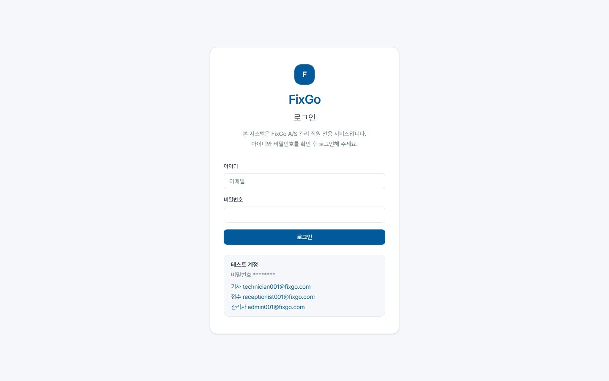

| 메뉴 영역 | 화면 및 주요 업무 |
|-------|------------|
| 인증    | 로그인 /login |

| 메뉴 영역 | 화면 및 주요 업무                                 |
|-------|--------------------------------------------|
| 계정    | 마이페이지 /member/me                           |
| 조직    | 직원 목록 /member/list 및 상세 /member/{memberId} |

세부 화면 명세는 1.3의 해당 업무 영역을 참고한다.

---

#### 1.2.2 관리자 화면

전체 A/S와 운영 정보를 조회하고 계정 발급, 직원 관리, 운영 통계 및 AI 업무 도우미를 이\
용한다. 접수·결제·배송·이메일 관리 업무를 수행하며 점검 및 수리 화면에도 접근할 수 있다.

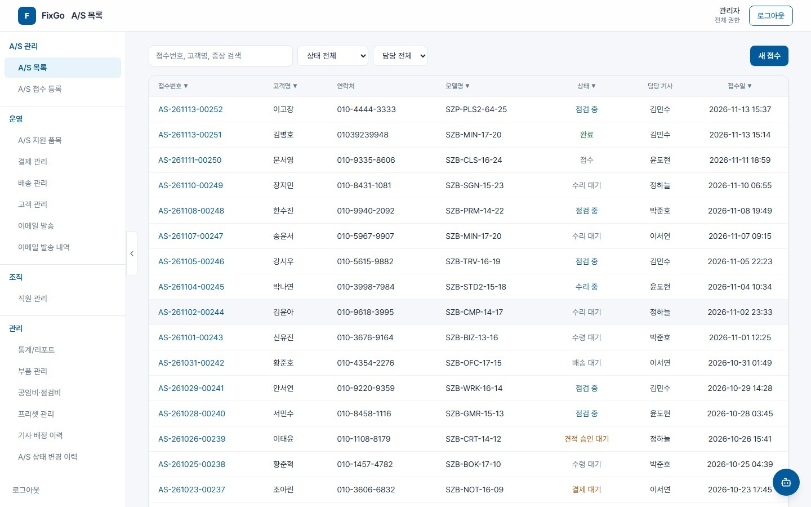

| 메뉴 영역  | 화면 및 주요 업무                                      |
|--------|-------------------------------------------------|
| A/S 관리 | A/S 목록, 접수 등록, 접수 상세                            |
| 운영     | 지원 품목, 결제 관리, 배송 관리, 고객 관리, 이메일 발송·내역           |
| 조직     | 직원 관리 및 계정 발급                                   |
| 관리     | 통계/리포트, 부품·재고, 공임비·점검비, 프리셋, 기사 배정·상태 변경 이력, AI |

세부 화면 명세는 1.3의 해당 업무 영역을 참고한다.

---

#### 1.2.3 접수담당자 화면

전체 접수 목록을 조회하고 고객 및 제품 정보에 따라 접수 등록·수정, 기사 재배정, 결제 처\
리, 배송·방문 수령 및 이메일 안내 업무를 수행한다.

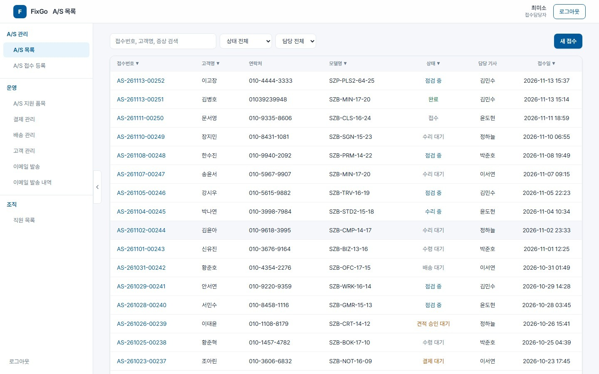

| 메뉴 영역  | 화면 및 주요 업무                                   |
|--------|----------------------------------------------|
| A/S 관리 | A/S 목록, A/S 접수 등록                            |
| 운영     | A/S 지원 품목, 결제 관리, 배송 관리, 고객 관리, 이메일 발송·발송 내역 |
| 조직     | 직원 목록·상세 조회                                  |

세부 화면 명세는 1.3의 해당 업무 영역을 참고한다.

---

#### 1.2.4 수리기사 화면

본인에게 배정된 A/S를 조회하고 점검·견적·수리를 수행한다. 결제 및 배송은 조회 중심이며\
직원 목록·상세와 수리 프리셋에 접근한다.

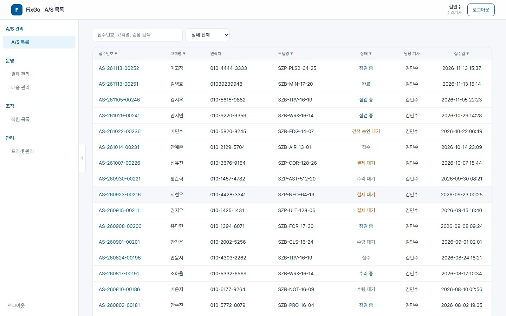

| 메뉴 영역  | 화면 및 주요 업무                        |
|--------|-----------------------------------|
| A/S 관리 | 본인 담당 A/S 목록 (/as/list), 점검·수리 상세 |
| 운영     | 결제 및 배송 조회                        |
| 조직     | 직원 목록·상세 조회                       |
| 수리     | 수리 프리셋 및 고장 증상 프리셋                |

세부 화면 명세는 1.3의 해당 업무 영역을 참고한다.

---

#### 1.2.5 고객 포털 화면

유효한 고객 전용 토큰 링크를 통해 로그인 없이 접수 현황을 확인하고 견적을 승인 또는 거\
부하며 결제할 수 있다. 직원 메뉴는 제공하지 않는다.

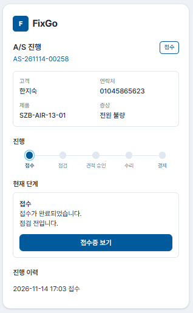 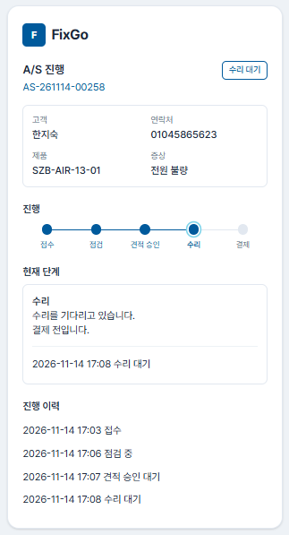 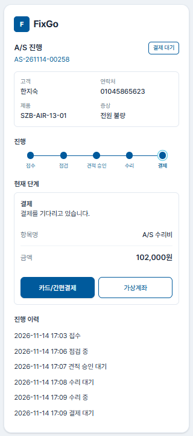 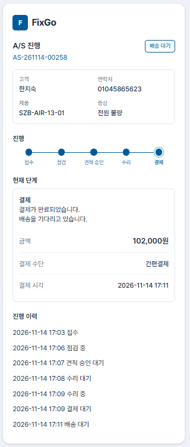 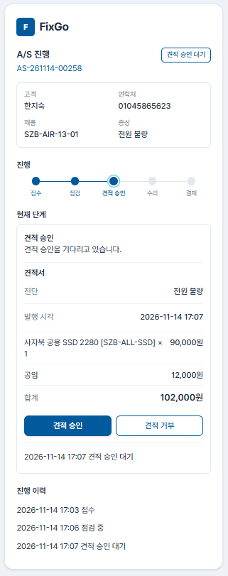 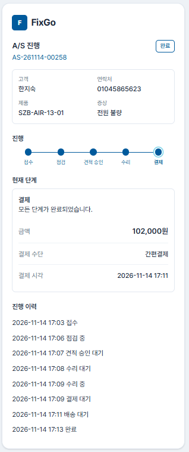

| 메뉴 영역 | 화면 및 주요 업무                                    |
|-------|-----------------------------------------------|
| 고객 포털 | /portal/{token}                               |
| 결제 결과 | /portal/{token}/success, /portal/{token}/fail |

세부 화면 명세는 1.3의 해당 업무 영역을 참고한다.

---

### 1.3 업무 기능별 상세 화면 설계

화면별로 실제 URL 또는 모달의 진입 위치, 접근 권한, 화면 캡처, 출력 데이터, 입력 데이\
터, 화면 제어 및 동작 규칙을 작성한다.

---

#### 1.3.1 인증 및 계정 관리

##### 1.3.1.1 로그인 (/login)

접근 권한: 직원 공통

**출력 데이터 항목 (Output Data)**

- 이메일, 비밀번호 입력란

- 로그인 버튼

- 데모 계정 버튼: 관리자, 접수담당자, 수리기사

- 로그인 실패 시 오류 메시지

**입력 데이터 항목 (Input Data)**

- 이메일

- 비밀번호

- 데모 계정 선택

**화면 제어 및 동작 규칙 (Behavior Rules)**

- 이메일과 비밀번호가 맞으면 역할에 맞는 첫 화면인 A/S 목록으로 이동한다.

- 실패하면 로그인 화면에 머물고 오류를 보여 준다.

- 로그인하지 않은 사용자는 업무 화면으로 들어가지 못한다.

- 데모 계정 버튼은 해당 계정의 이메일과 비밀번호를 입력란에 채운다.

- 이미 로그인한 사용자는 A/S 목록으로 이동한다.

##### 1.3.1.2 마이페이지 및 비밀번호 변경 (/member/me)

접근 권한: 관리자 · 접수담당자 · 수리기사

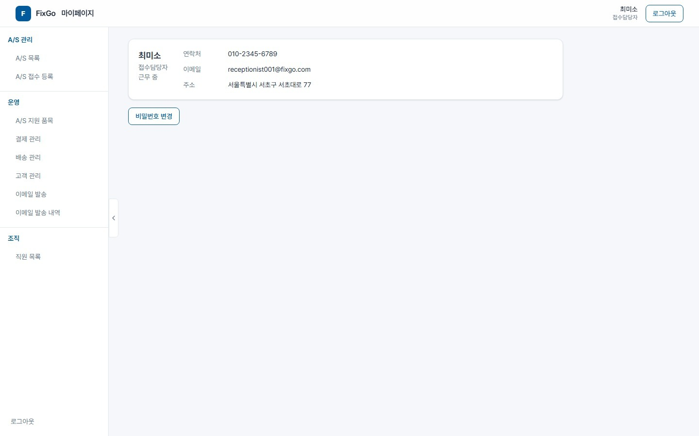

**출력 데이터 항목 (Output Data)**

- 로그인한 직원의 이름, 이메일, 연락처, 주소, 역할

- 비밀번호 변경 버튼과 변경 모달

- 변경 결과 안내

- 근무 상태

**화면 제어 및 동작 규칙 (Behavior Rules)**

- 직원 이메일로 로그인한 계정만 비밀번호를 바꿀 수 있다.

- 기존 비밀번호가 비어 있거나, 새 비밀번호가 4자 미만이거나, 확인 값이 다르면 저장하\
  지 않는다.

- 변경에 성공하면 안내 후 다시 로그인 화면으로 보낸다.

- 관리자, 접수담당자, 수리기사는 자신의 마이페이지에 들어갈 수 있다.

- 상단 로그인 사용자 이름을 눌러 마이페이지로 이동한다.

##### 1.3.1.3 비밀번호 변경 모달 (/member/me)

접근 권한: 직원 공통

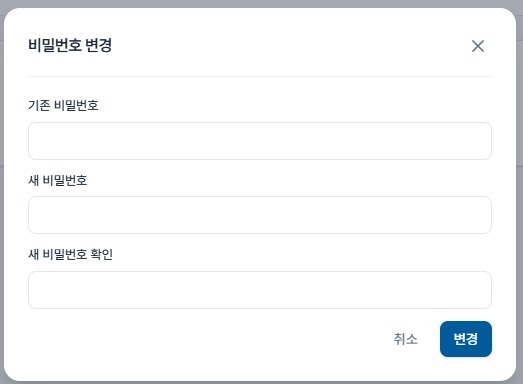 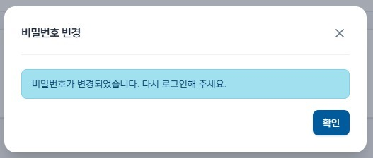

**입력 데이터 항목 (Input Data)**

- 기존 비밀번호, 새 비밀번호, 새 비밀번호 확인

**화면 제어 및 동작 규칙 (Behavior Rules)**

- 기존 비밀번호, 새 비밀번호 및 확인 값을 입력한다. 변경 성공 후 확인하면 다시 로그인\
  화면으로 이동한다. 취소 또는 닫기는 비밀번호 변경을 적용하지 않는다.

---

#### 1.3.2 A/S 접수 관리

##### 1.3.2.1 A/S 접수 목록 (/as/list)

접근 권한: 관리자 · 접수담당자 · 수리기사

**출력 데이터 항목 (Output Data)**

- 접수목록: 접수번호, 고객명, 연락처, 모델명, 상태, 담당 기사, 접수일

- 상태: 접수, 점검 중, 견적 승인 대기, 수리 대기, 수리 중, 결제 대기, 배송 대기, 수령 대\
  기, 완료

- 한 페이지 20건과 페이지 이동

**입력 데이터 항목 (Input Data)**

- 검색: 접수번호, 고객명, 증상

- 상태: 전체, 접수, 점검 중, 견적 승인 대기, 수리 대기, 수리 중, 결제 대기, 배송 대기, 수\
  령 대기, 완료

- 담당 기사: 접수담당자와 관리자만 이 필터가 보인다.

- 정렬: 접수번호, 고객명, 모델명, 상태, 접수일

**화면 제어 및 동작 규칙 (Behavior Rules)**

- 관리자와 접수담당자는 전체 접수를 볼 수 있다.

- 수리기사는 본인에게 배정된 접수만 볼 수 있다.

- 검색, 상태, 기사 필터는 목록을 다시 조회한다.

- 행을 누르면 A/S접수 상세 페이지로 이동한다.

- 수리기사는 행을 누르면 수리 단계면 수리 화면으로, 그 전이면 점검 화면으로 간다.

- 접수는 관리자또는 접수담당자가 할 수 있다.

##### 1.3.2.2 A/S 접수 등록 (/as/new)

접근 권한: 관리자 · 접수담당자

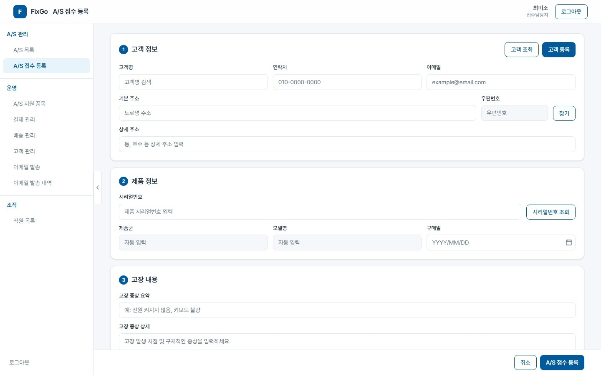

**입력 데이터 항목 (Input Data)**

- 고객명 검색, 연락처, 이메일, 기본 주소, 우편번호, 상세 주소

- 고객 조회, 고객 등록, 우편번호 찾기

- 시리얼번호, 시리얼번호 조회, 구매일

- 고장 증상 요약, 고장 증상 상세, 고객 요청 사항

- 수령 방식: 택배, 방문 수령

- 담당 기사

**화면 제어 및 동작 규칙 (Behavior Rules)**

- 고객은 기존 고객을 고르거나 이 화면에서 새로 등록한다.

- 제품은 시리얼번호로 찾는다.

- 주소와 우편번호는 필수 입력이다.

- 고객 조회, 시리얼번호 조회, 기사 목록 조회를 할 수 있다.

- 주소 항목에 찾기 버튼 클릭 시 카카오 우편번호 API로 조회할 수 있다.

- 시리얼번호 조회로 제품군과 모델명을 자동 입력한다.

- 접수 시 발급된 고객 포털 링크를 안내 이메일로 전달한다. 취소 시 목록으로 돌아간다.

- 등록 완료 시 A/S 접수 상세 페이지로 이동한다.

##### 1.3.2.3 고객 정보 조회

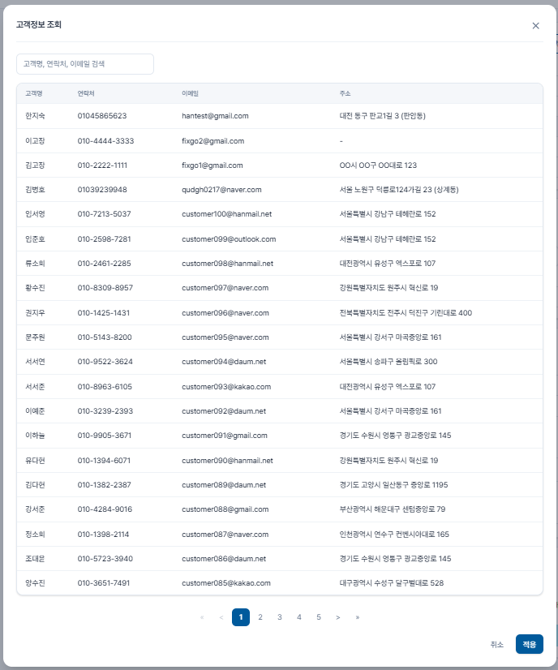

**출력 데이터 항목 (Output Data)**

- 고객명, 연락처, 이메일, 주소, 페이지네이션

**입력 데이터 항목 (Input Data)**

- 고객 검색, 고객 선택 또는 신규 고객명·연락처·이메일·주소 입력

**화면 제어 및 동작 규칙 (Behavior Rules)**

- 기존 고객 선택 후 적용하면 고객 정보가 자동 입력된다. 신규 고객은 접수 등록 화면에\
  서 등록한다.

##### 1.3.2.4 시리얼번호 조회 모달

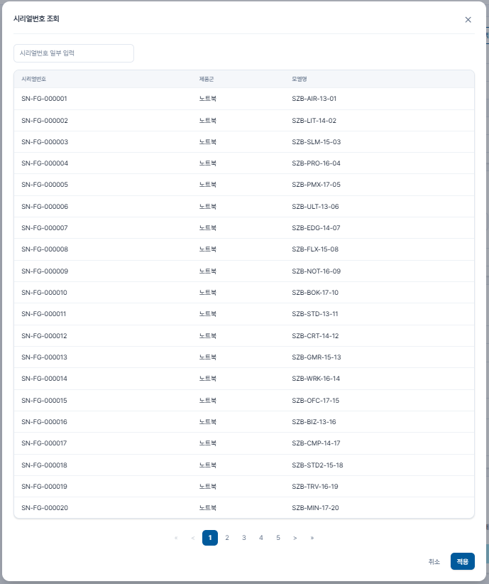

**출력 데이터 항목 (Output Data)**

- 시리얼번호, 제품군, 모델명, 페이지네이션

**입력 데이터 항목 (Input Data)**

- 시리얼번호 검색, 제품 선택

**화면 제어 및 동작 규칙 (Behavior Rules)**

- 선택 후 적용하면 제품 정보가 자동 입력된다.

##### 1.3.2.5 담당 기사 조회 모달

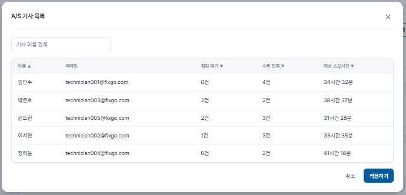

**출력 데이터 항목 (Output Data)**

- 이름, 이메일, 점검 대기 건, 수리 진행 건, 예상 소요 시간, 상태

**입력 데이터 항목 (Input Data)**

- 기사명 검색, 기사 선택

**화면 제어 및 동작 규칙 (Behavior Rules)**

- 선택 후 적용하면 담당 기사가 배정된다.

##### 1.3.2.6 우편번호 찾기 모달

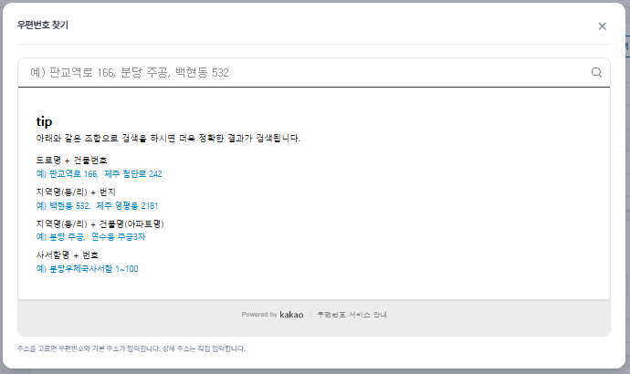

**출력 데이터 항목 (Output Data)**

- 카카오 우편번호 검색 결과: 우편번호, 도로명·지번 주소, 건물명

**입력 데이터 항목 (Input Data)**

- 도로명, 지번, 건물명, 우편번호 검색

**화면 제어 및 동작 규칙 (Behavior Rules)**

- 선택한 우편번호와 기본 주소를 접수 화면에 반영하고 상세 주소는 직접 입력한다.

##### 1.3.2.8 A/S 접수 상세 및 수정 (/as/details/{asReceptionId})

접근 권한: 관리자 · 접수담당자 · 수리기사

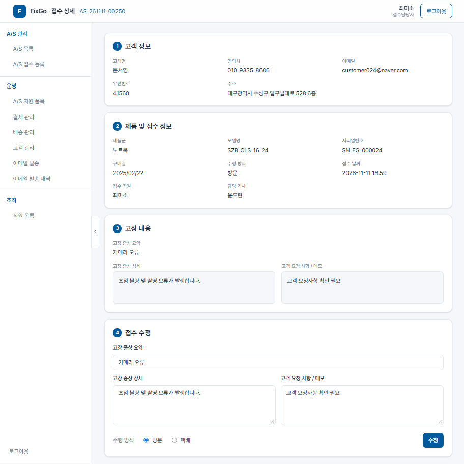

**출력 데이터 항목 (Output Data)**

- 접수번호

- 고객 정보: 고객명, 연락처, 이메일, 우편번호, 주소

- 제품 및 접수 정보: 제품군, 모델명, 시리얼번호, 구매일, 수령 방식, 접수 날짜, 접수 직\
  원, 담당 기사

- 고장 증상 요약, 고장 증상 상세, 고객 요청 사항

- 담당 기사와 배정 이력: 이전 기사, 새 기사, 시각, 변경자, 사유

- 진행 단계: 접수, 점검, 견적, 수리, 결제, 배송, 완료

- 상태 변경 이력: 이전 상태, 변경 상태, 시각, 변경자, 사유

- 고객 안내 링크와 만료 시각

- 서류: 접수증, 견적서, 수리 내역서

**입력 데이터 항목 (Input Data)**

- 수리 시작 전 접수 수정 가능

- 담당 기사 재배정과 사유. 결제 대기 이후에는 재배정할 수 없다.

- 고객 안내 링크 복사

- 서류 버튼

- 수정 항목: 고장 증상 요약, 상세, 고객 요청 사항, 수령 방식.

**화면 제어 및 동작 규칙 (Behavior Rules)**

- 접수 내용을 조회한다.

- 접수 수정은 수리가 시작되기 전만 가능하다.

- 기사 재배정은 결제 대기 전에만 가능하고, 배정 이력에 남는다.

- 고객 안내 링크를 복사해 고객 포털로 보낼 수 있다.

- 상태 변경 이력 확인이 가능하다.

- 수정과 재배정은 접수한 담당자가 할 수 있다.

- 견적서는 수리비 확정 후, 수리 내역서는 수리 완료 후 조회한다.

##### 1.3.2.9 접수증

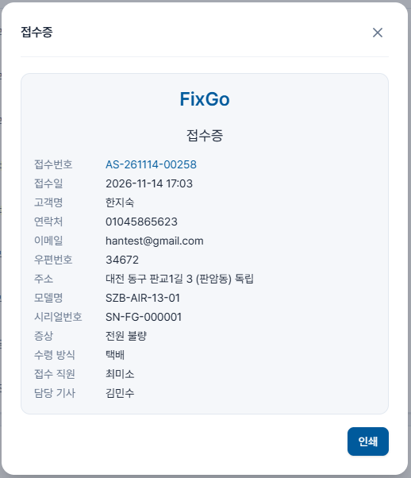

**출력 데이터 항목 (Output Data)**

- 접수번호, 접수일, 고객명, 연락처, 이메일, 우편번호, 주소

- 모델명, 시리얼번호, 증상, 수령 방식, 접수 직원, 담당 기사

**입력 데이터 항목 (Input Data)**

- 인쇄

- 모달 닫기

**화면 제어 및 동작 규칙 (Behavior Rules)**

- 접수 상세의 서류 발급에서 연다.

- 인쇄는 브라우저 인쇄를 연다.

##### 1.3.2.10 견적서, 수리내역서

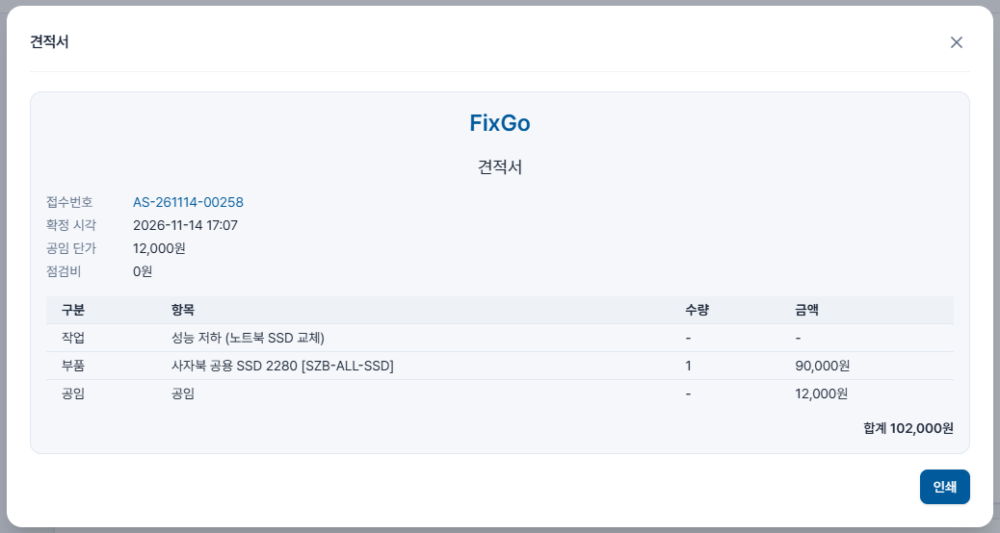 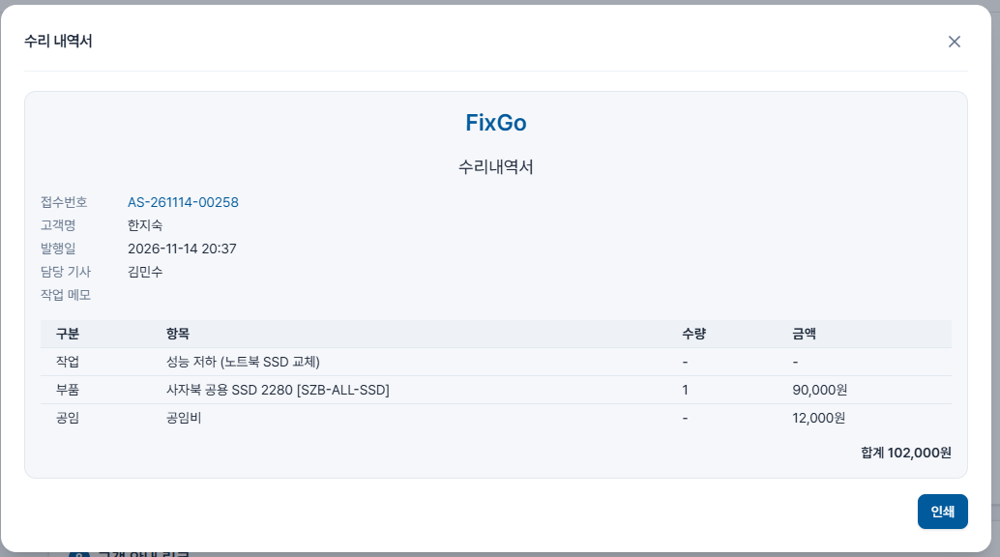 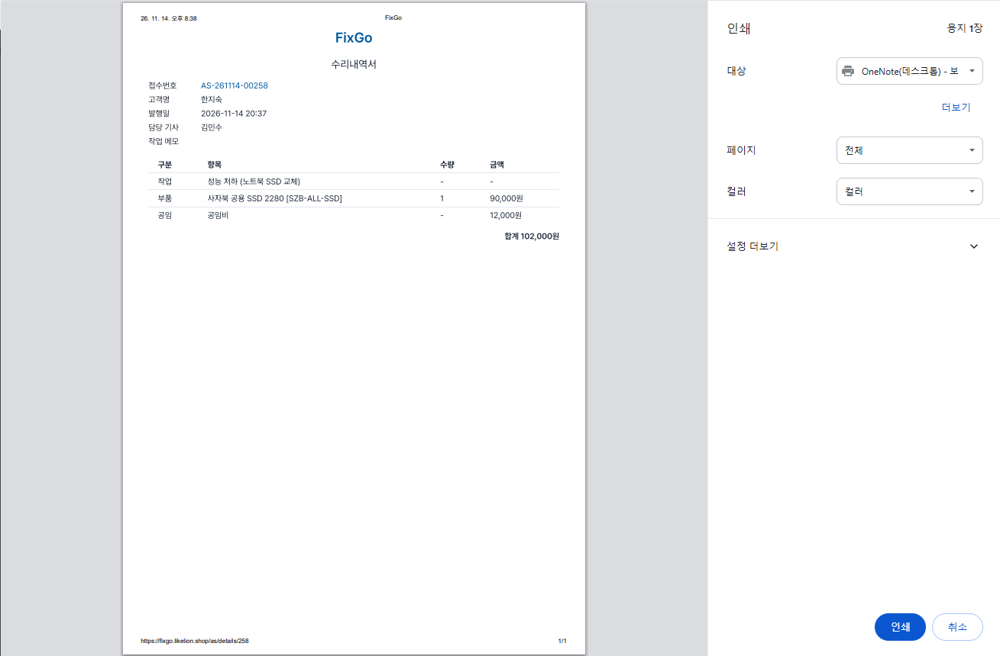

출력 데이터 항목\
(Output Data)

- 견적서: 접수번호, 확\
  정시각, 고객공임 단\
  가, 점검비, 수리 항목

- 수리 내역서: 접수번\
  호, 고객명, 발행일,\
  담당기사, 작업내역

입력 데이터 항목 (Input\
Data)

- 인쇄

- 모달 닫기

화면 제어 및 동작 규칙\
(Behavior Rules)

- 접수 상세의 견적서,\
  수리내역서에서 연\
  다.

- 인쇄는 브라우저 인쇄\
  를 연다.

---

#### 1.3.3 점검 및 수리 관리

##### 1.3.3.1 기사 전용 담당 A/S 목록 (/as/my)

접근 권한: 수리기사

**출력 데이터 항목 (Output Data)**

- 본인 배정 접수: 접수번호, 고객명, 연락처, 모델명, 상태, 담당 기사, 접수일

- 상태 필터와 페이지네이션

- 담당 기사 필터와 새 접수 버튼은 없다.

**입력 데이터 항목 (Input Data)**

- 접수번호, 고객명, 증상 검색

- 상태 필터

**화면 제어 및 동작 규칙 (Behavior Rules)**

- 로그인한 수리기사에게 배정된 접수만 조회한다.

- 행을 누르면 진행 단계에 따라 점검 또는 수리 화면으로 이동한다.

##### 1.3.3.2 A/S 진행 상세 · 점검 (/as/{repairId}/inspection)

접근 권한: 관리자 · 수리기사(담당 건)

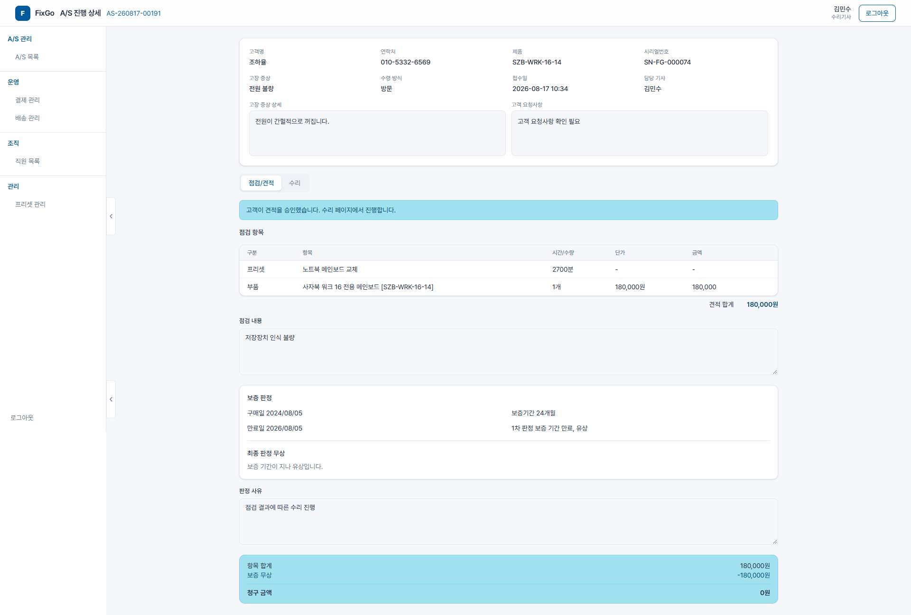

**출력 데이터 항목 (Output Data)**

- 접수 요약: 고객, 제품, 시리얼, 증상, 수령 방식, 접수일, 담당 기사

- 보증 판정: 1차 판정, 최종 판정, 청구 금액

- 점검 항목, 견적 합계, 보증 무상 금액, 청구 금액

- 점검 내용

- 점검 항목: 구분, 항목, 수리 시간/부품 수량, 단가, 금액. 구매일, 보증기간, 만료일, 최종\
  판정.

**입력 데이터 항목 (Input Data)**

- 수리 프리셋 선택

- 점검 내용

- 고객 과실 여부와 판정 사유

- 점검 중단 사유: 수리 불가 등

- 점검 완료

**화면 제어 및 동작 규칙 (Behavior Rules)**

- 구매일과 모델 보증기간으로 무상 또는 유상을 먼저 계산한다. 보증 기간 안의 고객 과실\
  은 유상으로 바꿀 수 있고, 사유가 필요하다.

- 무상으로 저장하면 금액은 0원이고 고객 승인 없이 수리 대기로 넘어간다.

- 유상으로 저장하면 견적 승인 대기가 된다.

- 수리 불가 등으로 점검을 중단하면 견적과 수리를 건너뛰고 반환 단계로 간다.

- 점검 기록이 없는 경우 안내 문구를 표시한다.

- 접수 상태에서 점검 시작을 수행한다. 프리셋을 적용하거나 항목을 추가·수정·삭제하고\
  견적 합계를 표시한다.

##### 1.3.3.3 수리 프리셋 불러오기 (모달)

접근 권한: 관리자 · 수리기사(담당 건)

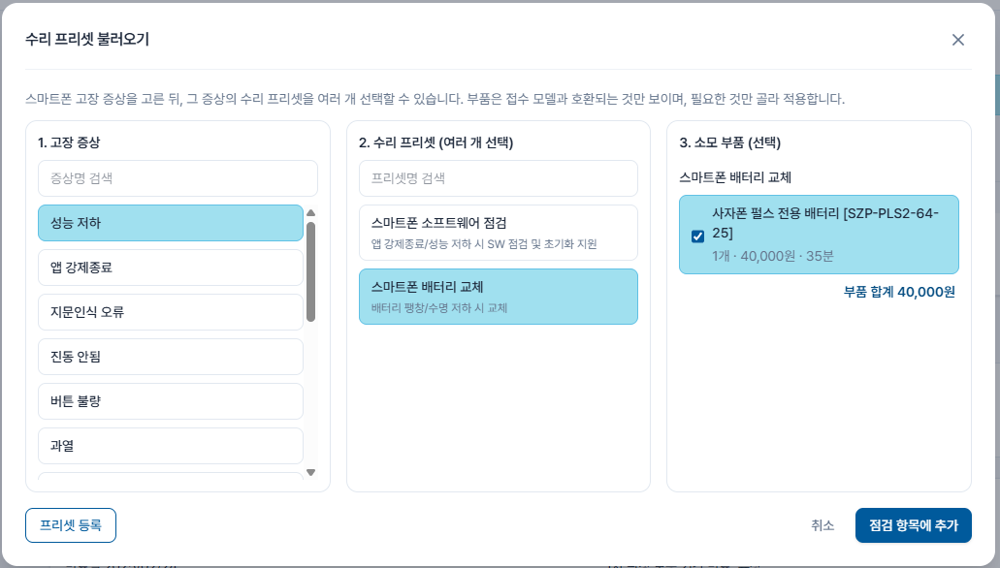

**출력 데이터 항목 (Output Data)**

- 고장 증상 목록, 연결 수리 프리셋, 부품명·코드·수량·단가·금액, 예상 수리비 합계

**입력 데이터 항목 (Input Data)**

- 증상 검색 및 선택, 프리셋 선택, 부품

**화면 제어 및 동작 규칙 (Behavior Rules)**

- 증상 선택 시 연관 프리셋을 표시한다.

- 적용하면 점검 항목에 반영하고 취소하면 반영하지 않는다.

##### 1.3.3.4 A/S 진행 상세 · 수리 (/as/{repairId}/repair)

접근 권한: 관리자 · 수리기사(담당 건)

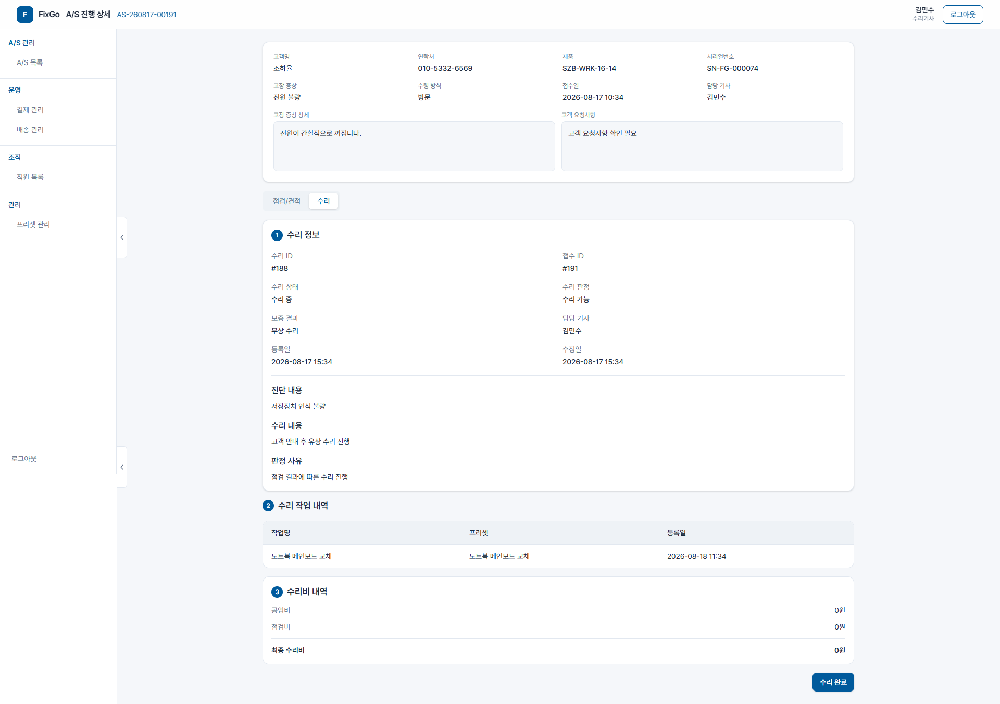

**출력 데이터 항목 (Output Data)**

- 접수 요약

- 수리 작업 내역: 작업명, 프리셋, 등록일

- 사용 부품

- 현재 수리 상태 안내

- 수리 상태, 보증 결과, 진단 내용, 수리 내용, 작업 항목별 비용 및 최종 수리비

**입력 데이터 항목 (Input Data)**

- 수리 시작

- 작업과 부품 추가

- 수리 완료, 또는 반환 시 배송·수령 대기로 전환

**화면 제어 및 동작 규칙 (Behavior Rules)**

- 고객이 견적을 승인했거나 무상 수리가 확정된 뒤에 수리를 시작할 수 있다.

- 수리 시작은 상태를 수리 중으로 바꾼다.

- 수리 완료 때 사용 부품의 재고를 차감한다.

- 견적이 거부된 건은 수리 작업을 진행할 수 없다.

- 유상 수리 완료는 결제 단계로, 무상 또는 반환 처리 건은 수령 방식에 따른 배송 대기·수\
  령 대기로 이어진다.

---

#### 1.3.4 프리셋 관리

##### 1.3.4.1 고장 증상 프리셋 (/preset/list)

접근 권한: 관리자 · 수리기사

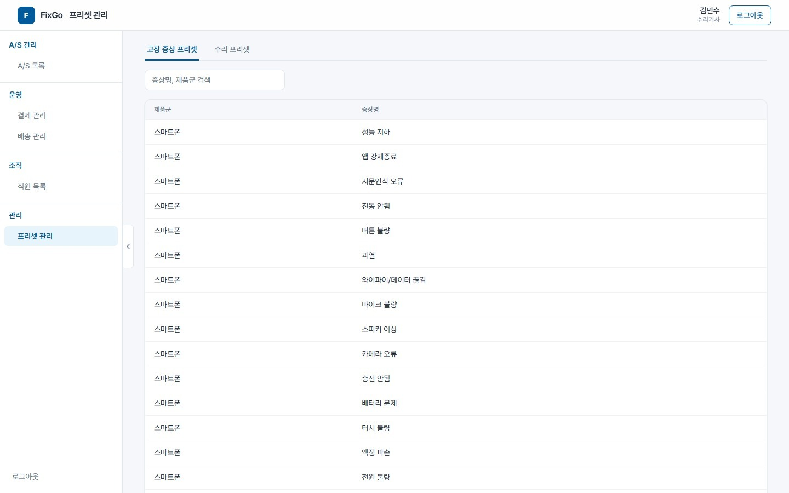

**출력 데이터 항목 (Output Data)**

- 제품군, 증상명

**입력 데이터 항목 (Input Data)**

- 증상명 검색

- 증상 등록, 수정, 삭제

**화면 제어 및 동작 규칙 (Behavior Rules)**

- 프리셋 관리 화면에서 증상 목록으로 전환해 조회하고 수정한다.

- 접수 등록의 증상 선택에서 이 프리셋을 사용한다.

---

#### 1.3.5 고객 관리

##### 1.3.5.1 고객 관리 (/customer)

접근 권한: 관리자 · 접수담당자

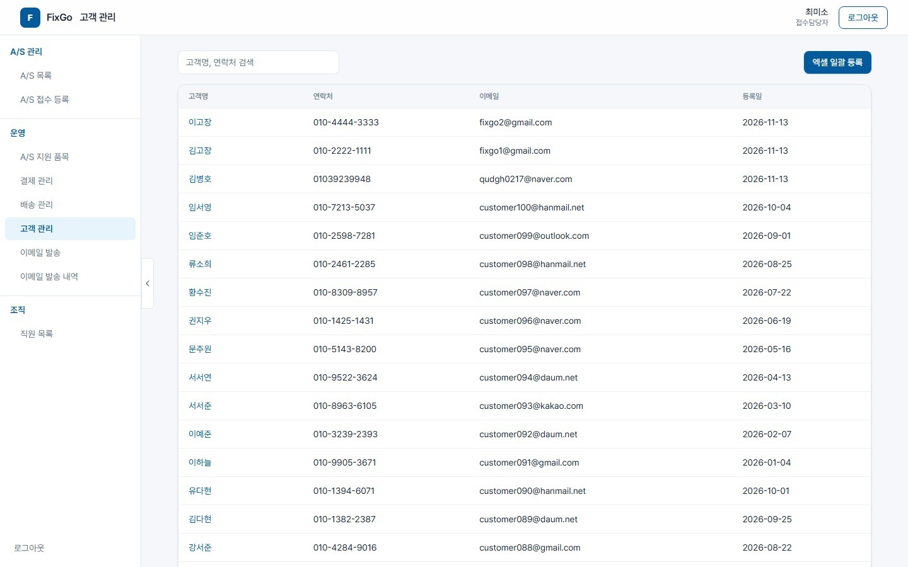

**출력 데이터 항목 (Output Data)**

- 고객명, 연락처, 이메일, 등록일

- 한 페이지 20건과 페이지 이동

**입력 데이터 항목 (Input Data)**

- 고객명, 연락처 검색

- 엑셀 일괄 등록

**화면 제어 및 동작 규칙 (Behavior Rules)**

- 등록된 고객을 조회한다.

- 검색어를 입력하면 이름 또는 연락처가 맞는 고객만 보여 준다.

- 행을 누르면 해당 고객 상세 페이지로 이동한다.

- 액셀 일괄 등록 버튼 클릭 시 고객 엑셀 일괄 등록 모달이 열린다.

##### 1.3.5.2 고객 엑셀 일괄 등록 (모달)

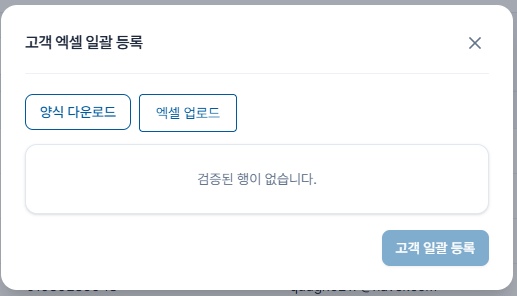

**출력 데이터 항목 (Output Data)**

- 양식 다운로드

- 검증 결과: 등록 가능 건수, 오류 건수, 행별 사유

- 등록 결과: 성공 건수, 실패 건수

**입력 데이터 항목 (Input Data)**

- 엑셀 파일 선택

- 검증

- 고객 일괄 등록

**화면 제어 및 동작 규칙 (Behavior Rules)**

- 엑셀 일괄 등록 버튼 클릭 시 해당 모달이 열린다.

- 엑셀에 데이터를 입력하여 업로드를 하고 고객 일괄 등록 버튼 클릭시 고객이 등록 된\
  다.

- 등록 가능한 고객이 없으면 저장하지 않는다.

##### 1.3.5.3 고객 상세 및 수정

customer/{customerId}

접근 권한: 관리자 · 접수담당자

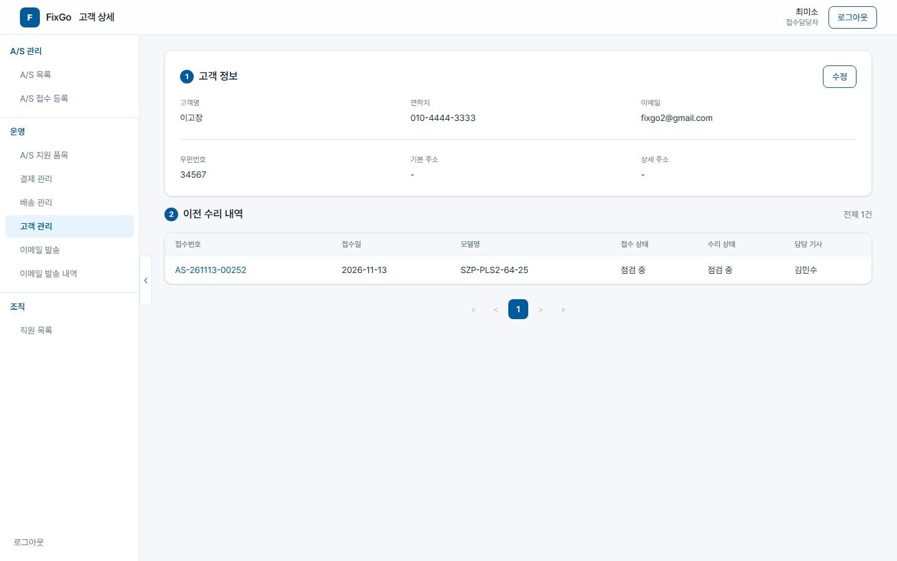

**출력 데이터 항목 (Output Data)**

- 고객명, 연락처, 이메일, 우편번호, 기본 주소, 상세 주소

- 이 고객의 접수: 접수번호, 접수일, 모델명, 접수 상태, 수리 상태, 담당 기사

**입력 데이터 항목 (Input Data)**

- 이름, 연락처, 이메일, 기본 주소, 상세 주소

- 우편번호 찾기. 우편번호 칸은 직접 수정하지 않는다.

- 저장

**화면 제어 및 동작 규칙 (Behavior Rules)**

- 고객 정보와 과거 접수를 함께 보여 준다.

- 저장하면 고객 정보를 수정한다.

- 접수 행에서 해당 A/S 상세로 이동할 수 있다.

- 관리자와 접수담당자가 사용할 수 있다.

#### 1.3.6 결제 관리

##### 1.3.6.1 결제 관리 (/payment/list)

접근 권한: 관리자 · 접수담당자 · 수리기사

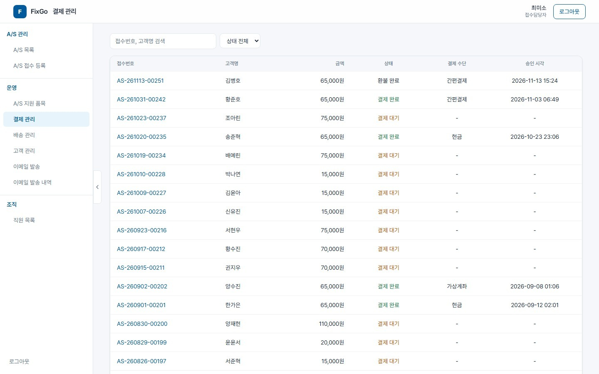

**출력 데이터 항목 (Output Data)**

- 접수번호, 고객명, 금액, 상태, 결제 수단, 승인 시각

- 한 페이지 20건과 페이지 이동

**입력 데이터 항목 (Input Data)**

- 접수번호, 고객명 검색

- 상태 필터: 전체, 결제 대기, 입금 대기, 결제 완료, 환불 완료 등 청구 상태

**화면 제어 및 동작 규칙 (Behavior Rules)**

- 청구와 결제 결과를 조회한다.

- 행을 누르면 해당 결제 상세 페이지로 이동한다.

- 현금 결제와 환불 처리는 상세 화면에서 한다.

##### 1.3.6.2 결제 상세 · 현금 결제 및 환불 (/payment/{billId})

접근 권한: 관리자 · 접수담당자 · 수리기사

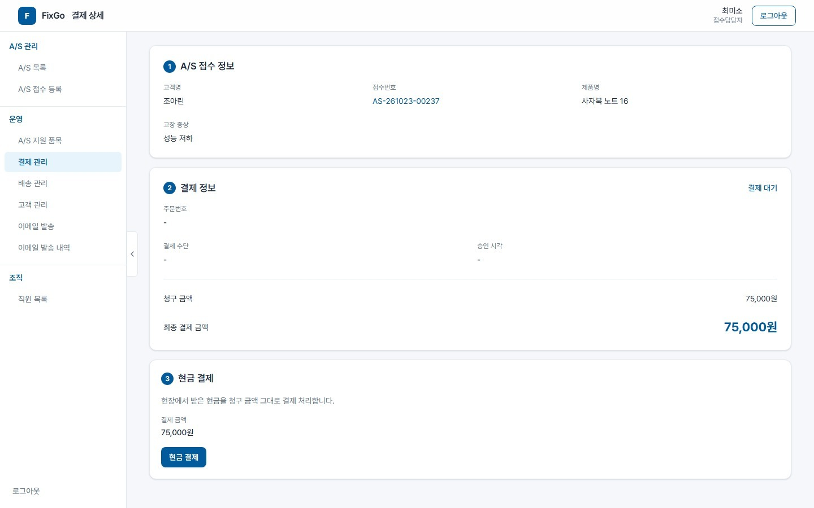

**출력 데이터 항목 (Output Data)**

- 접수번호, 고객, 청구 금액, 결제 상태, 결제 수단, 승인 시각

- 환불 정보: 환불 금액, 환불 상태, 환불 사유, 환불 시각

- 가상계좌가 있으면 계좌 정보

- 결제 기본 정보의 제품명·고장 증상, 주문번호, 결제 및 환불 이력

**입력 데이터 항목 (Input Data)**

- 현금 결제 확인

- 환불 사유

- 가상계좌 환불일 때 은행, 계좌번호, 예금주

**화면 제어 및 동작 규칙 (Behavior Rules)**

- 미결제이고 진행 중인 결제나 입금 대기가 없을 때만 현금 결제를 받는다. 금액은 청구\
  금액 그대로다.

- 발급된 가상계좌가 있으면 현금을 받을 수 없고, 가상계좌를 먼저 취소해야 한다.

- 환불은 사유가 있어야 한다. 가상계좌 환불은 은행, 계좌번호, 예금주가 필요하다.

- 현금 결제와 환불은 확인 뒤에만 실행한다.

- 현금 처리와 환불은 관리자와 접수담당자가 한다.

- 환불은 전액 환불을 요청한다. 현금 결제는 청구 금액 전액으로 처리한다.

---

#### 1.3.7 배송 및 방문 수령 관리

##### 1.3.7.1 배송 및 방문 수령 목록 (/shipment/list)

접근 권한: 관리자 · 접수담당자 · 수리기사

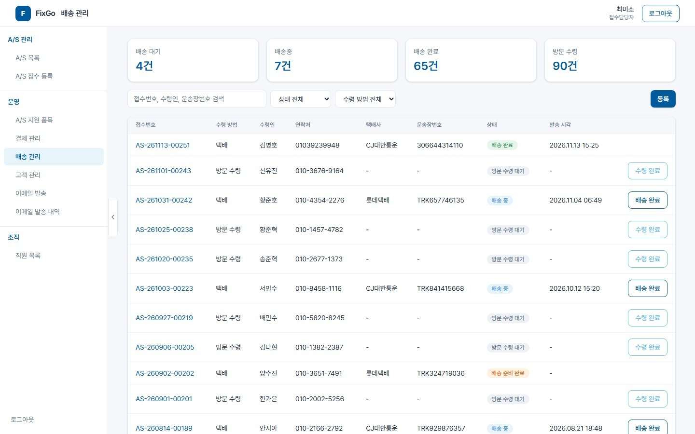

**출력 데이터 항목 (Output Data)**

- 배송 현황: 배송 대기, 배송 중, 배송 완료, 방문 수령 건수

- 배송 목록: 접수번호, 수령 방법, 수령인, 연락처, 택배사, 운송장번호, 배송 상태, 발송\
  시각

- 배송 상태: 배송 등록 대기, 배송 준비 완료, 배송 중, 배송 완료, 방문 수령 대기, 방문 수\
  령 완료

- 한 페이지 20건과 페이지 이동

**입력 데이터 항목 (Input Data)**

- 검색: 접수번호, 수령인, 운송장번호

- 상태 필터: 전체, 배송 등록 대기, 배송 준비 완료, 배송 중, 배송 완료, 방문 수령 대기,\
  방문 수령 완료

- 수령 방법 필터: 전체, 택배, 방문 수령

- 등록 버튼

- 배송 완료 버튼

- 수령 완료 버튼

**화면 제어 및 동작 규칙 (Behavior Rules)**

- 택배 배송과 방문 수령 내역을 하나의 목록에서 조회한다.

- 검색, 배송 상태 및 수령 방법을 기준으로 조건별 조회가 가능하다.

- 목록의 행을 클릭하면 해당 배송 또는 방문 수령 상세 모달을 표시한다.

- 등록 버튼을 클릭하면 배송 등록 모달을 표시한다.

- 이미 배송 내역이 등록된 접수는 신규 배송 등록 대상에서 제외한다.

- 배송 중인 택배 건에는 배송 완료 버튼을 표시한다.

- 방문 수령 대기 건에는 수령 완료 버튼을 표시한다.

- 배송 알림, 배송 조회 및 운송장 수정은 배송 상세 모달에서 처리한다.

- 관리자와 접수담당자는 배송 등록 및 상태 변경이 가능하며, 수리기사는 목록과 상세 정\
  보를 조회할 수 있다.

- 배송 완료 또는 방문 수령 완료 처리 시 A/S 접수 상태를 완료로 변경하고 상태 변경 이\
  력을 저장한다.

##### 1.3.7.2 배송 등록 (모달)

접근 권한: 관리자 · 접수담당자

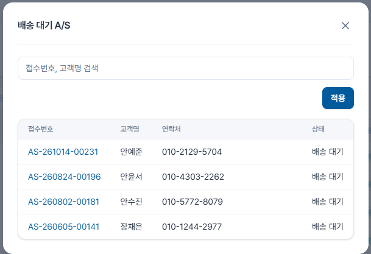 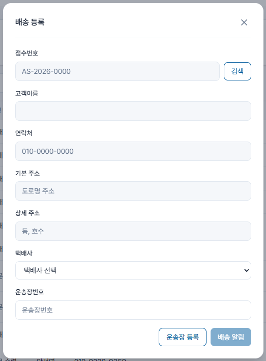

**출력 데이터 항목 (Output Data)**

- 배송 등록 대상 목록: 접수번호, 고객명, 연락처, 접수 상태

- 선택한 접수 정보: 접수번호, 수령인, 연락처, 기본 주소, 상세 주소

**입력 데이터 항목 (Input Data)**

- 접수번호 및 고객명 검색

- 배송 등록 대상 선택

- 택배사 선택

- 운송장번호 입력

- 운송장 등록 버튼

**화면 제어 및 동작 규칙 (Behavior Rules)**

- 배송 등록 모달에서 배송 대기 상태인 A/S 접수를 검색한다.

- 택배 배송 방식으로 접수된 건 중 배송 내역이 등록되지 않은 건만 검색 대상으로 표시한\
  다.

- 접수번호 또는 고객명을 기준으로 배송 등록 대상을 검색할 수 있다.

- 검색 버튼을 누르면 배송 등록 대상만 조회된다.

- 적용을 클릭하면 해당 접수번호, 수령인, 연락처 및 주소 정보를 자동으로 표시한다.

- 택배사와 운송장번호를 입력한 후 운송장을 등록한다.

- 동일한 A/S 접수에 배송 내역을 중복 등록할 수 없다.

- 운송장 등록이 완료되면 배송 상태를 배송 준비 완료(READY)로 설정한다.

- 운송장 등록과 배송 시작 알림은 별도의 기능으로 처리한다.

- 등록 완료 시 모달을 닫고 배송 목록을 갱신한다.

##### 1.3.7.3 배송 및 방문 수령 상세 (모달)

접근 권한: 관리자 · 접수담당자 · 수리기사

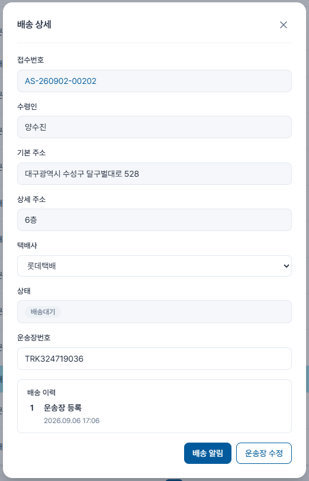 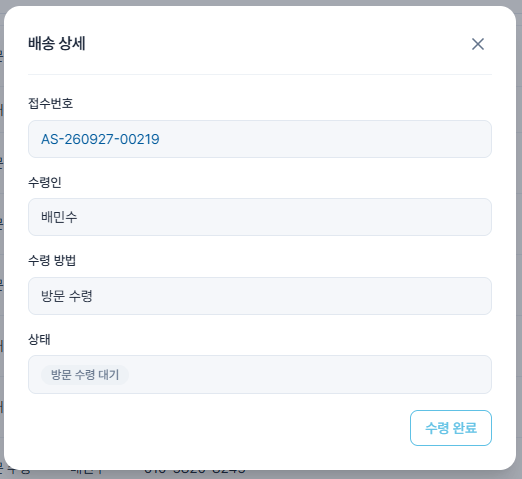 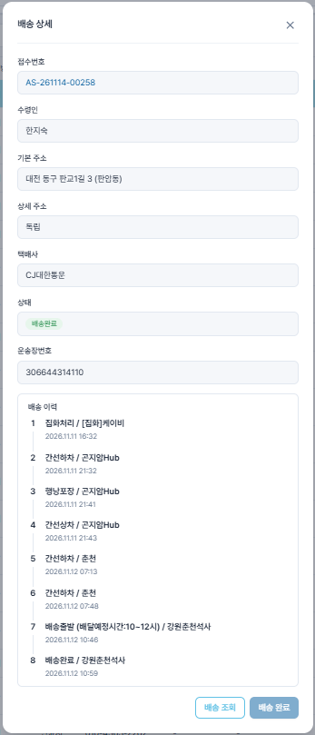

**출력 데이터 항목 (Output Data)**

- 접수 정보: 접수번호

- 수령 정보: 수령인, 연락처, 기본 주소, 상세 주소

- 배송 정보: 택배사, 운송장번호, 현재 배송 상태, 발송 시각

- 배송 조회 결과: 스마트택배(SweetTracker) API에서 조회한 최신 배송 정보

- 배송 이력: 처리 단계, 처리 내용, 발생 일시

- 방문 수령 정보: 수령 상태, 수령 완료 일시

**입력 데이터 항목 (Input Data)**

- 배송 알림 버튼

- 운송장 수정 버튼

- 배송 조회 버튼

- 배송 완료 버튼

- 수령 완료 버튼

**화면 제어 및 동작 규칙 (Behavior Rules)**

- 배송 목록에서 선택한 접수의 배송 또는 방문 수령 정보를 표시한다.

- 택배 배송은 택배사, 운송장번호 및 배송 이력을 표시하고, 방문 수령은 수령 정보와 수\
  령 상태를 표시한다.

- 배송 준비 완료 상태에서는 운송장 수정 및 배송 알림 기능을 제공한다.

- 배송 중 상태에서는 배송 조회 및 배송 완료 기능을 제공한다.

- 배송 완료 상태에서는 배송 상세 정보 및 배송 이력을 조회할 수 있다.

- 방문 수령 대기 상태에서는 수령 완료 기능을 제공한다.

- 방문 수령 완료 상태에서는 수령 완료 정보만 조회할 수 있다.

- 배송 조회 버튼 클릭 시 스마트택배(SweetTracker) API를 이용하여 최신 배송 상태 및\
  배송 이동 이력을 조회한다.

- 수리기사는 상세 정보를 읽기 전용으로 조회하며, 배송 등록, 운송장 수정, 배송 알림 및\
  완료 처리는 할 수 없다.

##### 1.3.7.4 운송장 정보 수정 (모달)

접근 권한: 관리자 · 접수담당자

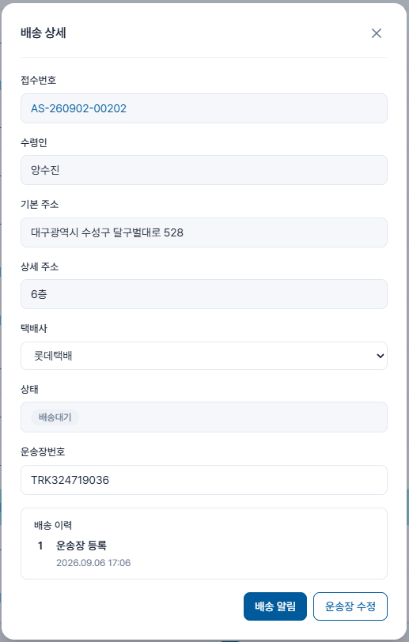

**출력 데이터 항목 (Output Data)**

- 기존 택배사 및 운송장번호

- 접수번호, 수령인, 연락처, 주소

- 현재 배송 상태

**입력 데이터 항목 (Input Data)**

- 변경할 택배사

- 변경할 운송장번호

- 저장 및 취소 버튼

**화면 제어 및 동작 규칙 (Behavior Rules)**

- 배송 준비 완료(READY) 상태에서만 운송장 정보를 수정할 수 있다.

- 기존 택배사와 운송장번호를 수정 입력란에 표시한다.

- 택배사 및 운송장번호만 수정할 수 있으며, 수령인과 연락처, 주소 등 기존 수령 정보는\
  읽기 전용으로 유지한다.

- 수정 완료 시 변경된 운송장 정보를 저장하고 배송 상세 및 목록에 반영한다.

- 배송이 시작된 이후에는 운송장 정보를 수정할 수 없다.

- 취소 버튼 클릭 시 변경 내용을 저장하지 않고 이전 화면으로 돌아간다.

##### 1.3.7.5 배송 시작 및 배송 알림(모달)

접근 권한: 관리자 · 접수담당자

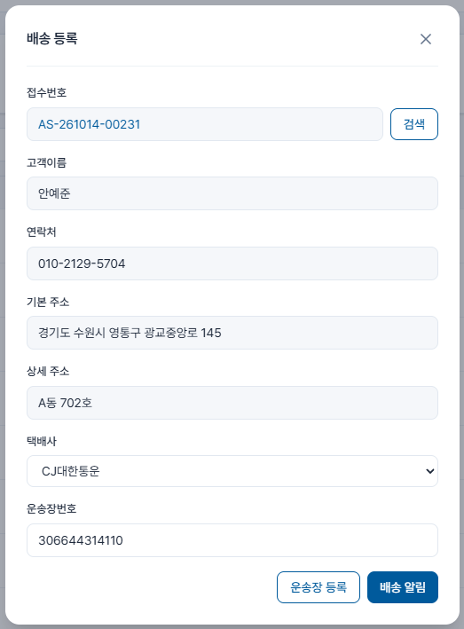

**출력 데이터 항목 (Output Data)**

- 접수번호, 수령인, 택배사, 운송장번호

- 현재 배송 상태

- 배송 시작 및 이메일 발송 결과

**입력 데이터 항목 (Input Data)**

- 배송 알림 버튼

**화면 제어 및 동작 규칙 (Behavior Rules)**

- 배송 준비 완료(READY) 상태에서 배송 알림 기능을 사용할 수 있다.

- 배송 알림 버튼 클릭 시 배송 상태를 배송 중(SHIPPING)으로 변경하고 발송 시각을 기\
  록한다.

- 고객 이메일로 배송 시작 안내를 발송한다.

- 배송 안내 이메일에는 택배사, 운송장번호 및 배송 조회 링크를 포함한다.

- 이메일 발송 결과는 이메일 발송 내역에 저장한다.

- 배송 시작 처리 후 변경된 배송 상태와 발송 시각을 배송 목록 및 상세에 반영한다.

- 이미 배송이 시작된 건은 중복으로 배송 시작 처리할 수 없다.

##### 1.3.7.6 배송 조회 및 배송·수령 완료 처리

접근 권한: 관리자 · 접수담당자

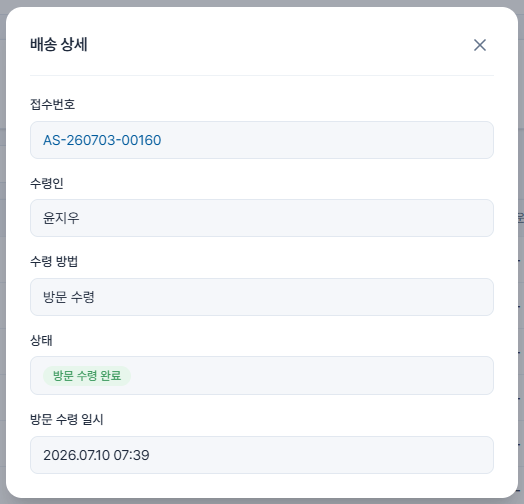 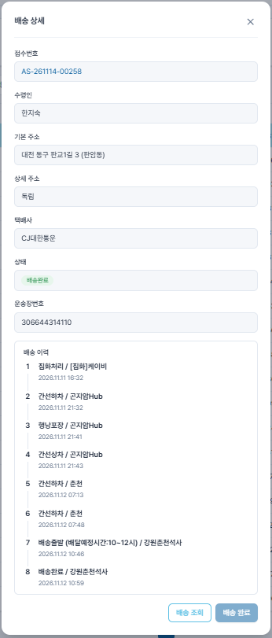

**출력 데이터 항목 (Output Data)**

- 접수 정보: 접수번호, 수령인, 수령 방법

- 배송 정보: 택배사, 운송장번호, 현재 배송 상태, 발송 시각

- 배송 조회 결과: 최신 배송 상태 및 배송 완료 여부

- 배송 이력: 배송 단계, 처리 내용, 처리 위치, 발생 일시

- 방문 수령 정보: 수령 상태, 수령 완료 일시

**입력 데이터 항목 (Input Data)**

- 배송 조회 버튼

- 배송 완료 버튼

- 수령 완료 버튼

**화면 제어 및 동작 규칙 (Behavior Rules)**

- 배송 조회: 배송 조회 버튼 클릭 시 등록된 택배사 코드와 운송장번호를 이용하여 스마트\
  택배(SweetTracker) API를 호출하고, 최신 배송 상태 및 상세 배송 이력을 갱신한다.

- 자동 배송 상태 갱신: Spring Scheduler를 통해 배송 중(SHIPPING)인 배송 내역을\
  매일 오전 10시에 자동으로 조회하고 배송 상태 및 배송 이력을 갱신한다.

- 자동 배송 완료: 스마트택배 API 조회 결과가 배송 완료(complete = true, level = 6)\
  인 경우 배송 상태를 배송 완료(DELIVERED)로 자동 변경한다.

- 수동 배송 완료: 배송 중(SHIPPING)인 건은 담당자가 배송 완료 버튼을 클릭하여 수동\
  으로 배송 완료 처리할 수 있다.

- 방문 수령 완료: 방문 수령 대기 상태에서 고객이 제품을 수령하면 수령 완료 버튼을 클\
  릭하여 방문 수령 완료(PICKED_UP)로 변경하고 수령 완료 일시를 기록한다.

- A/S 상태 연계: 자동 또는 수동 배송 완료 및 방문 수령 완료 처리 시 해당 A/S 접수 상\
  태를 완료(COMPLETED)로 변경한다.

- 상태 변경 이력 관리: 변경 전 상태, 변경 후 상태, 변경 일시, 변경자 및 변경 사유를 A/S\
  상태 변경 이력에 저장한다.

- 중복 처리 방지: 동일한 배송 이벤트는 고유 키(eventKey)를 기반으로 중복 저장을 방\
  지하며, 이미 완료된 배송 및 방문 수령 건은 중복으로 완료 처리할 수 없다.

- 조회 실패 처리: 배송 조회 실패 시 오류 내용을 기록하고 기존 배송 상태를 유지한다. 특\
  정 배송 건의 자동 조회가 실패하더라도 나머지 배송 건의 조회는 계속 진행한다.

- 화면 갱신: 배송 조회 및 완료 처리 결과를 배송 목록, 배송 상세 및 A/S 접수 상세에 반\
  영한다.

---

#### 1.3.8 이메일 알림 관리

##### 1.3.8.1 이메일 발송 · 프리셋 · 발송 통계 (/notification)

접근 권한: 관리자 · 접수담당자

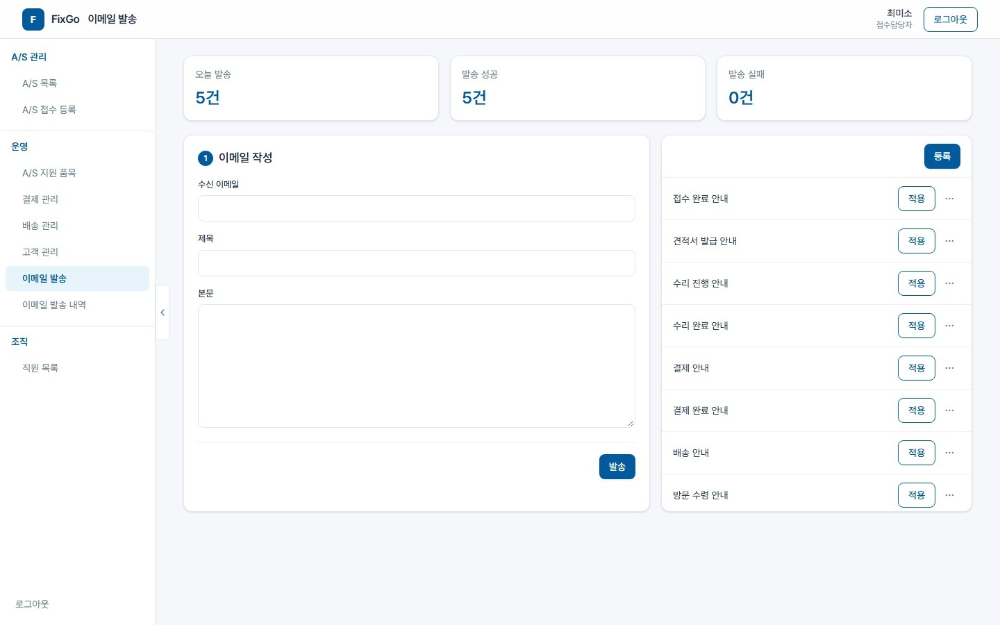

**출력 데이터 항목 (Output Data)**

- 오늘 발송, 발송 성공, 발송 실패 건수

- 수신 고객, 제목, 본문

- 이메일 프리셋 목록: 프리셋 제목, 메일 제목, 본문

**입력 데이터 항목 (Input Data)**

- 수신 고객 검색 및 선택

- 제목, 본문

- 프리셋 선택

- 발송

- 프리셋 등록, 수정, 삭제: 프리셋 제목, 메일 제목, 본문

**화면 제어 및 동작 규칙 (Behavior Rules)**

- 제목과 본문은 필수 입력 사항이다.

- 프리셋에 있는 적용 버튼을 누르면 제목과 본문을 채운다.

- 발송 성공과 실패 건수는 오늘 통계다. 기간별 성공·실패 조회는 이메일 발송 내역에서\
  확인할 수 있다.

- 프리셋 적용 후 제목과 본문을 수정할 수 있다.

- 등록 버튼 클릭 시 SMS 프리셋 등록 모달이 뜬다.

- 미트볼 버튼 클릭시 해당 프리셋 수정과 삭제가 뜬다.

- 수정 클릭시 SMS 프리셋 수정 모달이 뜬다.

- 삭제 클릭시 해당 SMS 프리셋이 삭제된다.

- Gmail SMTP 기반으로 이메일을 발송하고 결과를 발송 내역에 반영한다.

##### 1.3.8.2 이메일 프리셋 등록·수정·삭제

접근 권한: 관리자 · 접수담당자

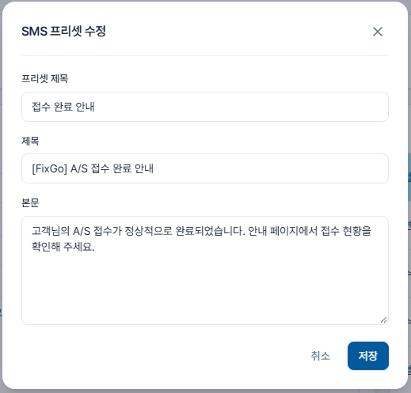

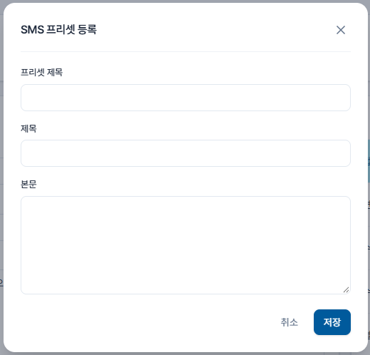

**출력 데이터 항목 (Output Data)**

- 프리셋 제목, 메일 제목, 본문, 프리셋 목록

**입력 데이터 항목 (Input Data)**

- 등록, 수정 적용

**화면 제어 및 동작 규칙 (Behavior Rules)**

- 등록·수정한 프리셋을 목록에 반영한다.

- 적용 시 이메일 작성 영역의 제목과 본문을 채운다.

##### 1.3.8.3 이메일 발송 내역 · 상세 및 재발송 (/notification/list)

접근 권한: 관리자 · 접수담당자

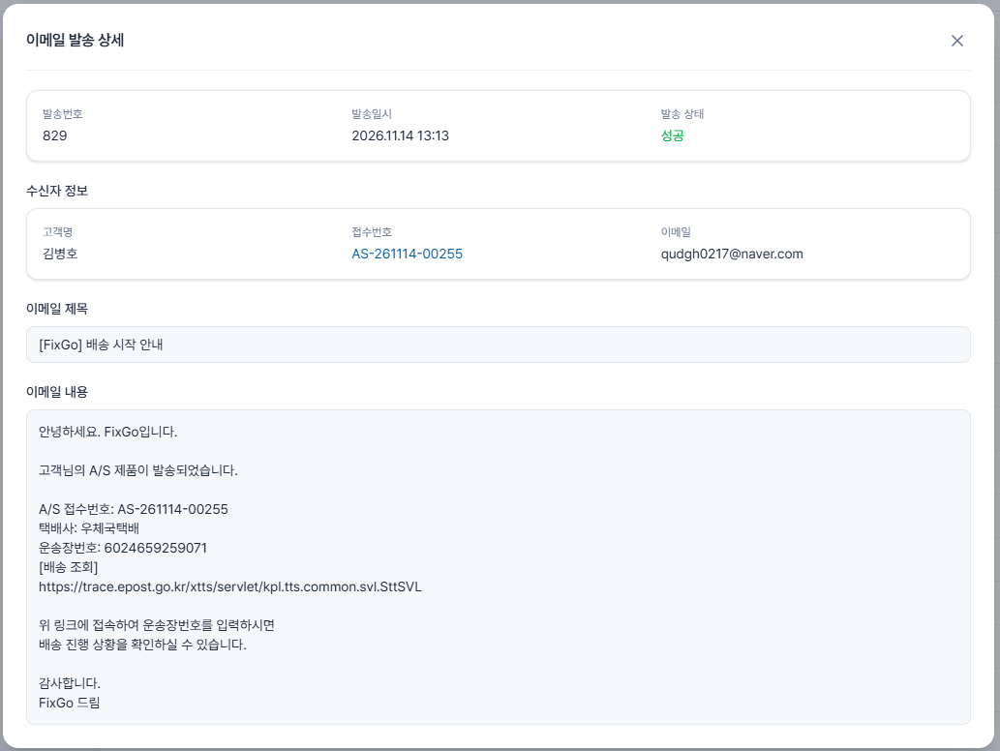 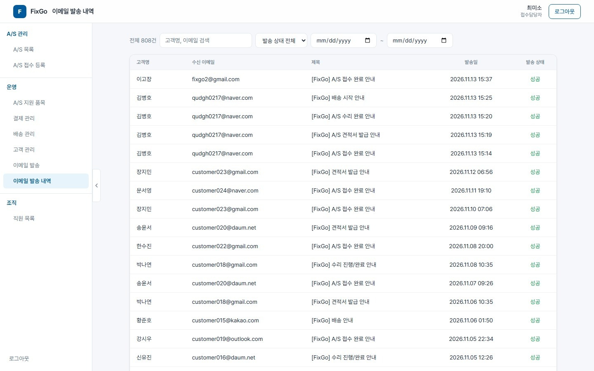

**출력 데이터 항목 (Output Data)**

- 고객명, 수신 이메일 , 제목, 발송일, 발송 상태

- 상세 모달: 수신자, 제목, 본문, 발송 시각, 발송 상태, 실패 시 실패 사유

- 조회 결과 전체 건수. 발송 상태는 성공 또는 실패로 표시.

- 한 페이지 20건과 페이지 이동

**입력 데이터 항목 (Input Data)**

- 고객명, 이메일, 제목 검색

- 시작일, 종료일

- 발송 상태: 전체, 성공, 실패

- 실패 메일의 상세에서 재발송

**화면 제어 및 동작 규칙 (Behavior Rules)**

- 이메일 상세는 해당 행을 눌렀을 때 모달로 연다.

- 상태 필터의 성공은 SENT, 실패는 FAILED로 조회한다.

- 관리자와 접수담당자가 사용할 수 있다.

- 기간과 검색, 발송 상태 조건을 함께 적용할 수 있다.

##### 1.3.8.4 이메일 발송 상세 및 실패 재발송 (모달)

접근 권한: 관리자 · 접수담당자

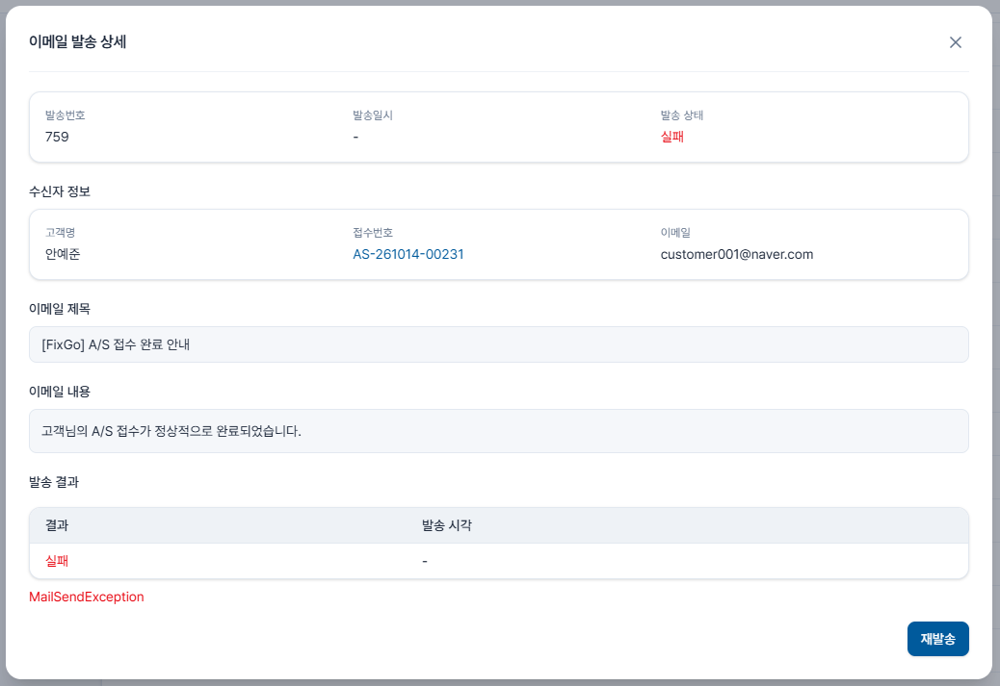

**출력 데이터 항목 (Output Data)**

- 수신자, 제목, 본문, 발송 시각, 발송 상태, 실패 사유

**입력 데이터 항목 (Input Data)**

- 목록 행 선택, 실패 건 재발송, 모달 닫기

**화면 제어 및 동작 규칙 (Behavior Rules)**

- 행을 클릭하면 상세 모달을 연다.

- 실패 상태에서만 재발송할 수 있으며 발송 결과를 내역에 반영한다.

---

#### 1.3.9 제품 및 지원 품목 관리

##### 1.3.9.1 지원 품목 · 제품 모델 및 수리 대상 제품 (/admin/products/list)

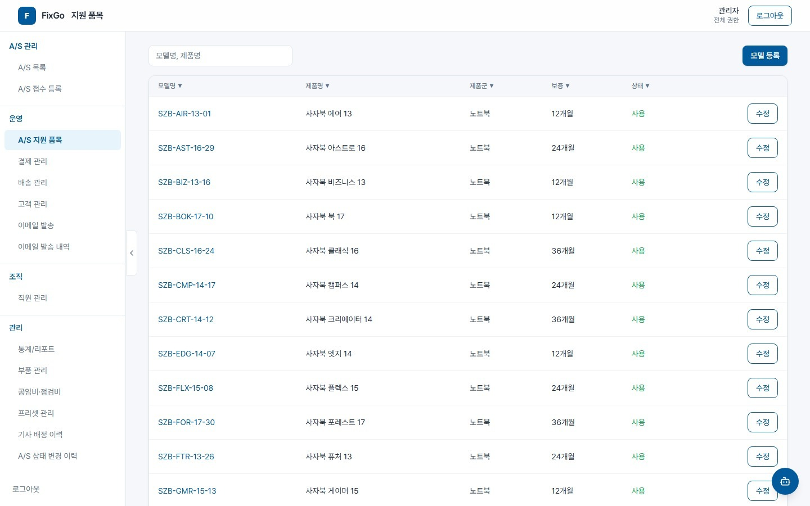 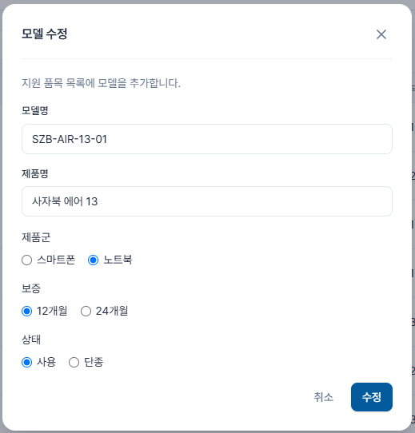

**출력 데이터 항목 (Output Data)**

- 모델명, 제품명, 제품군, 보증 개월, 상태

- 모델 상세 및 수정 모달

- 수리 대상 제품 목록: 고객, 모델, 시리얼번호, 구매일

**입력 데이터 항목 (Input Data)**

- 모델명, 제품명 검색

- 제품군 필터

- 모델 등록과 수정: 모델명, 제품명, 제품군, 보증 개월, 사용 상태

- 제품 목록 검색

**화면 제어 및 동작 규칙 (Behavior Rules)**

- 모델 목록에서 수정버튼 클릭시 수정 모달이 뜬다.

- 수리 대상 제품은 같은 지원 품목 화면의 제품 목록에서 시리얼과 구매일을 본다.

- 모델의 보증 개월은 점검 화면의 무상·유상 판정에 사용한다.

---

#### 1.3.10 부품 및 재고 관리

##### 1.3.10.1 부품 및 재고 관리 (/admin/parts/list)

접근 권한: 관리자

**출력 데이터 항목 (Output Data)**

- 번호, 부품명, 단가, 표준 작업시간, 재고, 상태

- 상태: 사용, 재고 부족, 단종

- 부품 상세 모달: 현재 재고, 단가, 입고·출고

**입력 데이터 항목 (Input Data)**

- 부품명 검색

- 상태 필터

- 부품 등록

- 단가 수정, 입고 수량, 출고 수량, 상태 변경

**화면 제어 및 동작 규칙 (Behavior Rules)**

- 행 또는 관리 버튼으로 상세 모달을 연다.

##### 1.3.10.2 부품 입고 등록(모달)

접근 권한: 관리자

**출력 데이터 항목 (Output Data)**

- 선택 부품, 현재 재고, 단가, 상태

**입력 데이터 항목 (Input Data)**

- 변동 유형, 입고 수량, 사유

**화면 제어 및 동작 규칙 (Behavior Rules)**

- 재고 변경 결과를 목록에 반영한다.

---

#### 1.3.11 공임비 및 점검비 관리 (/admin/costs)

##### 1.3.11.1 공임비 및 점검비 관리

접근 권한: 관리자

 

**출력 데이터 항목 (Output Data)**

- 공임비 표: 번호, 제품군, 금액, 적용일

- 점검비 표: 번호, 제품군, 금액, 적용일

**화면 제어 및 동작 규칙 (Behavior Rules)**

- 공임비는 10분당 금액이다.

- 행을 누르면 공임비 또는 점검비 수정 모달이 열리고, 저장하면 해당 제품군의 단가를 바\
  꾼다.

- 점검 화면의 견적 계산이 이 단가를 사용한다.

---

#### 1.3.12 직원 관리

##### 1.3.12.1 직원 목록 (/member/list)

접근 권한: 관리자 · 접수담당자 · 수리기사

**출력 데이터 항목 (Output Data)**

- 직원 목록: 이름, 이메일, 역할, 계정 상태

- 검색 및 필터: 이름·이메일 검색, 역할 필터

- 관리자에게만 계정 발급 버튼

- 관리자 화면 제목은 직원 관리, 그 외 역할의 제목은 직원 목록

- 한 페이지 20건과 페이지 이동

**입력 데이터 항목 (Input Data)**

- 검색: 이름 또는 이메일

- 역할 필터: 역할 전체, 관리자, 접수담당자, 수리기사

- 열 머리글 정렬: 이름, 이메일, 역할, 상태. 같은 열을 다시 누르면 오름차순과 내림차순\
  이 바뀐다.

- 페이지 번호, 이전, 다음, 처음, 마지막

**화면 제어 및 동작 규칙 (Behavior Rules)**

- 등록된 직원 목록을 조회한다.

- 이름 또는 이메일을 입력하면 해당 직원을 찾는다.

- 역할을 고르면 그 역할만 보여 준다.

- 계정 상태는 사용, 비활성, 삭제로 구분한다. 사용은 녹색으로 표시한다.

- 행을 누르면 직원 상세 페이지로 이동한다.

- 관리자, 접수담당자, 수리기사는 이 화면에 들어갈 수 있다.

- 계정 발급은 관리자만 할 수 있다.

- 이름·이메일 검색과 역할 필터를 함께 적용할 수 있다.

##### 1.3.12.2 직원 등록 · 계정 발급 (모달)

접근 권한: 관리자

**입력 데이터 항목 (Input Data)**

- 이메일 ,초기 비밀번호, 이름, 연락처, 주소

- 역할: 관리자, 접수담당자, 수리기사

**화면 제어 및 동작 규칙 (Behavior Rules)**

- 이메일, 초기 비밀번호, 이름, 연락처가 비어 있으면 발급하지 않는다.

- 발급에 성공하면 모달을 닫고 목록에 새 직원을 넣는다.

- 관리자만 계정 발급 버튼을 볼 수 있다.

##### 1.3.12.3 직원 상세 및 정보 수정 (/member/{memberId})

접근 권한: 관리자 · 접수담당자 · 수리기사

**출력 데이터 항목 (Output Data)**

- 직원명, 연락처, 이메일, 직원 권한, 계정 상태, 주소

- 최근 배정된 A/S: 접수번호, 고객명, 모델명, 상태

- 관리자에게 정보 수정, 직원 삭제, 역할 변경, 상태 변경

**입력 데이터 항목 (Input Data)**

- 정보 수정: 이름, 전화번호, 주소. 이메일은 읽기 전용

- 역할: 관리자, 접수담당자, 수리기사

- 상태: 사용, 비활성

- 삭제 확인: 취소, 삭제

**화면 제어 및 동작 규칙 (Behavior Rules)**

- 행에서 들어온 직원의 정보와 최근 배정 접수를 보여 준다.

- 관리자가 역할을 바꾸거나 상태를 바꾸면 바로 저장한다.

- 삭제는 확인 후에만 실행하고, 계정 상태를 삭제로 바꾼다.

- 수리기사에게 끝나지 않은 A/S가 있으면 역할 변경, 비활성, 삭제를 할 수 없다.

- 로그인한 본인의 역할이나 상태를 바꾸거나 삭제하면 로그아웃한다.

- 접수담당자와 수리기사는 상세를 볼 수 있고, 수정·삭제·역할 변경은 관리자만 한다.

- 최근 배정 목록의 접수번호를 누르면 해당 A/S 상세로 이동한다.

##### 1.3.12.4 직원 정보 수정 (모달)

접근 권한: 관리자

**출력 데이터 항목 (Output Data)**

- 기존 이름, 연락처, 주소, 읽기 전용 이메일

**입력 데이터 항목 (Input Data)**

- 이름, 전화번호, 주소, 저장·취소

**화면 제어 및 동작 규칙 (Behavior Rules)**

- 관리자만 직원 정보를 변경한다.

- 기존 정보를 입력란에 표시하며 저장 시 상세에 반영한다.

---

#### 1.3.13 통계 및 리포트

##### 1.3.13.1 통계 및 리포트 (/admin/statistics)

접근 권한: 관리자

**출력 데이터 항목 (Output Data)**

- 기간 안의 접수 건수, 처리 완료 건수, 완료율

- 장기 미처리 건수와 21일 이상 건수

- 평균 수리 기간

- 미입금 건수, 수납, 환불, 순수납, 총 입금액

- 월별 접수·완료 추이, 월별 수익

- 배송 현황 요약, 기사별 처리 요약, 모델별 고장 건수 요약

**입력 데이터 항목 (Input Data)**

- 기간: 이번 달, 지난 달, 최근 3개월 등 미리 정한 기간과 직접 입력 시작일·종료일

**화면 제어 및 동작 규칙 (Behavior Rules)**

- 시작일이 종료일보다 늦으면 조회하지 않는다.

- 카드를 누르면 해당 상세 통계로 이동한다.

- 요청 목록의 접수 통계와 결제 통계는 대시보드와 상세 화면으로 나뉘어 있다.

##### 1.3.13.2 기사별 수리 현황 (/admin/statistics/technicians)

접근 권한: 관리자

**출력 데이터 항목 (Output Data)**

- 기사명, 배정 건수, 완료 건수, 평균 처리 시간

**입력 데이터 항목 (Input Data)**

- 기간 선택

- 기사명 정렬

**화면 제어 및 동작 규칙 (Behavior Rules)**

- 선택 기간에 기사를 거친 수리 현황을 보여 준다.

- 대시보드의 기사별 처리 현황에서 이 화면으로 들어온다.

##### 1.3.13.4 제품 모델별 수리 통계 (/admin/statistics/models)

접근 권한: 관리자

**출력 데이터 항목 (Output Data)**

- 모델명, 제품군, 수리 건수

**입력 데이터 항목 (Input Data)**

- 기간 선택

- 제품군: 전체, 노트북, 스마트폰 등

**화면 제어 및 동작 규칙 (Behavior Rules)**

- 모델별 고장·수리 건수를 보여 준다.

- 행을 누르면 해당 모델의 고장 증상 통계로 이동한다.

##### 1.3.13.5 모델별 고장 증상 통계 (/admin/statistics/models/{modelId})

접근 권한: 관리자

**출력 데이터 항목 (Output Data)**

- 모델명

- 증상별 건수와 비율

**입력 데이터 항목 (Input Data)**

- 기간 선택

**화면 제어 및 동작 규칙 (Behavior Rules)**

- 한 모델에서 어떤 증상이 얼마나 나왔는지 보여 준다.

##### 1.3.13.6 결제 통계 · 기간별 수납 (/admin/statistics/repair_cost)

접근 권한: 관리자

**출력 데이터 항목 (Output Data)**

- 수리비 수납: 수납, 환불, 순수납, 현재 미입금

- 입금 대기 내역: 접수번호, 고객명, 금액, 상태

- 기간별 내역 필터: 전체, 입금, 미입금, 환불

**입력 데이터 항목 (Input Data)**

- 조회 기간 선택

- 검색: 접수번호, 고객명

- 결제 상태 필터: 전체, 입금, 미입금, 환불

- 정렬: 접수번호, 고객명, 금액, 상태, 일자

- 검색 버튼

**화면 제어 및 동작 규칙 (Behavior Rules)**

- 통계/리포트 화면에서 수리비 수납 상세 화면으로 이동한다.

- 조회 기간을 선택하면 해당 기간의 수납 금액, 환불 금액, 순수납 금액 및 결제 내역을 조\
  회한다.

- 순수납 금액은 수납 금액에서 환불 금액을 차감하여 표시한다.

- 현재 미입금 건수는 결제가 완료되지 않은 청구서를 기준으로 표시한다.

- 접수번호 또는 고객명을 입력하고 검색 버튼을 클릭하면 해당 조건에 맞는 결제 내역을\
  조회한다.

- 결제 상태 필터를 선택하면 입금, 미입금, 환불 상태에 해당하는 내역만 표시한다.

- 검색, 조회 기간 및 결제 상태 필터를 함께 적용할 수 있다.

- 테이블의 정렬 가능한 열 제목을 클릭하면 오름차순 또는 내림차순으로 정렬한다.

- 접수번호를 클릭하면 해당 A/S 접수 상세 화면으로 이동한다.

- 통계/리포트로 돌아가기를 클릭하면 통계/리포트 화면으로 이동한다.

##### 1.3.13.7 입금 대기 내역 (/admin/statistics/deposits/waiting)

접근 권한: 관리자

**출력 데이터 항목 (Output Data)**

- 접수번호, 고객명, 모델, 금액, 청구일, 경과일, 합계

**입력 데이터 항목 (Input Data)**

- 기간, 접수번호·고객명 검색, 상태 필터, 페이지 이동

**화면 제어 및 동작 규칙 (Behavior Rules)**

- 통계 대시보드의 미입금 카드에서 들어온다.

- 입금 대기 내역을 조회한다.

##### 1.3.13.8 배송 현황 통계 · 기간별 배송 내역 (/admin/statistics/shipments)

접근 권한: 관리자

**출력 데이터 항목 (Output Data)**

- 수령 방법별 건수, 상태별 건수

- 기간 내역: 접수번호, 고객명, 수령 방법, 상태, 발송 시각

**입력 데이터 항목 (Input Data)**

- 기간 선택

- 접수번호, 고객명 검색

- 수령 방법: 전체, 택배, 방문 수령

- 상태: 배송 등록 대기, 배송 준비 완료, 배송 중, 배송 완료, 방문 수령 대기, 방문 수령 완\
  료

**화면 제어 및 동작 규칙 (Behavior Rules)**

- 대시보드의 배송 현황 카드에서 들어온다.

##### 1.3.13.9 장기 미처리 접수 (/admin/statistics/incomplete)

접근 권한: 관리자

**출력 데이터 항목 (Output Data)**

- 접수번호, 고객명, 모델, 현재 상태, 담당 기사, 경과일, 마지막 상태 변경일

**입력 데이터 항목 (Input Data)**

- 접수번호, 고객명 검색

- 경과일: 전체, 14일 이상, 21일 이상

- 현재 상태 필터

- 접수번호, 경과일, 마지막 상태 변경일 정렬

**화면 제어 및 동작 규칙 (Behavior Rules)**

- 완료되지 않고 오래 머문 접수를 찾는다.

- 대시보드의 장기 미처리 카드에서 들어온다.

- 행에서 해당 접수 상세로 이동할 수 있다.

##### 1.3.13.10 기사 배정 이력 (/admin/allocation_history)

접근 권한: 관리자

**출력 데이터 항목 (Output Data)**

- 접수번호, 고객명, 모델, 구분, 이전 기사, 변경 기사, 변경자, 사유, 일시

- 구분은 최초 배정 또는 변경

**입력 데이터 항목 (Input Data)**

- 접수번호, 고객, 기사, 사유 검색

**화면 제어 및 동작 규칙 (Behavior Rules)**

- 모든 접수의 기사 배정과 변경을 시간순으로 조회한다.

- 개별 접수의 배정 이력은 접수 상세에도 있다.

- 검색 및 필터링을 할 수 있다.

##### 1.3.13.11 A/S 상태 변경 이력 (/admin/status_change_history)

접근 권한: 관리자

**출력 데이터 항목 (Output Data)**

- 접수번호, 고객명, 모델, 이전 상태, 변경 상태, 변경자, 사유, 일시

**입력 데이터 항목 (Input Data)**

- 접수번호, 고객명, 사유 검색

**화면 제어 및 동작 규칙 (Behavior Rules)**

- 모든 접수의 상태 변경을 한 목록으로 조회한다.

---

#### 1.3.14 관리자 AI 업무 도우미

##### 1.3.14.1 관리자 AI 채팅 및 대화 이력 (/admin/ai)

접근 권한: 관리자

**출력 데이터 항목 (Output Data)**

- 대화 목록: 사용자 메시지와 AI 답변

- 답변은 스트리밍으로 이어 붙인다.

**입력 데이터 항목 (Input Data)**

- 질문 입력

- 전송

- 창 열기, 닫기, 크기 조절, 위치 이동

**화면 제어 및 동작 규칙 (Behavior Rules)**

- 관리자로 로그인한 모든 업무 화면의 오른쪽 아래에 버튼이 있다.

- 질문을 보내면 이전 대화를 함께 서버로 보내고, 답변을 이어서 보여 준다.

---

#### 1.3.15 고객 포털

##### 1.3.15.1 고객 포털 · 접수 현황, 견적 승인 및 결제 (/portal/{token})

접근 권한: 유효한 토큰을 가진 고객

     

**출력 데이터 항목 (Output Data)**

- 접수 정보: 고객명, 연락처, 제품명, 증상

- 진행 단계: 접수, 점검, 수리, 결제

- A/S 한 건에 대한 전체 흐름 정보

**입력 데이터 항목 (Input Data)**

- 도달한 진행 단계 선택

- 접수증 보기 / 접수증 닫기

- 견적 상태가 승인 대기일 때 견적 승인, 견적 거부

- 미결제일 때 카드/간편결제, 가상계좌

- 가상계좌 대기일 때 가상계좌 취소

- 승인 확인: 승인 또는 거부, 닫기

**화면 제어 및 동작 규칙 (Behavior Rules)**

- 로그인 없이 토큰만으로 연다.

- 토큰이 없거나 만료되면 링크가 유효하지 않다고 보여 준다.

- 진행 목록 클릭 시 해당하는 화면으로 이동

- 아직 도달하지 않은 진행 단계는 클릭할 수 없다.

- 견적 승인은 확인 후 수리를 진행하게 하고, 견적 거부는 확인 후 점검비 결제로 넘어간\
  다고 안내한다.
