# 와이어프레임 V1

Blocked: No
구분(Phase): 기획
상태: 완료
우선순위: P0
작업기간: 2026/10/27 → 2026/10/28

# **1. 화면 설계서 (UI Wireframe)**

## **목차**

- [1. 화면 설계서 (UI Wireframe)](https://github.com/BEBC-25/23-project-ms/blob/develop/docs/02_design/03_ui_wireframe.md#1-%ED%99%94%EB%A9%B4-%EC%84%A4%EA%B3%84%EC%84%9C-ui-wireframe)
- [1.1 서비스 화면 구성 개요](https://github.com/BEBC-25/23-project-ms/blob/develop/docs/02_design/03_ui_wireframe.md#11-%EC%84%9C%EB%B9%84%EC%8A%A4-%ED%99%94%EB%A9%B4-%EA%B5%AC%EC%84%B1-%EA%B0%9C%EC%9A%94)
- [1.2 주요 화면별 명세](https://github.com/BEBC-25/23-project-ms/blob/develop/docs/02_design/03_ui_wireframe.md#12-%EC%A3%BC%EC%9A%94-%ED%99%94%EB%A9%B4%EB%B3%84-%EB%AA%85%EC%84%B8)
- [1.3 전체 화면 와이어프레임 배치도](https://github.com/BEBC-25/23-project-ms/blob/develop/docs/02_design/03_ui_wireframe.md#13-%EC%A0%84%EC%B2%B4-%ED%99%94%EB%A9%B4-%EC%99%80%EC%9D%B4%EC%96%B4%ED%94%84%EB%A0%88%EC%9E%84-%EB%B0%B0%EC%B9%98%EB%8F%84)
- [1.4 전체 화면 흐름도 및 내비게이션 구조](https://github.com/BEBC-25/23-project-ms/blob/develop/docs/02_design/03_ui_wireframe.md#14-%EC%A0%84%EC%B2%B4-%ED%99%94%EB%A9%B4-%ED%9D%90%EB%A6%84%EB%8F%84-%EB%B0%8F-%EB%82%B4%EB%B9%84%EA%B2%8C%EC%9D%B4%EC%85%98-%EA%B5%AC%EC%A1%B0)

## **1.1 서비스 화면 구성 개요**

사자전자 A/S 업무 통합관리시스템은 스마트폰 및 노트북 제품의 A/S 접수부터 점검, 견적 승인, 수리, 결제 및 제품 반환까지의 전 과정을 통합 관리하는 반응형 SPA(Single Page Application)
기반 웹 시스템이다.

직원의 효율적인 고객·제품·수리 이력 관리, 담당 기사의 체계적인 수리 업무 처리, 관리자의 실시간 A/S 현황 및 운영 통계 모니터링을 지원한다.

또한 견적 승인, 결제 확인, 고객 알림 및 배송 관리 등 반복 업무를 자동화하여 업무 효율성과 고객 서비스의 투명성을 높인다.

### **1.1.1 주요 화면 목록**

- 로그인 화면 `/login`
- 마이 페이지 `/member/me`
- 비밀번호 변경 `/member/me`
- 직원 목록 `/member/list`, 직원 상세 `/member/{memberId}`
- 고객 포탈 `/{token}`
- A/S 목록 `/as/list`
- A/S 진행 상세 (점검) `/as/{repairId}/inspection` , A/S 진행 상세 (수리) `/as/{repairId}/repair`
- 프리셋 관리 `/preset/list`
- A/S 목록 화면 `/as/list`
- A/S 접수 등록 화면 `/as/new` , A/S 접수 상세 화면 `/as/details/{asRequestId}`
- 고객 관리 `/customer` , 고객 상세 `customer/{customerId}`
- 결제 관리 `/payment/list` , 결제 상세 화면`/payment/{orderId}`
- 배송 관리 `/shipment/list`
- 알림/SMS - 알림 `/notification_service` , SMS 발송 내역 `/notification/list`
- 지원 품목 `/admin/products/list`, 부품 관리 `/admin/parts/list`
- 통계/ 리포트 `/admin/statistics`
- 입금 대기 내역 `/admin/statistics/deposits/waiting` , 기사별 수리 현황 조회 `/admin/statistics/technicians` , 제품 모델 별 수리 건수
  `/admin/statistics/models` , 모델 별 고장 증상 통계 `/admin/statistics/models/{id}`, 기간별 수리비 추이
  `/admin/statistics/repair_cost` , 장기 미처리 조회 `/admin/statistics/incomplete`
- 기사 배정 이력 `/admin/allocation_history` , A/S 상태 변경이력 `/admin/status_change_history`

## 1.2 주요 화면별 명세

### 1.2.1 직원 공통

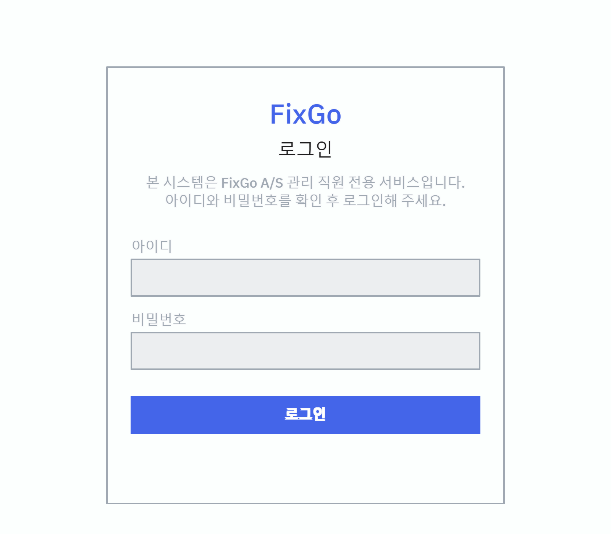

1. 로그인 화면 `/login`

- 입력 데이터 항목 (Input Data):
    - 로그인 정보: 아이디, 비밀번호
- 화면 제어 및 동작 규칙 (Behavior Rules):
    - 아이디 및 비밀번호를 통한 직원 인증
    - 인증 성공 시 A/S 목록으로 이동
    - 인증 실패 시 오류 메시지 표시

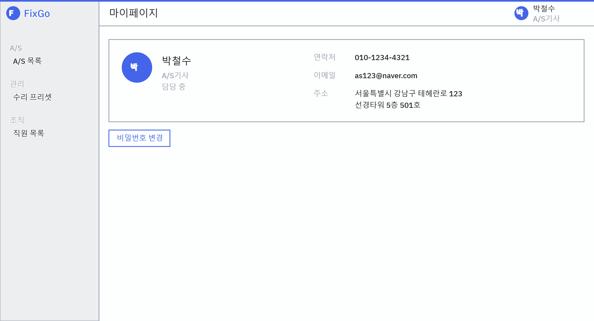

2. 마이페이지 `/member/me`

- 출력 데이터 항목 (Output Data):
    - 직원 기본 정보: 프로필 이미지, 직원명, 직책(A/S기사)
    - 직원 연락처 정보: 전화번호, 이메일, 주소
- 화면 제어 및 동작 규칙 (Behavior Rules):
    - 로그인한 직원의 기본 정보 및 연락처 정보를 조회하여 표시
    - 직원별 계정 정보에 따라 마이페이지 내용 표시
    - 비밀번호 변경 버튼 클릭 시 비밀번호 변경 화면으로 이동
    - 비밀번호 변경 시 기존 비밀번호 확인
    - 비밀번호 변경 성공 시 완료 메시지 표시

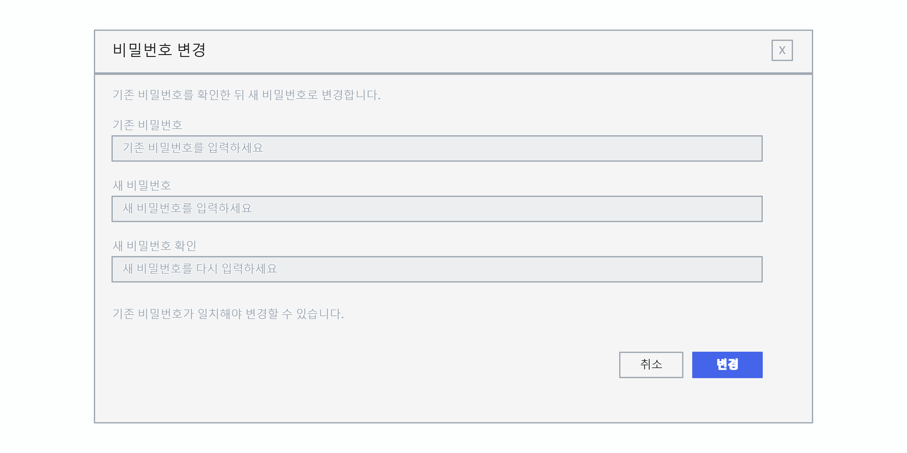
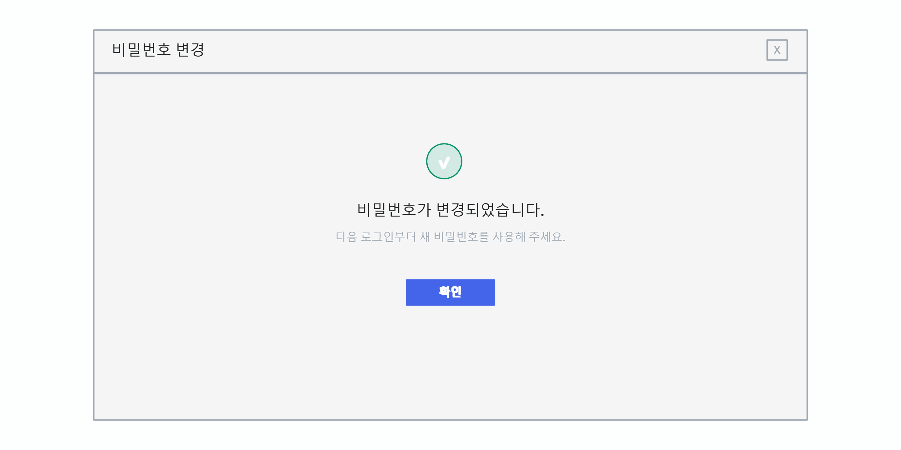

3. 비밀번호 변경 `/member/me`

- 입력데이터 항목 (Input Data):
    - 기존 비밀번호
    - 새 비밀번호 및 새 비밀번호 확인
- 화면 제어 및 동작 규칙 (Behavior Rules):
    - 변경 버튼을 눌러 변경된 비밀번호 적용
    - 취소나 x 버튼을 누르면 입력된 내용을 모두 취소하고 마이페이지로 이동
    - 확인 버튼을 누르면 현재 로그인 상태를 무효화 하고 로그인 화면으로 이동

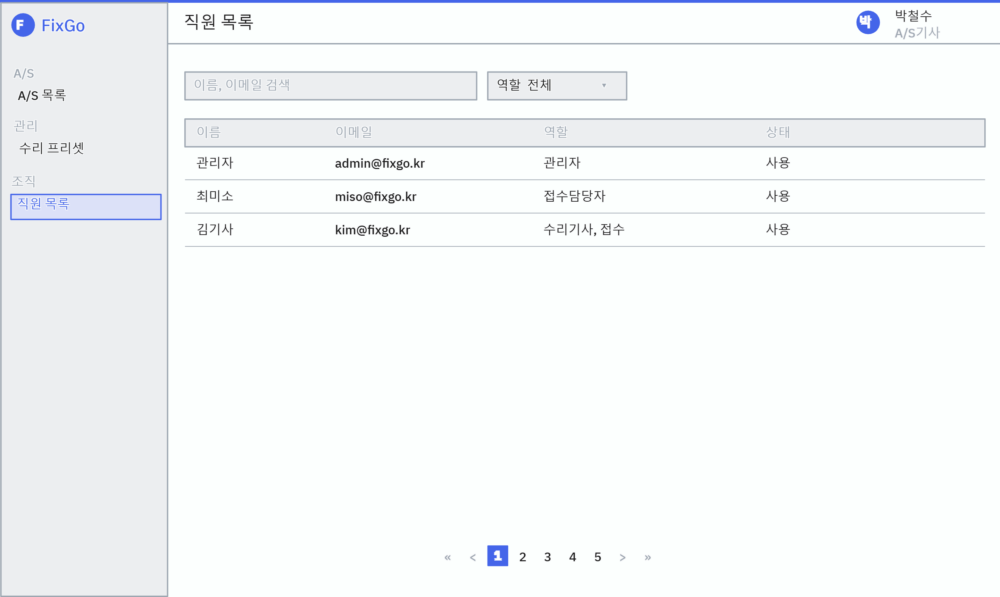

4. 직원 목록 화면 `/member/list`

- 출력 데이터 항목 (Output Data):
    - 직원 목록: 이름, 이메일, 역할, 계정 상태
    - 검색 및 필터: 이름·이메일 검색, 역할별 필터
    - 페이지네이션:  한 페이지당 20개 출력
- 입력 데이터 항목(Input Data):
    - 검색 및 필터 영역 : 이름, 이메일 검색어
    - 역할 필터 드롭다운: 전체, 관리자, 접수담당자, A/S 기사, 매니저(접수 담당자, A/S 기사 역할 모두 수행가능)
    - 페이지네이션: 페이지 번호 선택, 이전 페이지, 다음페이지 버튼, 맨 처음 페이지, 맨 마지막 페이지
- 화면 제어 및 동작 규칙 (Behavior Rules):
    - 등록된 직원 목록 조회
    - 이름 또는 이메일 입력 시 해당 직원 검색
    - 역할 선택 시 해당 역할의 직원만 필터링하여 표시
    - 직원별 역할 및 계정 사용 상태 표시
    - 접수담당자, A/S기사, 관리자, 매니저 모두 직원 목록 페이지 접근 가능

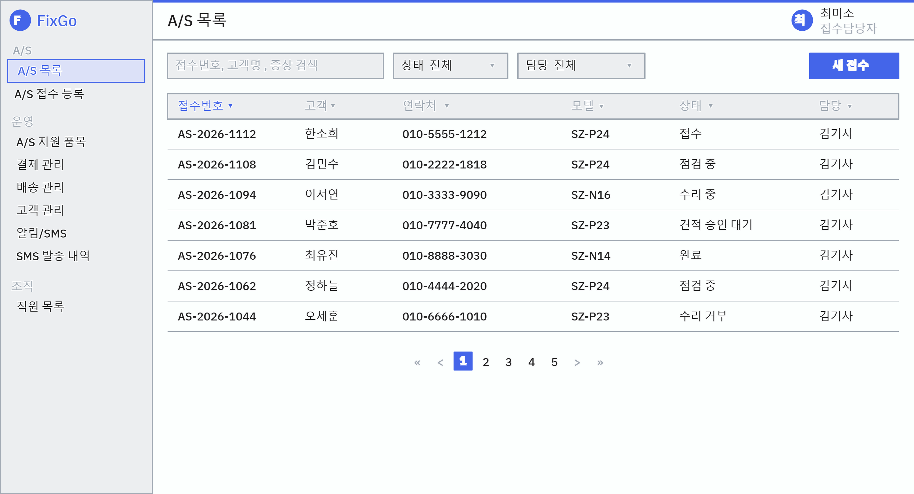
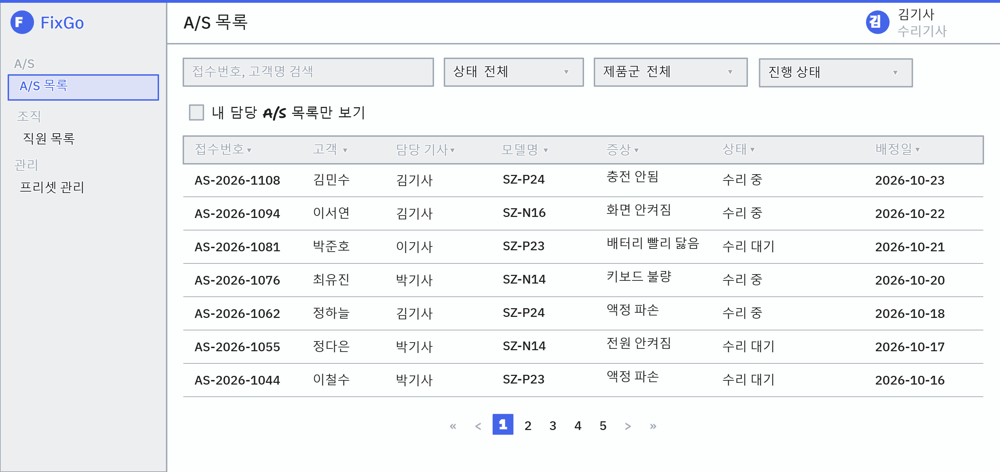

5. A/S 목록 `/as/list`

- 출력 데이터 항목 (Output Data):
    - 검색 및 필터 영역: 접수번호·고객명 검색, 상태 필터, 제품군 필터, 진행 상태 필터
    - A/S 목록: 접수번호, 고객명, 담당 기사, 모델명, 고장 증상, 진행 상태, 배정일
    - 목록 정렬: 항목 별 정렬기능 지원
- 화면 제어 및 동작 규칙 (Behavior Rules):
    - 로그인한 기사의 권한에 따라 조회 가능한 A/S 접수 건만 표시
    - 접수번호 또는 고객명 입력 시 검색 조건에 맞는 A/S 목록 조회
    - 상태 및 제품군 필터 선택 시 해당 조건에 맞는 목록 조회
    - 검색어와 여러 필터를 동시에 적용하여 목록 조회 가능
    - 정렬 기준 선택 시 해당 기준에 따라 목록 정렬
    - A/S기사의 경우 `내 담당 A/S 목록만 보기` 선택 시 로그인한 기사에게 배정된 A/S 접수 건만 조회
    - A/S 목록의 각 행 클릭 시 해당 A/S 진행 상세 페이지로 이동
    - 조회 결과가 없는 경우 안내 메시지 표시
    - 조회 결과가 여러 페이지인 경우 페이지 이동을 통해 추가 목록 조회 가능

### 1.2.2 고객용 화면

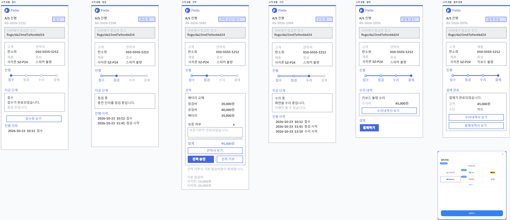

1. 고객 포탈 화면 `/{token}`

- 출력 데이터 항목 (Output Data):
    - 접수 정보: 고객명, 연락처, 제품명, 증상
    - 진행 단계: 접수, 점검, 수리, 결제
    - A/S 한 건에 대한 전체 흐름 정보
- 화면 제어 및 동작 규칙 (Behavior Rules):
    - 유효기간이 있는 링크로 접근 가능하며, A/S가 끝나면 만료
    - 견적 확인 후 수리 거부 시 점검비 결제
    - 수리 완료 시 고객 결제 가능
    - 진행 목록 클릭 시 해당하는 화면으로 이동

### **1.2.3 A/S 기사 화면**

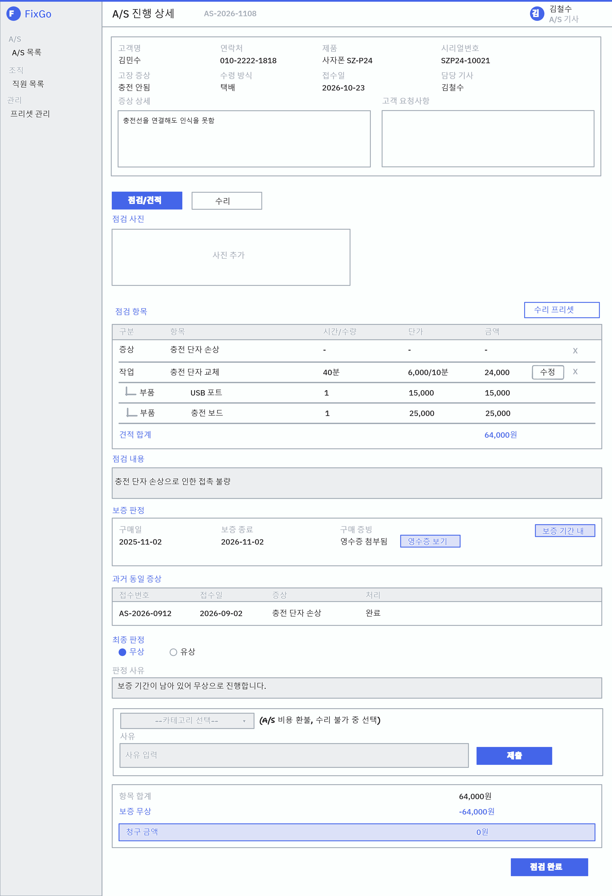

1. A/S 진행 상세 (점검) `/as/{repairId}/inspection`

- 출력 데이터 항목 (Output Data):
    - A/S 접수 정보(접수 번호, 고객명, 연락처, 제품 모델명, 시리얼 번호, 고장 증상, 수령 방식, 접수일, 담당
    - 진행 단계: 점검, 보증 현황, 견적, A/S 거부 / 불가 처리, 수리
    - 점검 정보: 점검 내용, 점검 사진
    - 수리 항목: 구분, 항목, 수리 시간/부품 갯수, 단가, 금액
    - 수리 항목 관리: 프리셋 불러오기, 수리 항목 수정/삭제
- 화면 제어 및 동작 규칙 (Behavior Rules):
    - 내 담당 A/S 에서 선택한 A/S 건의 고객, 제품 및 접수 정보 표시
    - 진행 단계별 버튼 클릭 시 해당 업무 화면으로 이동
    - 점검 내용 입력 및 수정 가능
    - 점검 사진 추가 버튼 클릭 시 이미지 업로드 가능
    - 프리셋 불러오기 버튼 클릭 시 등록된 수리 프리셋을 선택 또는 직접 입력하여 수리 항목에 추가
    - 등록된 수리 항목의 금액을 합산하여 예상 수리비 표시
    - 점검 완료 버튼 클릭 시 입력된 점검 정보 저장 및 점검 완료 처리

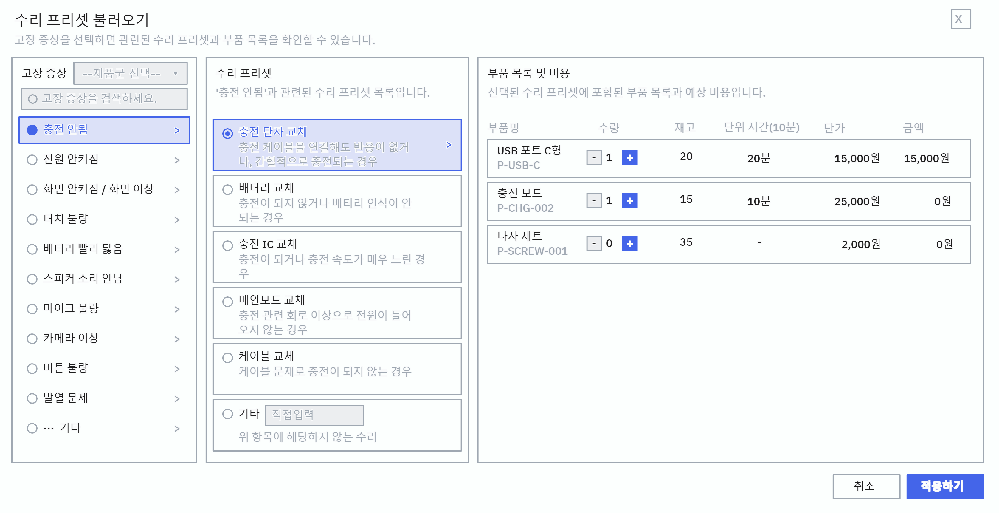
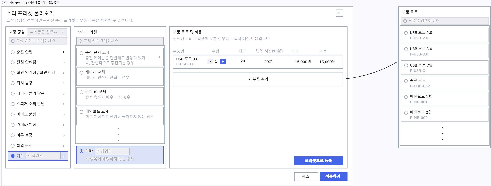

2. 수리 프리셋 불러오기(모달 이미지 수정 및 내용 추가)

- 출력 데이터 항목 (Output Data):
    - 고장 증상 목록: 고장 증상명, 증상 검색
    - 수리 프리셋 목록: 수리 프리셋명, 수리 작업 설명
    - 부품 목록 및 비용: 부품명, 부품 코드, 수량, 단가, 금액, 예상 수리비 합계
    - 선택된 수리 프리셋 정보: 선택한 수리 프리셋 명, 선택한 부품 및 수량, 예상 수리비
    - 직접 입력 영역: 작업명, 부품명, 단가, 수량
- 화면 제어 및 동작 규칙 (Behavior Rules):
    - 고장 증상 선택 시 해당 증상과 연결된 수리 프리셋 목록 표시
    - 고장 증상 검색 시 입력한 검색어에 해당하는 증상 목록 표시
    - 수리 프리셋 선택 시 연결된 부품 목록 및 예상 비용 표시
    - 부품 수량 변경 시 해당 부품 금액과 예상 수리비 자동 계산
    - 직접 입력 영역에서 수리 작업 또는 부품 항목 추가 가능
    - 추가 버튼 클릭 시 직접 입력한 항목을 부품 및 비용 목록에 반영
    - 적용하기 버튼 클릭 시 선택한 프리셋과 부품 정보를 A/S 진행 상세 화면의 수리 항목에 반영
    - 취소 또는 닫기 버튼 클릭 시 변경 사항을 적용하지 않고 모달 종료

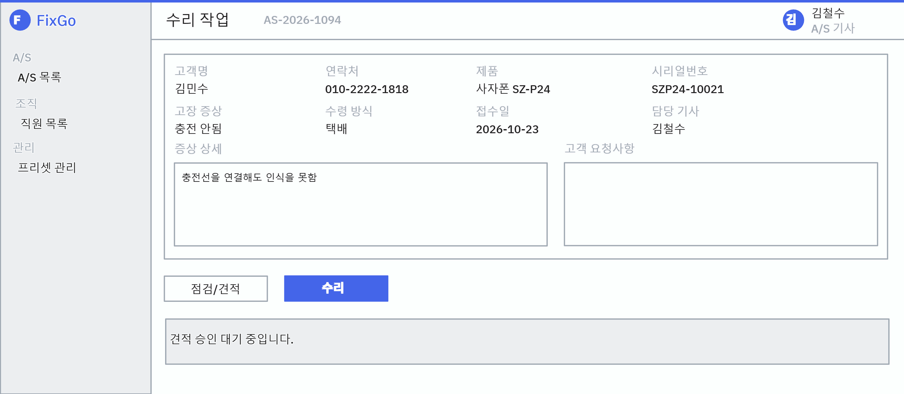

3. A/S 진행 상세 (수리 - 고객의 견적 동의 이전)  `/as/{repairId}/repair`

- 출력 데이터 항목 (Output Data):
    - 견적 승인 상태: 고객의 견적 승인 여부 및 현재 처리 상태
- 화면 제어 및 동작 규칙 (Behavior Rules):
    - 고객의 견적 승인 여부에 따라 수리 진행 가능 여부 제어
    - 견적 승인 전에는 수리 작업 진행 제한
    - 고객의 견적 거부 시 수리 진행 불가 처리

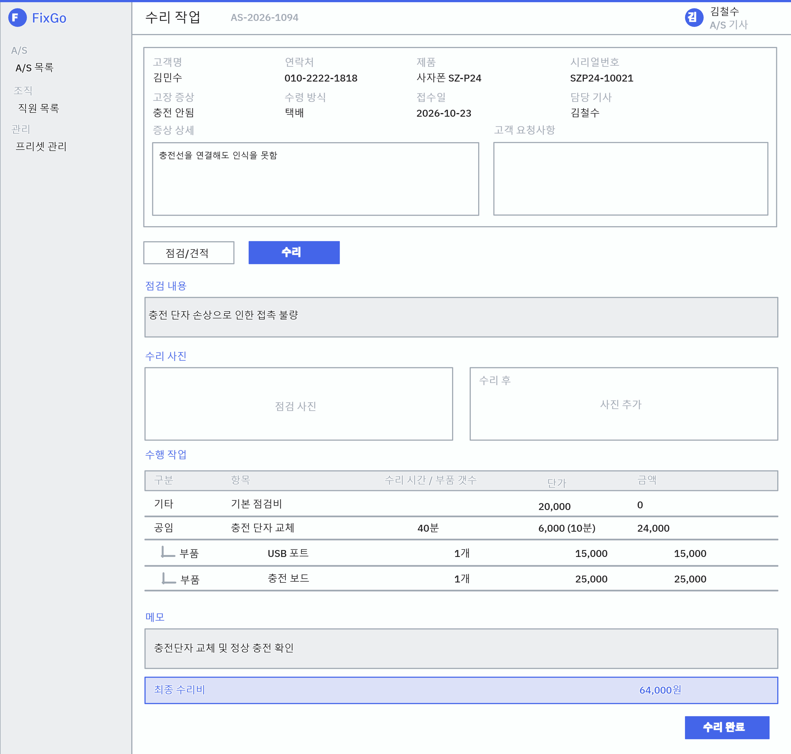

4. A/S 진행 상세 (수리 - 고객의 견적 동의 이후) `/as/{repairId}/repair`

- 출력 데이터 항목 (Output Data):
    - 수행 작업 내역: 작업 구분, 작업 항목, 수리 시간 또는 부품 개수, 단가, 금액
    - 최종 수리비: 작업 항목별 비용을 합산한 최종 금액
- 화면 제어 및 동작 규칙 (Behavior Rules):
    - 수행 작업 내역에 공임 및 부품 비용을 반영하고 항목별 금액 계산
    - 수리 작업 내역 변경 시 최종 수리비 자동 갱신
    - 수리 완료 버튼 클릭 시 해당 수리 건의 완료 처리

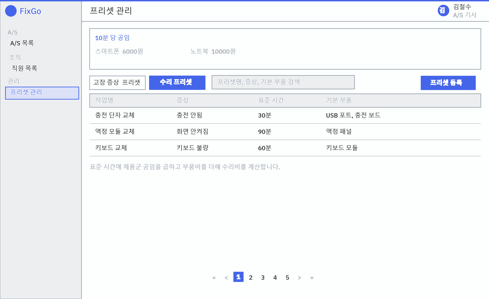

5. 프리셋 관리 `/preset/list`

- 출력 데이터 항목 (Output Data):
    - 시간당 공임: 스마트폰 공임, 노트북 공임
    - 프리셋 버튼: 고장 증상 프리셋, 수리 프리셋, 프리셋 등록
    - 프리셋 목록: 작업명, 증상, 표준 시간, 기본 부품
- 화면 제어 및 동작 규칙 (Behavior Rules):
    - 고장 증상 프리셋, 수리 프리셋 버튼으로 구분하여 조회
    - 프리셋 등록으로 새로운 프리셋 등록

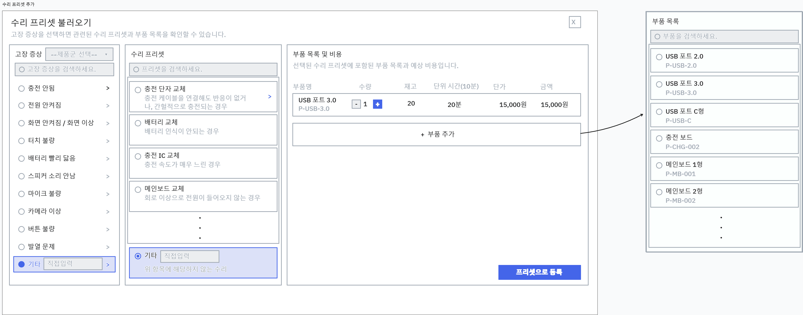

6. 프리셋 등록(모달)

- 출력 데이터 항목 (Output Data):
    - 프리셋 등록: 작업명, 증상, 표준작업시간, 사용 여부, 작업 설명, 기본 부품 및 수량
- 화면 제어 및 동작 규칙 (Behavior Rules):
    - 내용 입력 후 등록으로 새로운 프리셋 등록

### **1.2.4 접수담당자 화면**

1. A/S 목록 화면 `/as/list`

- 출력 데이터 항목 (Output Data):
    - A/S 목록: 접수 번호, 고객명, 고객 연락처, 제품 모델, 접수 상태, 담당 기사
    - 페이지네이션:  한 페이지당 20개 출력
- 화면 제어 및 동작 규칙 (Behavior Rules):
    - 접수번호, 고객명 검색
    - 접수 상태, 담당 기사 별 조회
    - 새 접수 버튼을 누르면 접수 등록 화면으로 이동
    - A/S 목록 데이터 테이블 행을 클릭 시 접수 상세 페이지로 이동
    - 페이지네이션: 페이지 번호 선택, 이전 페이지, 다음페이지 버튼, 맨 처음 페이지, 맨 마지막 페이지

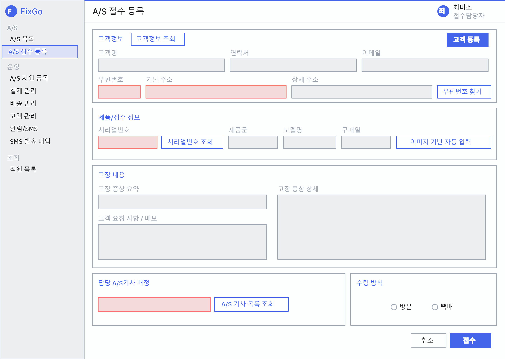

1. A/S 접수 등록 화면 `/as/new`

- 입력 데이터 항목 (Input Data):
    - 고객정보: 고객명, 연락처, 이메일, 우편번호, 기본 및 상세 주소
    - 제품 및 접수 정보: 시리얼 번호, 제품군, 모델명, 구매일
    - 고장 내용: 고장 증상 요약, 고객 요청 사항 및 메모, 고장 증상 상세
    - 담당 A/S기사 배정, 수령 방식 선택
- 화면 제어 및 동작 규칙 (Behavior Rules):
    - 고객 정보 조회: 이미 A/S를 맡긴 적 있는 고객이라면 정보를 새로 기입하는 대신 기존에 입력했던 정보를 불러온다
    - 시리얼번호 조회: 생산 업체 DB에 있는 데이터를 바탕으로 시리얼번호를 입력하면 제품군, 모델명 자동 입력
        - 생산 업체 DB 이번 프로젝트에서는 FixGo와 동일한 DB내에 테이블 형태로 구현함
    - A/S기사 목록 조회: A/S기사 목록을 조회하고 선택하면 A/S기사가 배정됨
    - 우편번호 찾기: 우편번호 찾기 버튼 클릭 시 카카오 우편번호 검색 팝업 표시

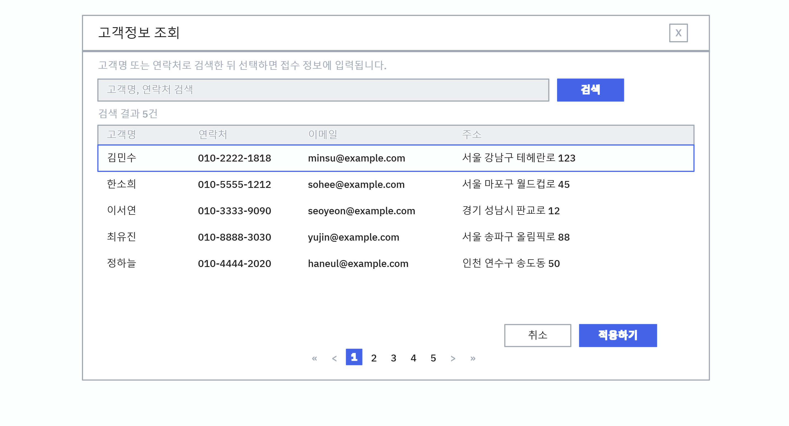

1.1 고객정보 조회(모달)

- 출력 데이터 항목 (Output Data):
    - DB에 저장된 고객 목록: 고객명, 연락처, 이메일, 주소
    - 페이지네이션:  한 페이지당 20개 출력
- 화면 제어 및 동작 규칙 (Behavior Rules):
    - 접수 시 DB에 저장된 고객 정보를 선택하여 적용
    - 해당 고객 선택 후 적용 시 고객 내용 자동 입력
    - 페이지네이션: 페이지 번호 선택, 이전 페이지, 다음페이지 버튼, 맨 처음 페이지, 맨 마지막 페이지

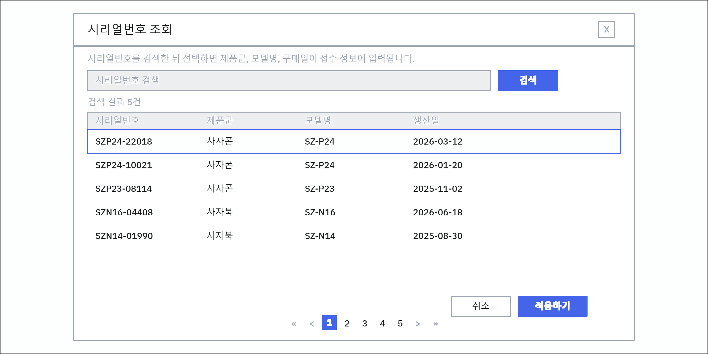

1.2. 시리얼번호 조회(모달)

- 출력 데이터 항목 (Output Data):
    - 제품의 정보: 시리얼번호, 제품군, 모델명, 생산일
    - 페이지네이션:  한 페이지당 20개 출력
- 화면 제어 및 동작 규칙 (Behavior Rules):
    - 시리얼 번호로 고객의 제품 정보 조회 가능
    - 시리얼 번호 선택 후 적용 시 제품 관련 내용 자동 입력
    - 페이지네이션: 페이지 번호 선택, 이전 페이지, 다음페이지 버튼, 맨 처음 페이지, 맨 마지막 페이지

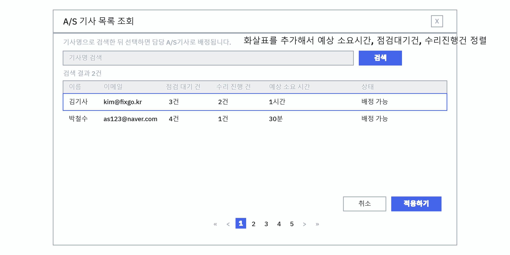

1.3 A/S기사 목록 조회(모달)

- 출력 데이터 항목 (Output Data):
    - A/S 기사 목록: 이름, 이메일, 점검 대기 건, 수리 진행 건, 예상 소요 시간, 상태
    - 페이지네이션:  한 페이지 당 20개 출력
- 화면 제어 및 동작 규칙 (Behavior Rules):
    - 기사 이름 검색을 통한 필터링 가능
    - 목록에 나열된 기사를 선택하고 적용하기 버튼을 눌러 기사 배정
    - 페이지네이션: 페이지 번호 선택, 이전 페이지, 다음페이지 버튼, 맨 처음 페이지, 맨 마지막 페이지

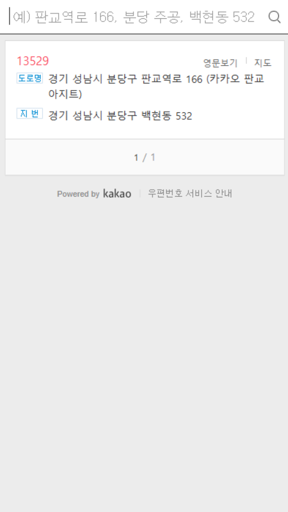

1.4 우편번호 찾기(모달)

- 출력 데이터 항목 (Output Data):
    - 카카오 우편번호 검색 결과: 우편번호, 도로명 주소, 지번 주소, 건물명(해당하는 경우)
- 입력 데이터 항목(Input Data):
    - 주소 검색어: 도로명, 지번, 건물명, 우편번호
- 화면 제어 및 동작 규칙 (Behavior Rules):
    - 우편번호 찾기 버튼 클릭 시 카카오 우편번호 서비스 모달 표시
    - 사용자가 주소 검색어 입력 시 카카오 우편번호 서비스를 통해 주소 검색
    - 상세 주소는 A/S 접수 화면에서 사용자가 직접 입력

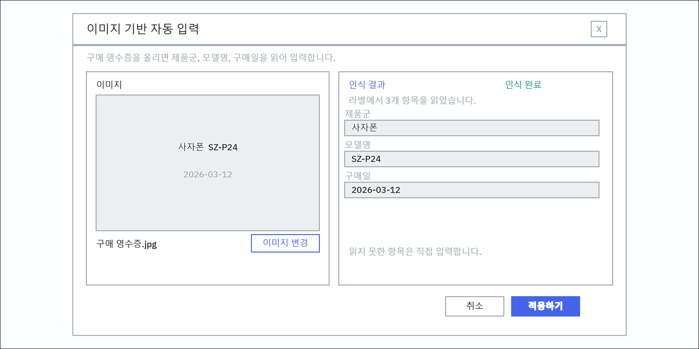

1.5 이미지 기반 자동 입력(모달)

- 출력 데이터 항목 (Output Data):
    - 업로드한 제품 영수증 이미지 미리보기
    - 이미지 인식 결과 및 인식 상태: 제품군, 모델명, 구매일
- 입력 데이터 항목 (Input Data):
    - 이미지 변경 버튼
    - 인식 결과 수정: 제품군, 모델명, 구매일
- 화면 제어 및 동작 규칙 (Behavior Rules):
    - 제품 영수증 이미지를 업로드 시 AI 이미지 분석을 통해 제품 정보 자동 인식
    - 이미지 인식 결과를 제품군, 모델명, 구매일 입력란에 자동 표시
    - 인식되지 않은 항목은 사용자가 직접 입력 가능
    - 자동 인식된 정보가 다를 경우 사용자가 직접 수정 가능
    - 이미지 변경 버튼 클릭 시 새로운 이미지 업로드하고 재분석 가능
    - 적용하기 버튼 클릭 시 입력된 제품 정보를 A/S 접수 화면에 자동 반영
    - 취소 또는 닫기 버튼 클릭 시 변경 사항을 적용하지 않고 종료

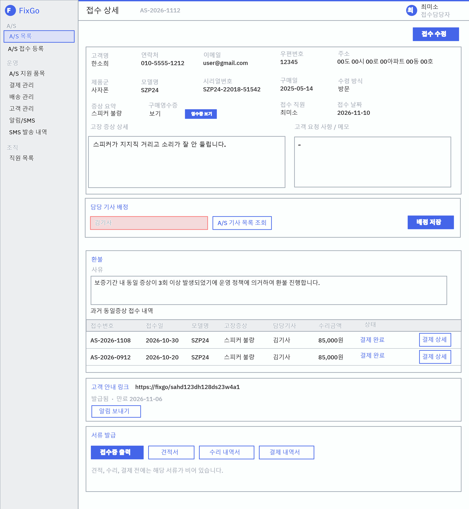

2. A/S 접수 상세 화면 `/as/details/{asRequestId}`

- 출력 데이터 항목 (Output Data):
    - 해당 A/S 접수 건에 대한 정보
    - 고객 정보: 고객명, 연락처, 이메일, 우편번호, 주소, 제품군, 모델명, 시리얼번호, 구매일, 수령 방식, 접수 직원, 증상 요약, 구매 영수증 , 고장 증세 상세, 고객 요청 사항/ 메모
    - 담당 기사 정보: 현재 배정 기사
    - 고객 안내 정보: 고객 안내 URL , 발급일, 만료일
    - 서류 발급 영역: 접수증, 견적서, 수리내역서, 결제 내역서
- 화면 제어 및 동작 규칙 (Behavior Rules):
    - A/S 기사 목록 조회를 통해 담당 기사 변경
    - 고객 안내 링크 복사 및 전송 가능
    - 알림 보내기 버튼 클릭 시 SOLAPI를 통해 고객 안내 링크 발송
    - 각종 서류 미리보기 및 출력 가능

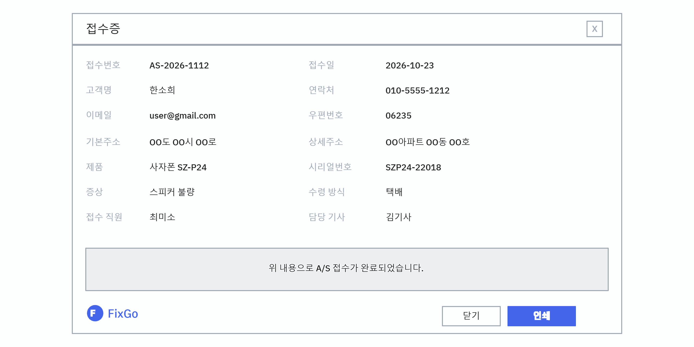

2.1. 접수증 출력(모달)

- 출력 데이터 항목 (Output Data):
    - 접수증 내용: 접수번호, 접수일, 고객명, 연락처, 이메일, 우편번호, 기본 주소, 상세 주소, 제품, 시리얼번호, 증상, 수령 방식, 접수 직원, 담당 기사
    - FixGo 로고
- 화면 제어 및 동작 규칙 (Behavior Rules):
    - 인쇄 버튼으로 접수증 출력

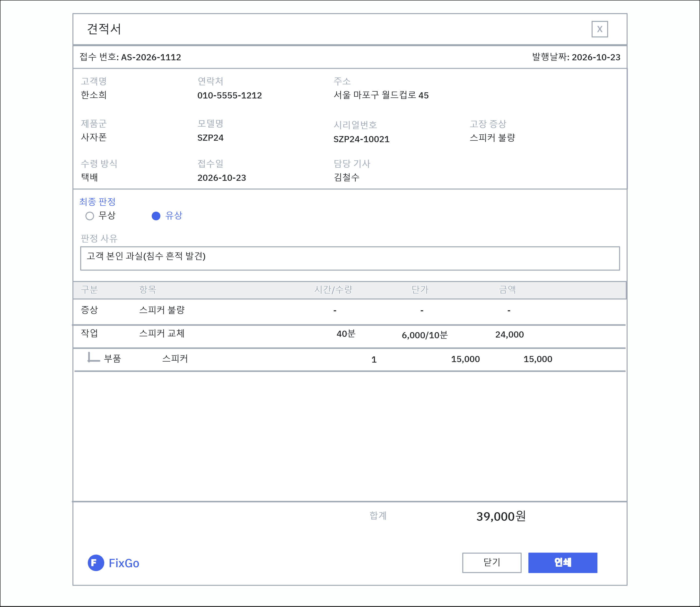

2.2. 견적서(모달)

- 출력 데이터 항목 (Output Data):
    - 견적서 내용: 고객명, 접수번호, 주소, 제품군, 모델명, 시리얼 번호, 고장증상, 수령 방식, 접수일, 담당 기사, 발행 날짜
    - 최종 판정: 유상, 무상
    - 판정 사유
    - 견적 항목 테이블: 구분(증상, 작업, 부품), 항목명, 작업시간/ 부품수량, 단가, 금액, 견적합계
- 화면 제어 및 동작 규칙 (Behavior Rules):
    - 인쇄 버튼으로 출력

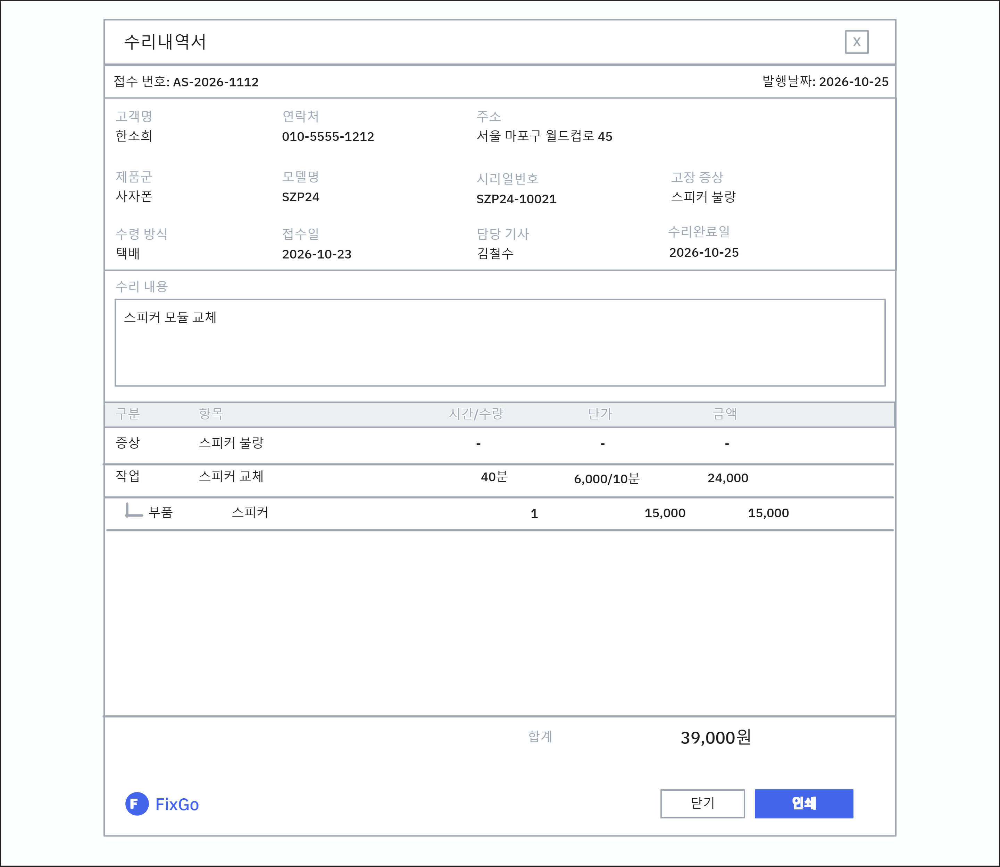

2.3. 수리 내역서 출력(모달)

- 출력 데이터 항목 (Output Data):
    - 수리 내역서: 고객명, 접수번호, 발행날짜, 담당기사, 수리 내용, 사용 부품, 금액
- 화면 제어 및 동작 규칙 (Behavior Rules):
    - 인쇄 버튼으로 수리 내역서 출력

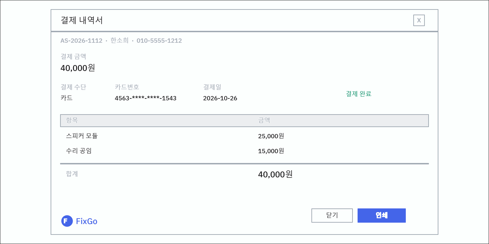

2.4. 결제 내역서 출력(모달)

- 출력 데이터 항목 (Output Data):
    - 결제 내역서: 접수번호, 고객명, 전화번호, 결제 금액, 결제 수단, 카드번호, 결제일, 결제 상태, 수리 항목
- 화면 제어 및 동작 규칙 (Behavior Rules):
    - 인쇄 버튼으로 결제 내역서 출력

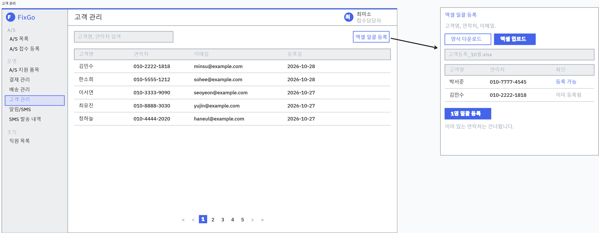

3. 고객 관리 `/customer`

- 출력 데이터 항목 (Output Data):
    - 고객 목록: 고객명, 고객 연락처, 이메일, 등록일
    - 검색 및 필터: 고객명·연락처 검색
    - 고객 정보 엑셀 일괄 등록 버튼
    - 페이지네이션:  한 페이지당 20개 출력
- 화면 제어 및 동작 규칙 (Behavior Rules):
    - 고객명, 연락처 검색
    - 데이터 테이블의 행을 누르면 고객 상세 정보 화면으로 이동
    - 엑셀 일괄 등록 버튼을 누르면 엑셀 일괄 등록 화면으로 이동
    - 페이지네이션: 페이지 번호 선택, 이전 페이지, 다음페이지 버튼, 맨 처음 페이지, 맨 마지막 페이지

3.1. 엑셀 일괄 등록(모달)

- 출력 데이터 항목 (Output Data):
    - 양식 다운로드 버튼, 엑셀 업로드 버튼
    - 업로드한 파일명, 고객 정보 목록 및 등록 가능 유무
    - 고객 일괄 등록 버튼
- 화면 제어 및 동작 규칙 (Behavior Rules):
    - 양식 다운로드 버튼을 누르면 고객 일괄 등록에 사용될 엑셀 파일 다운로드
    - 엑셀 업로드 버튼을 누르면 파일 첨부 화면으로 이동
    - 일괄 등록 버튼을 누르면 고객 정보 DB에 목록의 고객 정보가 추가

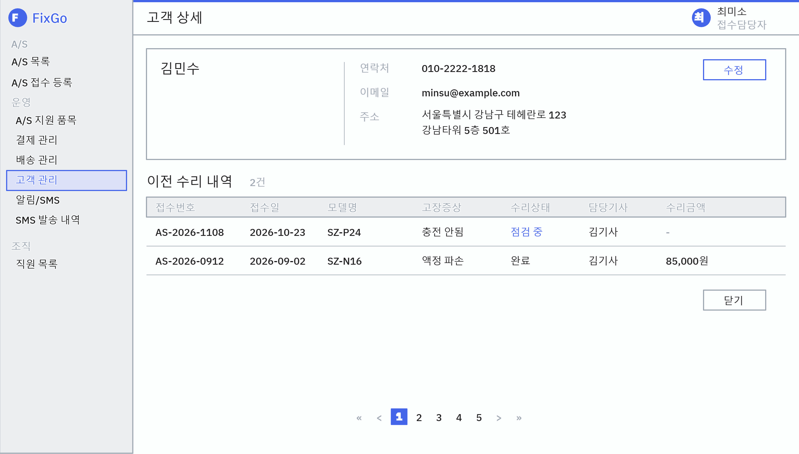

4. 고객 상세 `customer/{customerId}`

- 출력 데이터 항목 (Output Data):
    - 고객 정보(이름, 연락처, 이메일, 주소)
    - 고객의 이전 수리 내역: 접수 번호, 접수일, 모델명, 고장증상, 수리상태, 담당기사, 수리금액
    - 페이지네이션:  한 페이지당 20개 출력
- 화면 제어 및 동작 규칙 (Behavior Rules):
    - 수정 버튼으로 고객의 연락처, 이메일, 주소 등 수정 가능
    - 페이지네이션: 페이지 번호 선택, 이전 페이지, 다음페이지 버튼, 맨 처음 페이지, 맨 마지막 페이지

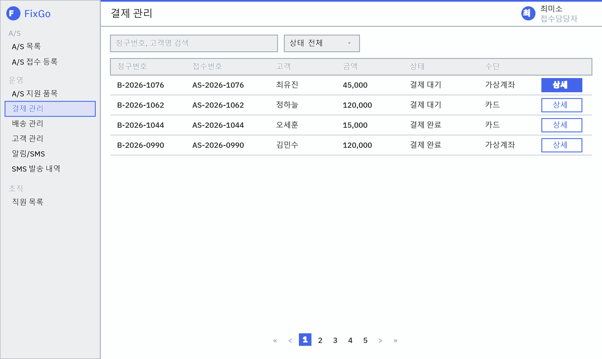

5. 결제 관리 화면 `/payment/list`

- 출력 데이터 항목 (Output Data):
    - 결제 목록: 청구번호, 접수번호, 고객명, 금액, 결제 상태, 결제 수단
    - 검색 및 필터: 청구번호·고객명 검색, 결제 상태별 필터
- 화면 제어 및 동작 규칙 (Behavior Rules):
    - 청구번호 또는 고객명 입력 시 해당 결제 내역 검색
    - 결제 상태 드롭다운 박스 선택 시 해당 상태의 결제 내역만 표시
    - 상세 버튼 클릭 시 결제 상세 화면으로 이동

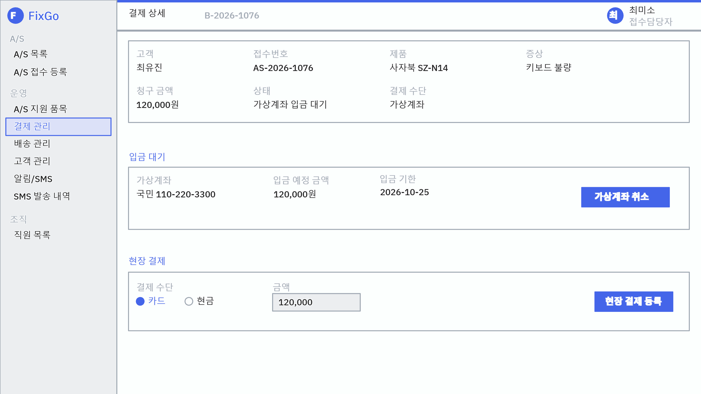

6-1. 결제 상세 화면 (결제완료 이전) `/payment/{orderId}`

- 출력 데이터 항목 (Output Data):
    - 결제 기본 정보: 청구번호, A/S 접수번호, 고객명, 제품명, 고장 증상, 청구 금액, 상태, 결제 수단
    - 결제 정보: 청구 금액, 결제 상태, 결제 수단
    - 가상 계좌: 가상계좌 번호, 입금 기한, 가상계좌 취소
    - 현장 결제 정보: 결제 수단(카드, 현금), 결제 금액, 현장 결제 등록 버튼
- 화면 제어 및 동작 규칙 (Behavior Rules):
    - 선택한 청구번호에 해당하는 결제 상세 정보 조회
    - 웹훅으로 가상계좌 입금 처리
    - 결제 완료 처리 시 결제 상태를 완료로 갱신

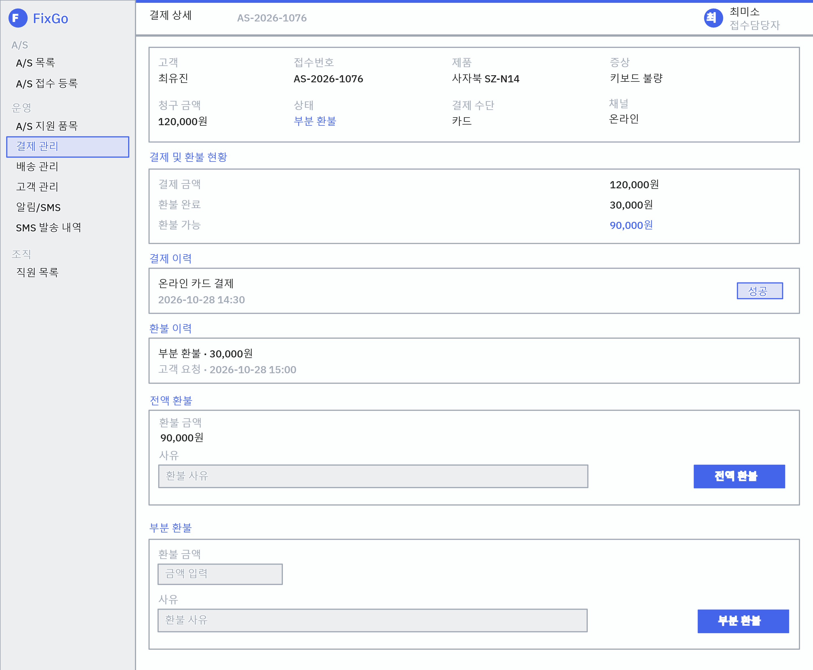

6-2. 결제 상세 화면 (결제 완료) `/payment/{orderId}`

- 출력 데이터 항목 (Output Data):
    - 결제 정보: 고객명, 접수번호, 제품 모델명, 증상, 청구 금액, 상태, 결제 수단, 결제 및 환불 현황, 결제 이력
    - 전액 환불 영역: 환불 금액, 환불 사유 입력, 전액 환불 버튼
    - 부분 환불 영역: 환불 금액 입력, 환불 사유 입력, 부분 환불 버튼
- 화면 제어 및 동작 규칙 (Behavior Rules):
    - 선택한 A/S 결제 건의 고객 정보 및 결제 내역 표시
    - 전액 환불 버튼 클릭 시 결제 된 전체 금액에 대한 환불 요청
    - 부분 환불 시 환불 금액과 환불 사유 입력
    - 부분 환불 금액은 잔여 환불 가능 금액을 초과할 수 없음
    - 환불 실패 시 오류 표시

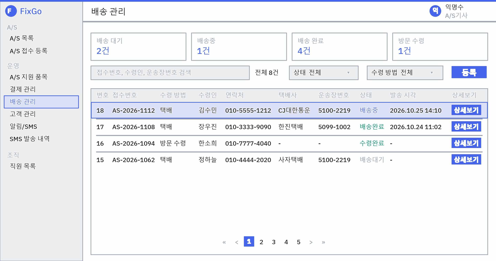

7. 배송 관리 `/shipment/list`

- 출력 데이터 항목 (Output Data):
    - 배송 통계: 배송 대기, 배송 시작, 배송 완료, 방문 수령 건수
    - 배송 상세 정보: 배송 상태 변경 이력 및 처리 기록
- 화면 제어 및 동작 규칙 (Behavior Rules):
    - 배송 상태와 수령 방법을 기준으로 배송 건수를 집계
    - 접수번호, 수령인, 운송장번호 등을 기준으로 배송 정보 검색
    - 배송 상태 및 수령 방법에 따른 목록 필터링
    - 배송 상세보기 버튼 클릭 시 해당 배송 건의 상세 정보 조회
    - 배송 상태 변경 시 변경 이력을 기록하여 추적할 수 있도록 처리

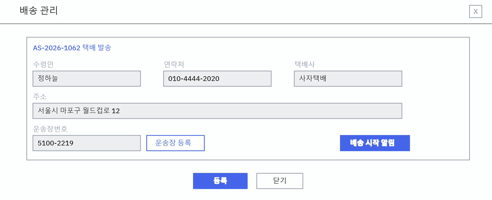

7.1. 배송 등록 (모달)

- 출력 데이터 항목 (Output Data):
    - 처리 결과: 배송 등록 완료 여부, 배송 시작 알림 발송 여부 및 발송 일시
    - 처리 기록: 배송 상태 변경 이력(변경 일시, 처리자, 변경 전/후 상태)
- 화면 제어 및 동작 규칙 (Behavior Rules):
    - 모달 오픈 시 선택한 접수 건의 정보를 자동으로 불러오며, 수정이 필요한 경우 접수 상세 화면에서 변경
    - 운송장번호는 택배사별 형식에 맞는지 유효성 검사 후 입력 처리
    - 운송장 등록 클릭 시 운송장번호의 유효성 및 중복 여부를 확인하고, 정상일 경우 해당 접수 건에 임시 반영
    - 배송 시작 알림은 운송장번호가 등록된 경우에만 활성화되며 클릭 시 수령인 연락처로 배송 시작 알림(문자/알림톡) 발송

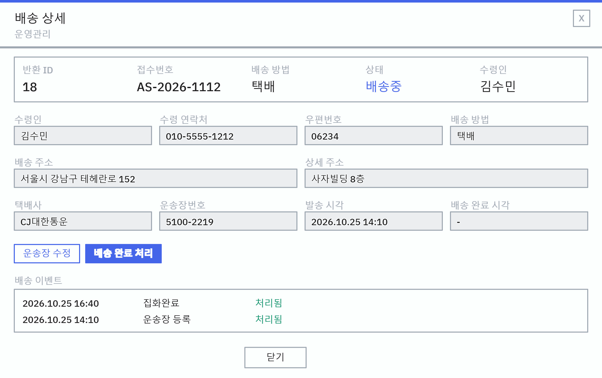

7.2. 배송 상세 (모달)

- 출력 데이터 항목 (Output Data):
    - 배송 이벤트 이력: 이벤트 발생 일시, 이벤트 유형(운송장 등록, 집화완료 등), 처리 결과
    - 처리 결과: 운송장번호 수정 완료 여부, 배송 완료 처리 여부
- 화면 제어 및 동작 규칙 (Behavior Rules):
    - 목록에서 배송 상세보기 클릭 시 해당 배송 건의 ID를 기준으로 상세 정보를 조회하여 모달에 표시
    - 상단 요약 및 배송 정보 항목은 읽기 전용으로 처리하며, 수정 가능한 항목은 운송장번호로 한정
    - 배송 이벤트는 최신 발생 순으로 정렬하여 표시
    - 배송 상태 변경 시 변경 이력을 기록하여 배송 이벤트에 표시

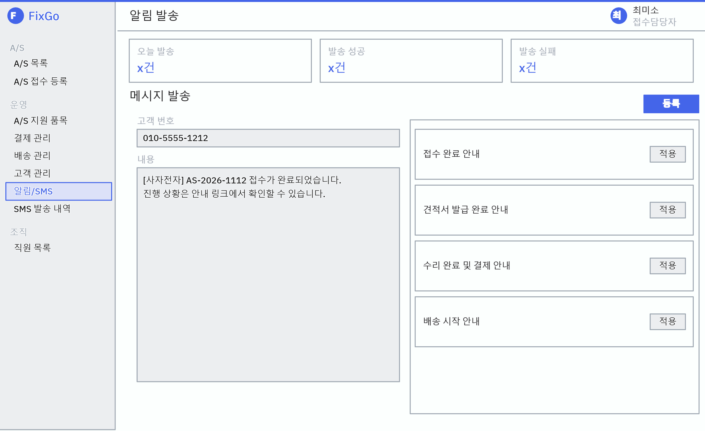

8. 알림/SMS - 알림 `/notification_service`

- 출력 데이터 항목 (Output Data):
    - KPI 카드 영역: 오늘 발송, 발송 성공, 발송 실패
    - 알림 템플릿 영역:
        - 템플릿 목록: 접수 완료 안내, 견적서 발급 완료 안내, 수리 완료 및 결제 안내, 배송 시작 안내
        - 템플릿 별 적용 버튼
    - 메시지 발송 영역: 선택한 템플릿 메시지 내용 표시, 고객 전화번호 표시
- 입력 데이터 항목 (Input Data):
    - 메시지 발송 영역 :  고객 전화번호, 내용
- 화면 제어 및 동작 규칙 (Behavior Rules):
    - 오늘 발송한 메시지의 전체 건수, 발송 성공 건수, 발송 실패 건수를 KPI 카드에 표시
    - 고객 전화번호 입력 및 수정가능
    - 템플릿 선택시 해당 프리셋의 제목과 메시지 내용을 자동으로 표시
    - 메시지 제목 및 내용 수정 가능
    - 발송하기 버튼 클릭 시 수신번호 및 메시지 내용 유효성 검사
    - SOLAPI API를 통해 메시지 발송 요청
    - 발송 실패 시 오류 메시지 표시
    - 프리셋 적용 버튼 클릭 시 메시지 발송 영역에서 내용 자동 기입

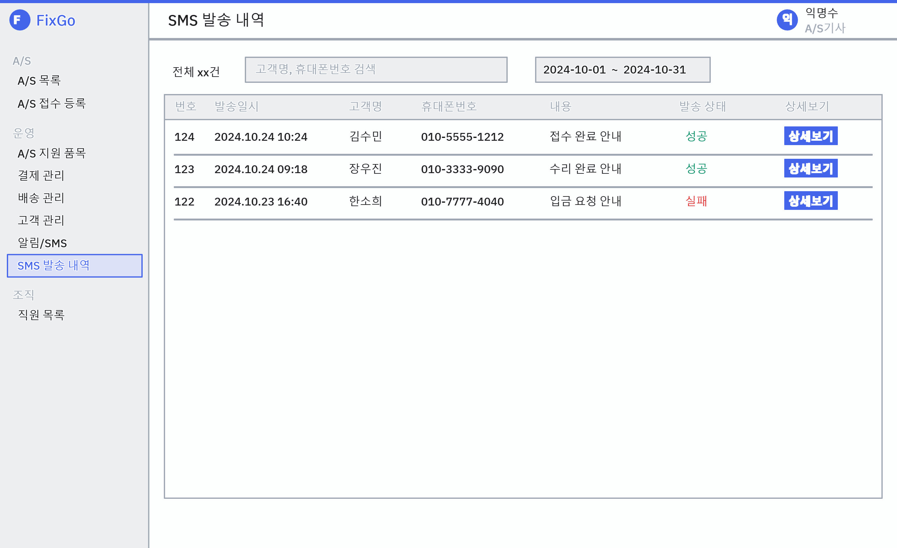

9. SMS 발송 내역 `/notification/list`

- 출력 데이터 항목 (Output Data):
    - SMS 발송 내역 목록: 번호, 발송일시, 고객명, 휴대폰 번호, 내용, 발송 상태(성공,실패), 상세보기 버튼
    - 조회 결과: 전체 발송 건수
- 화면 제어 및 동작 규칙 (Behavior Rules):
    - SOLAPI를 통해 발송한 알림톡 및 SMS 발송 내역을 목록으로 표시
    - 고객명 또는 휴대폰번호 입력 시 해당 조건에 맞는 발송 내역 검색
    - 조회 기간 선택 시 해당 기간에 발송된 내역만 표시
    - 검색어와 조회 기간 조건을 동시에 적용하여 목록 조회 가능
    - 발송 일시를 기준으로 최신순 정렬
    - 발송 상태에 따라 성공 또는 실패 여부 표시
    - 상세보기 클릭 시 해당 발송 상세 모달창으로 이동

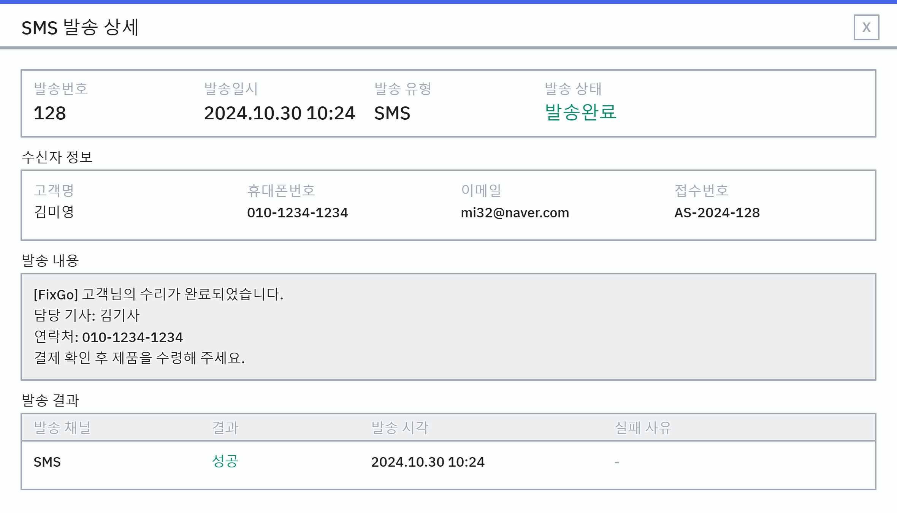

9.1. SMS 발송 상세(모달)

- 출력 데이터 항목 (Output Data):
    - 발송 정보: 발송번호, 발송일시, 발송유형, 발송상태
    - 수신자 정보: 고객명, 휴대폰번호, 이메일, 접수번호
    - 발송 내용: SMS 발송 내용
    - 발송 결과: 발송 채널, 결과, 발송시각, 실패사유

### **1.2.5 관리자 화면**

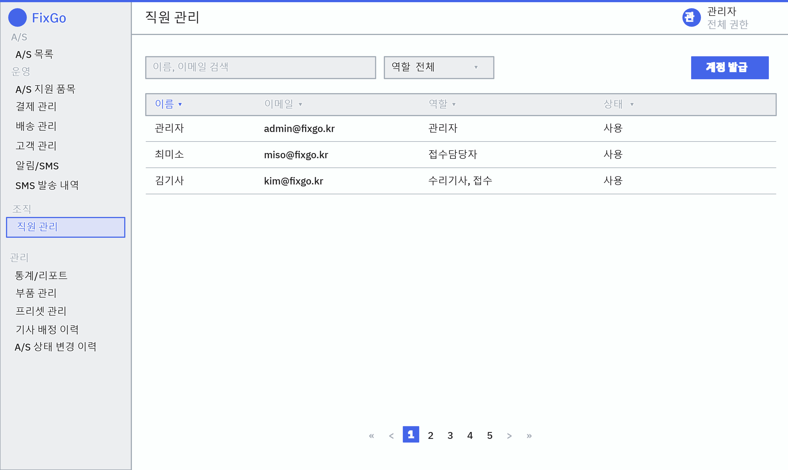

1. 직원 관리 `/member/list`

- 출력 데이터 항목 (Output Data):
    - 직원 목록: 이름, 이메일, 역할, 상태
- 화면 제어 및 동작 규칙 (Behavior Rules):
    - 이름, 이메일 검색
    - 역할 별 조회
    - 계정 발급: 직원의 계정을 신규 발급
    - 직원 클릭 시 직원 상세 페이지로 이동
    - 항목별 정렬기능 지원

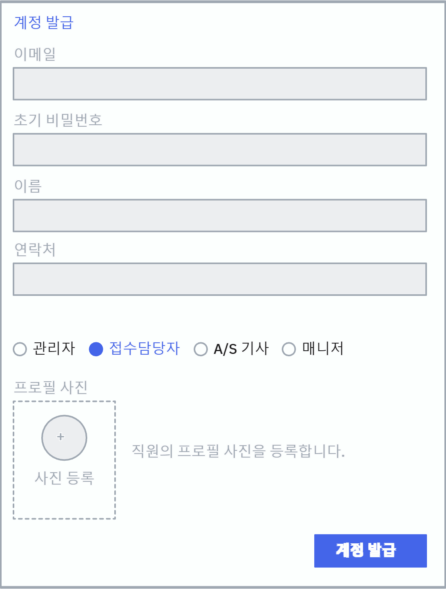

1.1. 계정 발급(모달)

- 출력 데이터 항목 (Output Data):
    - 이메일, 초기 비밀번호, 이름, 연락처, 프로필 사진
- 화면 제어 및 동작 규칙 (Behavior Rules):
    - 서식에 맞춰 직원 정보 입력 후 계정 발급

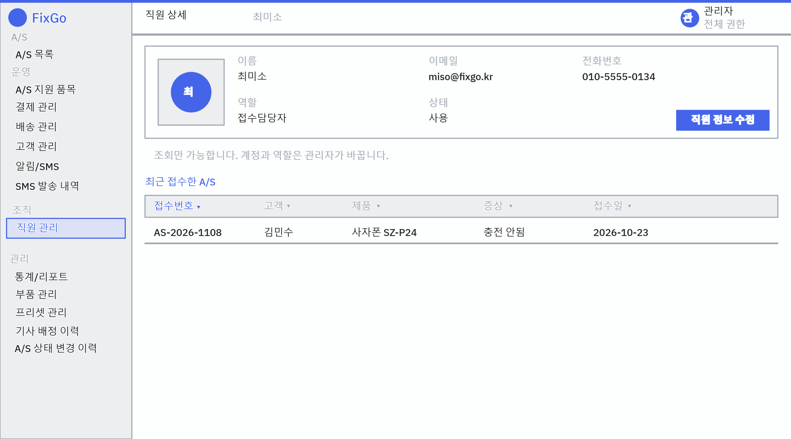

2. 직원 상세 `/member/{memberId}`

- 출력 데이터 항목 (Output Data):
    - 직원 기본 정보: 프로필 이미지, 이름, 이메일, 전화번호, 역할(관리자, 접수담당자, 수리기사, 매니저), 상태(활성, 비활성)
    - 최근 접수한 A/S 목록: 접수번호, 고객명, 제품명, 고장 증상, 접수일
- 입력 데이터 항목 (Input Data):
    - 직원 기본 정보 수정 버튼
- 화면 제어 및 동작 규칙 (Behavior Rules):
    - 선택한 직원의 기본 정보와 최근 접수한 A/S 목록 표시
    - 마이페이지에서도 로그인한 직원 정보 표시
    - 관리자에게만 직원 삭제 버튼 표시
    - 직원 삭제 시 기존 A/S 접수 이력은 유지하고 직원 상태를 DELETED로 변경

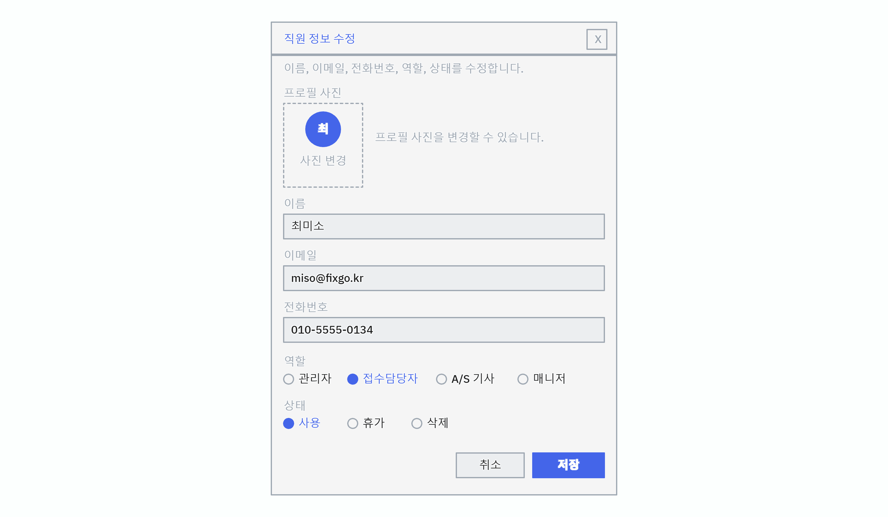

2.1. 직원 정보 수정(모달)

- 출력 데이터 항목 (Output Data):
    - 기존 직원 정보: 프로필 이미지, 이름, 이메일, 전화번호, 역할(관리자, 접수담당자, 수리기사), 상태(사용, 휴가, 중지)
- 입력 데이터 항목 (Input Data):
    - 관리자: 프로필 사진, 이름, 이메일, 전화번호, 역할, 상태(사용, 휴가, 삭제) 정보 변경가능
    - 본인: 비밀번호만 변경 가능
    - 저장 버튼, 취소 버튼
- 화면 제어 및 동작 규칙 (Behavior Rules):
    - 직원 정보 수정 버튼 클릭 시 해당 직원의 기존 정보를 입력란에 자동 표시
    - 관리자가 프로필 사진 변경 버튼 클릭 시 이미지 업로드 가능
    - 본인은 자신의 정보(비밀번호) 만 수정 가능
    - 관리자는 모든 직원의 정보를 조회하고 (이름, 이메일, 전화번호, 역할, 상태(사용, 휴가, 중지)) 수정 가능

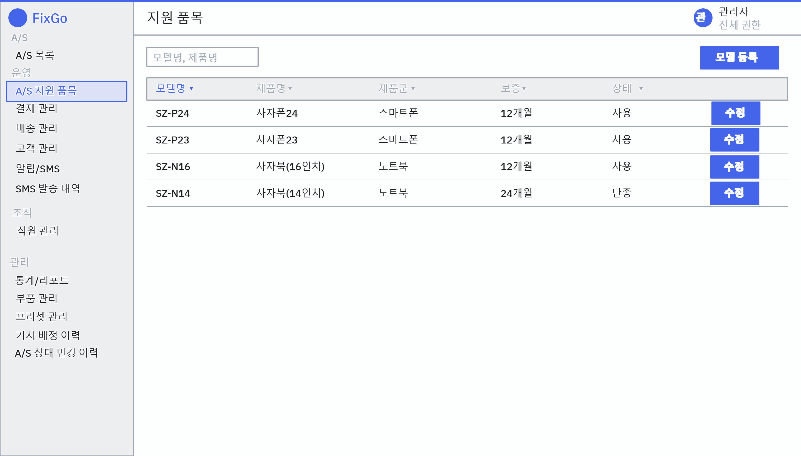

3. 지원 품목 `/admin/products/list`

- 출력 데이터 항목 (Output Data):
    - 제품 목록: 모델명, 제품명, 제품군, 보증 유효기간 및 수리 지원 유무
    - 검색: 모델명·제품명 검색
    - 모델 등록 버튼
- 화면 제어 및 동작 규칙 (Behavior Rules):
    - 모델명, 제품명 검색
    - 모델 등록 버튼을 누르면 모델 등록 화면으로 이동
    - 항목별 정렬기능 지원

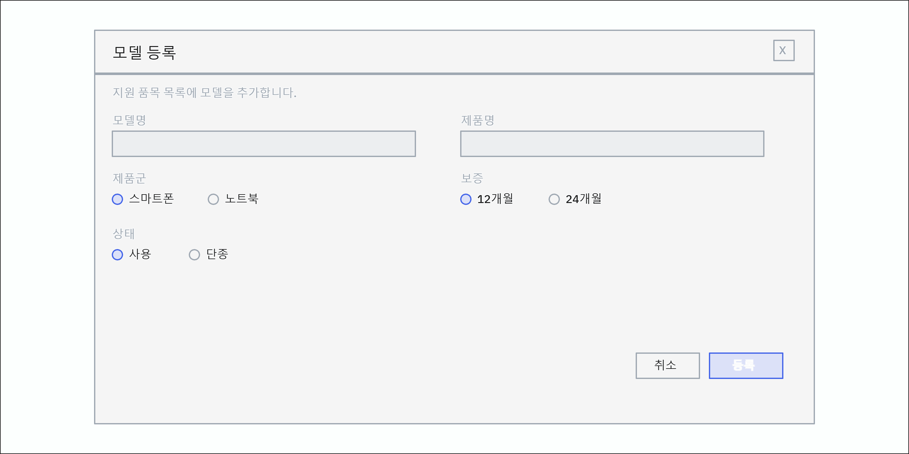

3.1. 모델 등록/수정(모달)

- 입력 데이터 항목 (Input Data):
    - 모델명, 제품명 입력할 수 있는 필드
    - 제품군, 보증, 상태 체크박스
- 화면 제어 및 동작 규칙 (Behavior Rules):
    - 취소 버튼을 누르면 지원 품목 페이지로 이동
    - 등록 버튼을 누르면 제품 정보 DB에 입력한 제품 정보가 추가
    - 상태 선택 가능

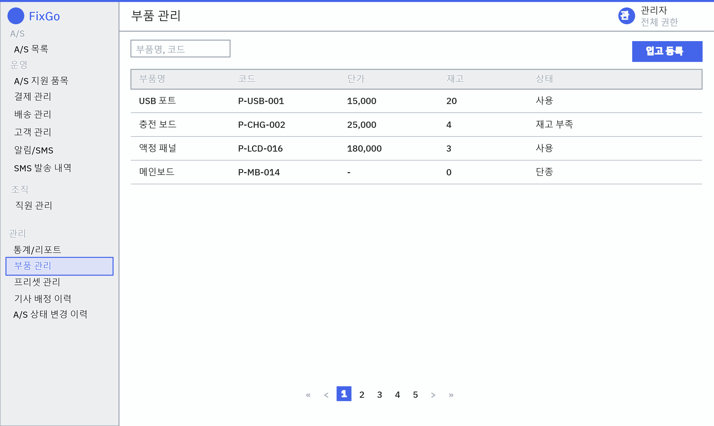

4. 부품 관리 `/admin/parts/list`

- 출력 데이터 항목 (Output Data):
    - 부품 목록: 부품명, 코드, 단가, 재고 및 상태
    - 검색 및 필터: 부품명·코드 검색, 재고 상태 별 필터
    - 입고 등록 버튼
- 화면 제어 및 동작 규칙 (Behavior Rules):
    - 부품명, 코드 검색
    - 입고 등록 버튼을 누르면 입고 등록 화면으로 이동

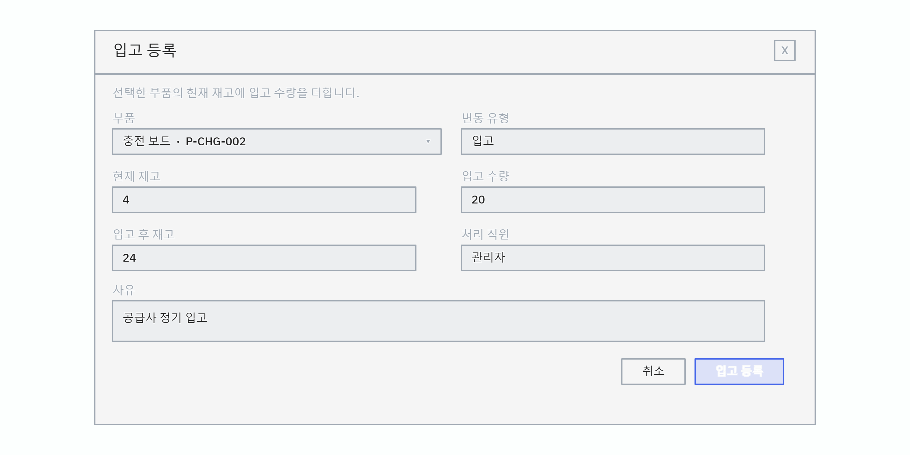

4.1. 입고 등록(모달)

- 출력 데이터 항목 (Output Data):
    - 부품 목록에 해당하는 부품
    - 선택한 부품의 현재 재고
- 입력 데이터 항목 (Input Data):
    - 입고 수량, 사유 입력할 수 있는 textarea
- 화면 제어 및 동작 규칙 (Behavior Rules):
    - 취소 버튼을 누르면 부품관리 페이지로 이동
    - 입고 등록 버튼을 누르면 부품 정보 DB에 입력한 부품 정보로 갱신

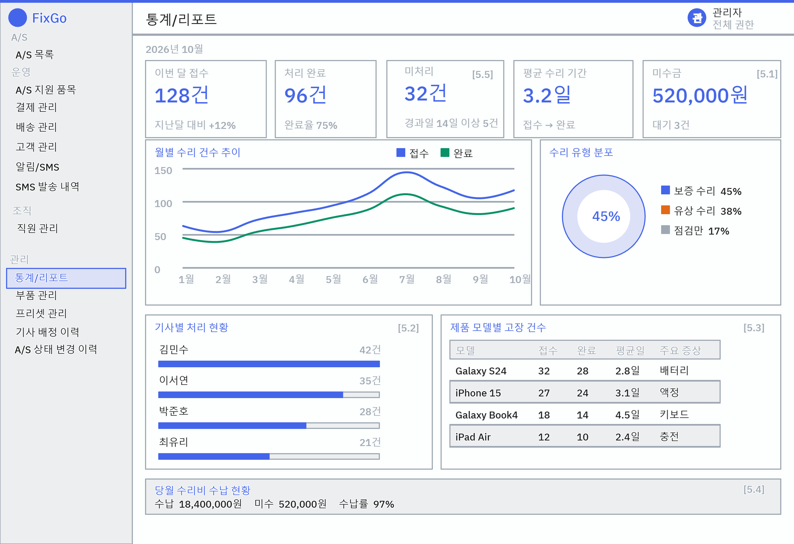

5. 통계/ 리포트 `/admin/statistics`

- 출력 데이터 항목 (Output Data):
    - KPI 카드 영역: 이번 달 접수, 처리 완료, 미처리, 평균 수리 기간, 미수금
    - 꺾은선 그래프영역:  월별 수리 건수 추이
    - 원형 그래프영역: 수리 유형 분포
    - 막대 그래프 영역: 기사별 처리 현황
    - 데이터 테이블 영역: 제품 모델별 고장 건수
    - 요약 카드: 월별 수리비 수납 현황
- 화면 제어 및 동작 규칙 (Behavior Rules):
    - 미수금 영역 클릭 시 입금 대기 내역 페이지로 이동
    - 기사별 처리 현황 영역 클릭 시 기사별 수리 현황 페이지로 이동
    - 제품 모델별 고장 건수 영역 클릭 시 제품 모델별 수리 접수 건수 페이지로 이동
    - 월별 수리비 수납 현황 영역 클릭 시 장기 미처리 조회 페이지로 이동

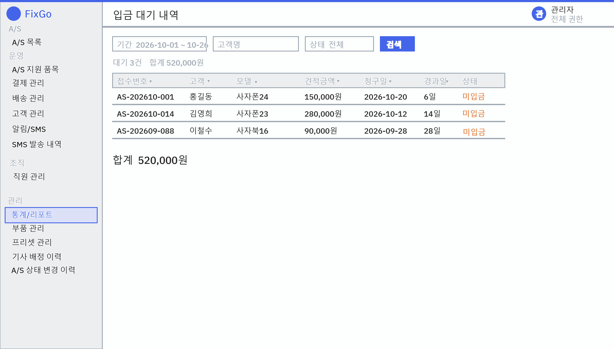

5.1. 입금 대기 내역 `/admin/statistics/deposits/waiting`

- 출력 데이터 항목 (Output Data):
    - 입금 대기 내역: 접수 번호, 고객, 모델, 견적 금액, 청구일, 경과일, 상태, 합계
- 화면 제어 및 동작 규칙 (Behavior Rules):
    - 기간 별로 필터링 하여 조회
    - 고객명으로 검색 가능
    - 상태 별로 필터링 하여 조회

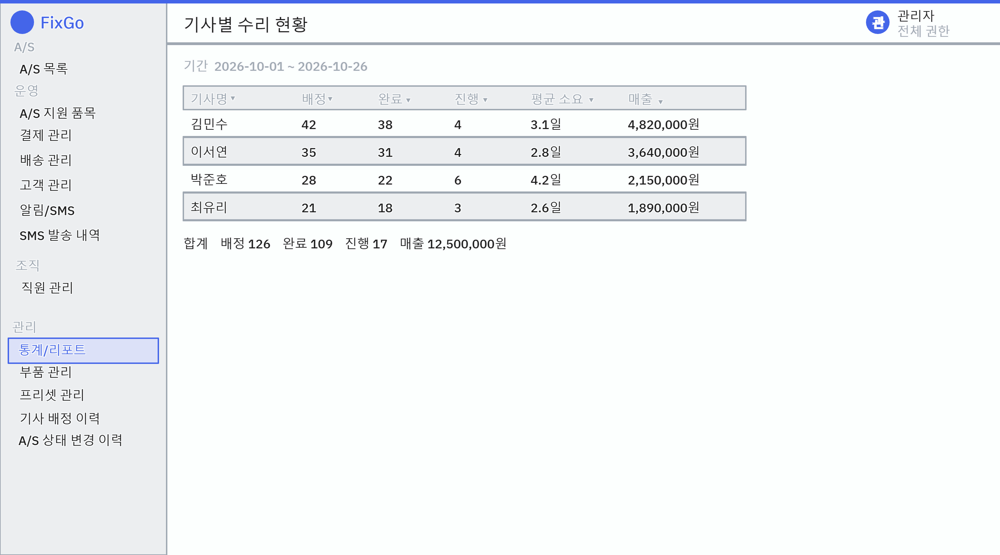

5.2. 기사별 수리 현황 조회 `/admin/statistics/technicians`

- 출력 데이터 항목 (Output Data):
    - 기간별 수리 현황: 기사명, 배정, 완료, 진행, 평균 소요, 매출

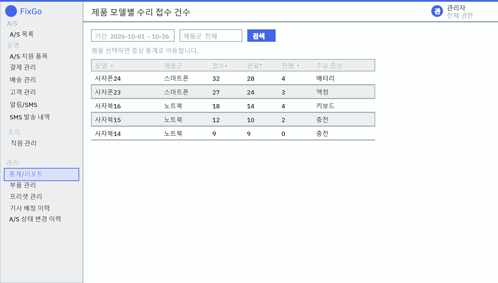

5.3. 제품 모델 별 수리 건수 `/admin/statistics/models`

- 출력 데이터 항목 (Output Data):
    - 제품 모델별 수리 접수 건수: 모델명, 제품군, 접수, 완료, 진행, 주요증상
- 화면 제어 및 동작 규칙 (Behavior Rules):
    - 주요 증상 클릭 시 고장 증상 분포 페이지로 이동

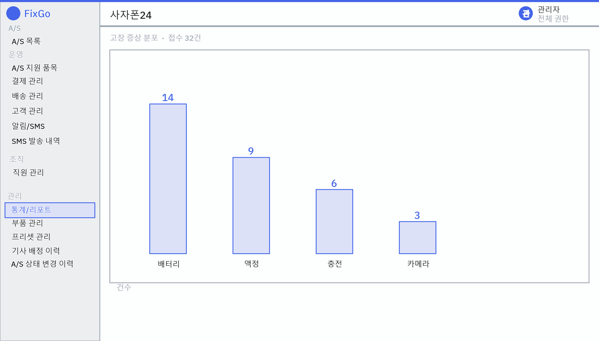

5.3.1 모델 별 고장 증상 통계 `/admin/statistics/models/{id}`

- 출력 데이터 항목 (Output Data):
    - 고장 증상 분포: 해당 모델의 고장 증상 분포 막대 그래프

5.4 기간별 수리비 추이 `/admin/statistics/repair_cost`

- 출력 데이터 항목 (Output Data):
    - 총 수리비: 기간 별 수리비 추이 그래프(단위: 백 만원)

5.5 장기 미처리 조회 `/admin/statistics/incomplete`

- 출력 데이터 항목 (Output Data):
    - 장기 미처리 A/S 건: 접수 번호, 고객명, 모델, 현재 상태, 담당 기사, 경과일, 최근 활동일
- 화면 제어 및 동작 규칙 (Behavior Rules):
    - 경과일 별로 필터링 가능
    - 상태 별로 조회 가능
    - 장기 미처리 건 클릭 시 해당 상세 페이지로 라우팅

6. 기사 배정 이력 `/admin/allocation_history`

- 출력 데이터 항목 (Output Data):
    - 기사 배정 이력: 일시, 접수번호, 구분, 이전 기사, 변경 기사, 변경자, 사유
- 화면 제어 및 동작 규칙 (Behavior Rules):
    - 필터링 및 검색 가능

7. A/S 상태 변경이력 `/admin/status_change_history`

- 출력 데이터 항목 (Output Data):
    - A/S 상태 변경 이력: 일시, 접수번호, 고객명, 모델, 이전 상태, 변경 상태, 변경자, 사유
- 화면 제어 및 동작 규칙 (Behavior Rules):
    - 상태 별로 필터링 및 검색 가능
    - 변경 이력 클릭 시 상세 페이지로 라우팅